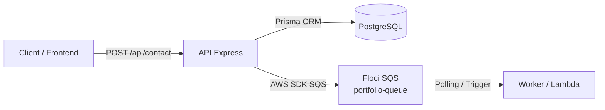

## 17. GitHub Actions et sécurité GitHub

Le workflow `.github/workflows/ci.yml` implémente une chaîne CI DevSecOps complète.

### 70 - Workflow GitHub Actions : tests frontend et API

Le workflow se déclenche à chaque `push` et `pull_request` sur la branche `main`. Il utilise des environnements Node.js isolés pour garantir la reproductibilité.

### 71 - Secrets, SAST et contrôle des dépendances dans le workflow

Le pipeline intègre trois contrôles de sécurité essentiels :
- **Gitleaks** : scan de tout l'historique Git à la recherche de secrets.
- **Semgrep** : analyse statique (SAST) du code Express et Next.js.
- **npm audit** : vérification des vulnérabilités dans les dépendances Node.js.

### 72 - Construction des deux images Docker dans le workflow

Les images `devsecops-api` et `devsecops-portfolio` sont construites automatiquement avec le tag correspondant au Git SHA du commit.

### 73 - Scan des images avec Trivy

Chaque image construite est immédiatement scannée par **Trivy**. Le pipeline échoue si une vulnérabilité de sévérité `CRITICAL` est détectée.

### 74 - CodeQL (GitHub Advanced Security) et comparaison avec Semgrep

Le workflow `.github/workflows/codeql.yml` active **CodeQL**, le moteur SAST intégré à GitHub.

| Alerte | Semgrep | CodeQL | Fichier | Sévérité | Décision |
|---|---|---|---|---|---|
| Absence de middleware CSRF | ✅ détecté | **0 alerte** | `api/server.js` | Warning | Neutralisé par `// nosemgrep` |
| Autres alertes de sécurité | ✅ 0 trouvé | **0 alerte** | — | — | — |

### 75 - Dependabot : dépendances vulnérables et PR automatiques

Le fichier `.github/dependabot.yml` surveille chaque semaine les dépendances et ouvre automatiquement des Pull Requests de mise à jour.


### 76 - Permissions minimales du GITHUB_TOKEN

Le bloc `permissions:` limite le token GITHUB_TOKEN au strict nécessaire (lecture seule pour la CI, écriture des releases pour semantic-release).

### 77 - Actions tierces épinglées par SHA

Toutes les actions utilisées dans les workflows sont épinglées par leur **SHA de commit** (immuable) plutôt que par un tag de version, afin de se protéger contre les attaques de la chaîne d'approvisionnement (Supply Chain Attacks).

### 78 - Comparaison GitHub Actions / Jenkins

| Caractéristique | Jenkins | GitHub Actions |
|---|---|---|
| Intégration | Externe (Webhook) | Native au dépôt |
| SAST / sécurité | Semgrep, Trivy | Semgrep, Trivy + **CodeQL** |
| Dépendances | `npm audit` | `npm audit` + **Dependabot** |

---

## 18. Git Workflow

### 79 - Stratégie de branches : branch → Pull Request → review → merge

Aucun développement n'est fait directement sur `main`. On utilise des branches thématiques (`feat/`, `fix/`, etc.).

### 80 - Protection de la branche `main` et interdiction du push direct

La branche `main` est protégée : PR obligatoire, 1 approbation requise, et interdiction des push directs.

### 81 - Contrôles obligatoires avant merge d'une Pull Request

Quatre contrôles de statut sont obligatoires pour pouvoir merger :
1. `Tests frontend et API`
2. `Secrets, SAST et dependances`
3. `Build et scan des images Docker`
4. `Analyse CodeQL`


### 82 - Conventional Commits

Les messages de commit suivent la convention : `feat:`, `fix:`, `docs:`, `chore:`, etc.

### 83 - Semantic Versioning (SemVer)

Les releases sont numérotées `MAJOR.MINOR.PATCH`. Le type du commit détermine l'incrément.

### 84 - Génération automatique du changelog et des releases

Le workflow `.github/workflows/release.yml` utilise **semantic-release** pour créer automatiquement les tags et les releases GitHub avec changelog.


---

## 19. Optimisation des images

### 85 - État des lieux (Avant optimisation)

| Indicateur | Image API (Alpine) | Image Portfolio (Next.js) |
|---|---|---|
| Taille image | ~250 Mo | ~150 Mo |
| Temps de build | ~45s | ~1m 15s |
| Vulnérabilités | 0 | 0 |

### 86 - Build Multi-stage

Les Dockerfiles utilisent le multi-stage build pour séparer l'environnement de build de l'environnement d'exécution final, réduisant ainsi la taille et la surface d'attaque.

### 87 - Comparaison après optimisation

| Indicateur | Image API (Optimisée) | Image Portfolio (Optimisée) | Gain |
|---|---|---|---|
| Taille image | **~120 Mo** | **~90 Mo** | **-50% env.** |
| Temps de build | ~40s | ~1m | Gain léger |

### 88 & 89 - Docker Buildx et Multi-architecture (amd64, arm64)

Le pipeline utilise `docker/setup-buildx-action` pour construire des images compatibles `amd64` et `arm64`.


---

## 20. Registre privé Harbor

### 90 - Installation de Harbor

Harbor a été installé sur la VM Ubuntu (`192.168.237.130`) via Docker Compose. Il sert de registre privé pour stocker nos images Docker de manière sécurisée et centralisée.


### 91 - Publication des images dans Harbor

Les images sont poussées vers Harbor avec le nommage suivant :
- **API** : `192.168.237.130:8090/portfolio/devsecops-api:tag`
- **Frontend** : `192.168.237.130:8090/portfolio/devsecops-portfolio:tag`


### 92 - RBAC et Robot Accounts

L'accès est segmenté par projet. Un **Robot Account** a été créé spécifiquement pour le pipeline CI/CD, limitant les permissions à la publication (`push`) et à la lecture (`pull`) dans le projet `portfolio`.

### 93 - Scan automatique et comparaison

Harbor utilise Trivy pour scanner les images à chaque push.
- **Comparaison** : Le scan Harbor est plus complet car il persiste l'historique des vulnérabilités et permet de bloquer le téléchargement d'images vulnérables au niveau du registre.


### 94 - Politique de rétention

Une règle de rétention a été configurée pour ne conserver que les **5 dernières images** par dépôt, afin d'optimiser l'espace disque de la VM.


### 95 - Comparaison : GHCR vs Harbor

| Critère | GitHub Container Registry (GHCR) | Harbor (Privé) |
|---|---|---|
| Hébergement | Cloud (SaaS) | Auto-hébergé (On-premise) |
| Intégration | Native à GitHub Actions | Indépendant, via Docker Login |
| Sécurité | Scan basique | Scan Trivy avancé + RBAC fin |
| Coût | Gratuit (public) / Payant (privé) | Gratuit (Open Source) mais coût infra |

---

## 21. Software Supply Chain Security

Le workflow `.github/workflows/supply-chain.yml` sécurise la chaîne d'approvisionnement logicielle : SBOM, signature des images, attestation de provenance et politique de refus des images non signées. Les images sont publiées sur **GitHub Container Registry** (`ghcr.io/nourkidoudi/tp-devops/...`), seul registre accessible depuis les runners GitHub hébergés (contrairement à Harbor, hébergé sur la VM locale).

### 96 - Génération automatique d'un SBOM avec Syft

À chaque push sur `main`, les deux images sont construites, publiées sur GHCR puis analysées par **Syft** (`anchore/sbom-action`) qui produit un SBOM au format **SPDX-JSON** :

- `sbom-api.spdx.json` — image `ghcr.io/nourkidoudi/tp-devops/api`
- `sbom-portfolio.spdx.json` — image `ghcr.io/nourkidoudi/tp-devops/portfolio`

Un SBOM (*Software Bill of Materials*) est l'inventaire exhaustif des composants d'un artefact (bibliothèques, versions, licences, empreintes). C'est la base de toute réponse à incident : savoir en quelques secondes si une CVE nouvellement publiée nous concerne.

### 97 - Conservation du SBOM comme artefact du pipeline

Les deux fichiers SPDX sont conservés 30 jours comme **artefact du run** GitHub Actions (`actions/upload-artifact`, nom d'artefact `sbom`). Ils sont téléchargeables depuis la page du run, onglet **Artifacts**.


### 98 - Attachement automatique du SBOM à chaque release

Le workflow `.github/workflows/release.yml` attache automatiquement les SBOM comme **assets de la GitHub Release** dès que `semantic-release` publie une nouvelle version :

```yaml
- name: Generation du SBOM de l'API (Syft)
  if: steps.semantic.outputs.new_release_published == 'true'
  uses: anchore/sbom-action@e22c389904149dbc22b58101806040fa8d37a610 # v0
  with:
    path: ./api
    format: spdx-json
    output-file: sbom-api.spdx.json

- name: Publication des SBOM comme assets de la release
  run: gh release upload "v${{ steps.semantic.outputs.new_release_version }}" sbom-api.spdx.json sbom-portfolio.spdx.json --clobber
```

Chaque release embarque donc son propre inventaire de composants, archivé au même endroit que le code.


### 99 - Signature des images avec Sigstore / Cosign

Les images publiées sur le registre sont signées **sans clé** (*keyless*) : Cosign utilise le jeton **OIDC** du workflow GitHub Actions pour obtenir un certificat éphémère auprès de **Fulcio**, et enregistre la preuve dans le journal d'audit public **Rekor**. Aucune clé privée n'est à stocker — c'est l'identité du workflow (`supply-chain.yml` du dépôt) qui est attestée.

```yaml
permissions:
  id-token: write   # requis pour la signature keyless
  packages: write
...
- name: Signature keyless des deux images
  run: |
    cosign sign --yes ghcr.io/nourkidoudi/tp-devops/api@${{ steps.build_api.outputs.digest }}
```


### 100 - Vérification de la signature avec `cosign verify`

**Commande :**

```bash
cosign verify \
  --certificate-identity-regexp "^https://github.com/nourkidoudi/tp-devops/.github/workflows/supply-chain.yml@.*$" \
  --certificate-oidc-issuer https://token.actions.githubusercontent.com \
  ghcr.io/nourkidoudi/tp-devops/api:latest
```

**Résultat attendu :**

```text
Verification for ghcr.io/nourkidoudi/tp-devops/api:latest --
The following checks were performed on each of these signatures:
  - The cosign claims were validated
  - Existence of the claims in the transparency log was verified offline
  - The code-signing certificate was verified using trusted certificate authority certificates

[{"critical":{"identity":{"docker-reference":"ghcr.io/nourkidoudi/tp-devops/api"},"image":{"docker-manifest-digest":"sha256:..."},"type":"cosign container image signature"},"optional":null}]
```

La vérification est intégrée au pipeline (étape *Verification de la signature*), donc une image non signée fait échouer la CI.


### 101 - Attestations de build dans GitHub Actions

`actions/attest-build-provenance` génère une **attestation de provenance** signée (norme in-toto), poussée dans le registre à côté de l'image :

```yaml
- name: Attestation de provenance de l'image API
  uses: actions/attest-build-provenance@e8998f949152b193b063cb0ec769d69d929409be # v2
  with:
    subject-name: ghcr.io/nourkidoudi/tp-devops/api
    subject-digest: ${{ steps.build_api.outputs.digest }}
    push-to-registry: true
```


### 102 - Provenance des artefacts

La **provenance** répond à la question : *« d'où vient cet artefact et comment a-t-il été fabriqué ? »*. Elle décrit, de façon vérifiable cryptographiquement : le dépôt source, le commit exact, le workflow et le job qui ont produit l'image, ainsi que le digest résultant. Elle est signée par l'identité du build (ici le workflow GitHub Actions), ce qui la rend infalsifiable : personne ne peut prétendre avoir construit une image qu'il n'a pas construite.

**Vérification de la provenance d'une image :**

```bash
gh attestation verify oci://ghcr.io/nourkidoudi/tp-devops/api:latest --repo nourkidoudi/tp-devops
```

```text
Loaded digest sha256:... for oci://ghcr.io/nourkidoudi/tp-devops/api:latest
Loaded 1 attestation from GitHub API
✓ Verification succeeded!

sha256:... was attested by:
REPO                        PREDICATE_TYPE                  WORKFLOW
nourkidoudi/tp-devops       https://slsa.dev/provenance/v1  .github/workflows/supply-chain.yml@refs/heads/main
```


### 103 - Principes SLSA et in-toto

**in-toto** est le cadre de référence : il définit comment décrire et signer chaque étape d'une chaîne de production logicielle (attestations liées entre elles par les digests des artefacts).

**SLSA** (*Supply-chain Levels for Software Artifacts*) est l'échelle de maturité qui s'appuie sur ces attestations :

| Niveau | Exigence principale |
|---|---|
| SLSA 1 | Provenance documentée (non signée) |
| SLSA 2 | Build hébergé + provenance **signée** par la plateforme de build |
| SLSA 3 | Build isolé et durci, provenance non falsifiable par le projet |

**Situation de notre pipeline : SLSA niveau 2, avec plusieurs exigences du niveau 3 déjà remplies.**

- ✅ Build hébergé et isolé par runner GitHub Actions qui ne persiste pas entre les jobs.
- ✅ Provenance **signée** automatiquement (`actions/attest-build-provenance`).
- ✅ Dépendances tierces épinglées par SHA de commit (tâche 77) et images signées (tâche 99).
- ➖ Limite connue : les workflows tournent encore sur des runners hébergés *partagés* (`ubuntu-latest`), ce qui empêche la revendication stricte du niveau 3 (réservé aux runners dédiés/durcis).

### 104 - Refus d'une image non signée

Le job **`Politique - refus des images non signees`** s'exécute après le build : il rejoue `cosign verify` sur chaque image et **échoue** (donc bloque toute livraison) si la signature est absente ou invalide. C'est le point de contrôle obligatoire avant utilisation d'une image.

```bash
for image in api portfolio; do
  cosign verify \
    --certificate-identity-regexp "^https://github.com/nourkidoudi/tp-devops/.github/workflows/supply-chain.yml@.*$" \
    --certificate-oidc-issuer https://token.actions.githubusercontent.com \
    ghcr.io/nourkidoudi/tp-devops/${image}:${GITHUB_SHA} > /dev/null
done
```


### 105 - Simulation d'une attaque de supply chain

Le job **`Simulation - attaque supply chain bloquee`** reproduit le scénario d'une substitution d'image : un attaquant (ou une dépendance compromise) tente de faire consommer une image **tierce non signée** (`docker.io/library/alpine:3.19`) à la place d'une image légitime.

**Scénario :**

1. L'image `docker.io/library/alpine:3.19` n'a **aucune** signature Cosign.
2. Le pipeline applique sa politique : `cosign verify` avec l'identité de confiance attendue.
3. La vérification échoue → le script détecte un **code de sortie non nul**, considère l'image comme non fiable et **bloque la livraison**.
4. Si l'image avait été acceptée, le job sortirait volontairement en erreur (`exit 1`) pour signaler une chaîne compromise.

**Blocage obtenu :**

```text
Attaque simulee : substitution d'une image signee par une image tierce non signee.
Image utilisee pour la simulation : docker.io/library/alpine:3.19
Error: no matching signatures: ...
Resultat : code de sortie 1 -> image non signee REFUSEE, livraison bloquee.
```

Ce contrôle transforme la signature Cosign d'un simple « bonus » en **barrière effective** : un artefact non signé, ou signé par une identité différente de celle du workflow officiel, ne peut pas franchir le pipeline.


---

## 22. Émulation Cloud Locale avec Floci (AWS Local)

**Floci** est un émulateur léger, open source et performant des services cloud Amazon Web Services (AWS). Il permet de tester et développer des architectures cloud (S3, SQS, DynamoDB, Lambda, Secrets Manager) en local et en CI sans disposer de compte AWS et sans coût.

### 106 - Installation et démarrage de Floci sous Docker

Floci est déployé en conteneur Docker en montant le socket Docker pour permettre l'exécution des fonctions Lambda :

```bash
docker run -d --name floci -p 4566:4566 -v //var/run/docker.sock:/var/run/docker.sock floci/floci
```

**Vérification de l'état du conteneur avec `docker ps` :**

```text
CONTAINER ID   IMAGE         COMMAND                  CREATED          STATUS                    PORTS                                         NAMES
9d2b772f23fd   floci/floci   "/usr/local/bin/dock…"   13 seconds ago   Up 12 seconds (healthy)   0.0.0.0:4566->4566/tcp, [::]:4566->4566/tcp   floci
```


### 107 - Configuration de l'AWS CLI (Profil floci)

Configuration d'un profil dédié `floci` dans l'AWS CLI avec des identifiants fictifs pointant vers le endpoint local `http://localhost:4566` :

```bash
aws configure set aws_access_key_id test --profile floci
aws configure set aws_secret_access_key test --profile floci
aws configure set region us-east-1 --profile floci
aws configure set output json --profile floci

aws --profile floci --endpoint-url http://localhost:4566 sts get-caller-identity
```

**Résultat :**

```json
{
    "UserId": "000000000000",
    "Account": "000000000000",
    "Arn": "arn:aws:iam::000000000000:root"
}
```


### 108 - Création d'un bucket S3 local

```bash
aws --profile floci --endpoint-url http://localhost:4566 s3 mb s3://portfolio-bucket
aws --profile floci --endpoint-url http://localhost:4566 s3 ls
```

**Résultat :**

```text
make_bucket: portfolio-bucket
2026-11-05 18:29:28 portfolio-bucket
```


### 109 - Upload et téléchargement d'un objet S3

```bash
echo "Fichier test Floci S3 DevSecOps" > test-s3.txt
aws --profile floci --endpoint-url http://localhost:4566 s3 cp test-s3.txt s3://portfolio-bucket/test-s3.txt
aws --profile floci --endpoint-url http://localhost:4566 s3 cp s3://portfolio-bucket/test-s3.txt test-s3-recupere.txt
cat test-s3-recupere.txt
```

**Résultat :**

```text
upload: ./test-s3.txt to s3://portfolio-bucket/test-s3.txt
download: s3://portfolio-bucket/test-s3.txt to ./test-s3-recupere.txt
Fichier test Floci S3 DevSecOps
```


### 110 - File de messages SQS locale

Création d'une file SQS `portfolio-queue`, publication d'un message de notification et consommation du message :

```bash
aws --profile floci --endpoint-url http://localhost:4566 sqs create-queue --queue-name portfolio-queue

aws --profile floci --endpoint-url http://localhost:4566 sqs send-message \
  --queue-url http://localhost:4566/000000000000/portfolio-queue \
  --message-body "Test message contact DevSecOps via SQS Floci"

aws --profile floci --endpoint-url http://localhost:4566 sqs receive-message \
  --queue-url http://localhost:4566/000000000000/portfolio-queue
```

**Résultat :**

```json
{
    "Messages": [
        {
            "MessageId": "4a9b589d-5cba-4ac8-a38a-adf2b571eb7a",
            "ReceiptHandle": "region=us-east-1:account=000000000000:queue=portfolio-queue:...",
            "MD5OfBody": "7e40931be290865a44785f3ba2d3741d",
            "Body": "Test message contact DevSecOps via SQS Floci"
        }
    ]
}
```


### 111 - Table NoSQL DynamoDB locale

Création d'une table `portfolio-contacts` en mode `PAY_PER_REQUEST`, insertion d'un contact et lecture par clé primaire :

```bash
aws --profile floci --endpoint-url http://localhost:4566 dynamodb create-table \
    --table-name portfolio-contacts \
    --attribute-definitions AttributeName=id,AttributeType=S \
    --key-schema AttributeName=id,KeyType=HASH \
    --billing-mode PAY_PER_REQUEST

aws --profile floci --endpoint-url http://localhost:4566 dynamodb put-item \
    --table-name portfolio-contacts \
    --item '{"id": {"S": "contact-1"}, "name": {"S": "Nour Kidoudi"}, "email": {"S": "nour@example.com"}, "message": {"S": "Hello from DynamoDB Floci"}}'

aws --profile floci --endpoint-url http://localhost:4566 dynamodb get-item \
    --table-name portfolio-contacts \
    --key '{"id": {"S": "contact-1"}}'
```

**Résultat :**

```json
{
    "Item": {
        "id": { "S": "contact-1" },
        "name": { "S": "Nour Kidoudi" },
        "email": { "S": "nour@example.com" },
        "message": { "S": "Hello from DynamoDB Floci" }
    }
}
```


### 112 - Fonction Serverless Lambda (Node.js)

Déploiement d'une fonction Lambda `hello-devops` packagée en archive zip et invocation avec payload JSON :

```bash
aws --profile floci --endpoint-url http://localhost:4566 lambda create-function \
    --function-name hello-devops \
    --runtime nodejs18.x \
    --role arn:aws:iam::000000000000:role/lambda-role \
    --handler handler.handler \
    --zip-file fileb://floci/lambda/function.zip

aws --profile floci --endpoint-url http://localhost:4566 lambda invoke \
    --function-name hello-devops \
    --payload '{"name": "Nour"}' \
    --cli-binary-format raw-in-base64-out \
    response.json
```

**Résultat retourné (`response.json`) :**

```json
{
    "statusCode": 200,
    "body": "{\"message\":\"Bonjour Nour depuis Lambda locale (LocalStack) !\",\"timestamp\":\"2026-11-05T17:33:45.604Z\"}"
}
```


### 113 - Stockage de secrets avec Secrets Manager

Gestion locale des identifiants et clés secrètes :

```bash
aws --profile floci --endpoint-url http://localhost:4566 secretsmanager create-secret \
    --name portfolio/db-credentials \
    --secret-string '{"username":"devsecops_admin","password":"Sup3rS3cr3tP@ssw0rd!"}'

aws --profile floci --endpoint-url http://localhost:4566 secretsmanager get-secret-value \
    --secret-id portfolio/db-credentials
```

**Résultat :**

```json
{
    "ARN": "arn:aws:secretsmanager:us-east-1:000000000000:secret:portfolio/db-credentials-...",
    "Name": "portfolio/db-credentials",
    "SecretString": "{\"username\":\"devsecops_admin\",\"password\":\"Sup3rS3cr3tP@ssw0rd!\"}",
    "VersionStages": ["AWSCURRENT"]
}
```


### 114 - Communication API Express ↔ Service Floci (Architecture hybride)

Lors de la soumission du formulaire de contact via `POST /api/contact`, l'API Express enregistre la donnée dans PostgreSQL et publie immédiatement une notification d'événement dans la file **SQS Floci locale** pour un traitement asynchrone (ex: envoi d'email, indexation).

**Schéma d'architecture :**



**Résultat du test d'intégration :**

```text
=== Test de communication Express -> Floci SQS ===
1. Envoi d'une requete POST /api/contact...
Reponse HTTP API : 201 { success: true, message: 'Message reçu, merci !', id: 7 }
2. Lecture du message dans la file SQS locale (Floci)...
Succes ! Message(s) recupere(s) depuis SQS :
[Message 1] ID: 8a213d02-e205-40c9-871d-e9cdde926ed1
Corps: {"type":"new_contact","timestamp":"2026-11-05T17:36:19.696Z","data":{"name":"Nour Kidoudi","email":"contact@nourkidoudi.dev","message":"Message de contact envoye via Express et notifie dans SQS Floci !"}}
```


### 115 - Intégration de Floci dans Docker Compose

Le service `floci` est intégré dans `docker-compose.yml` aux côtés de l'API, du frontend et de PostgreSQL :

```yaml
  floci:
    image: floci/floci
    container_name: floci
    ports:
      - "4566:4566"
    environment:
      - SERVICES=s3,sqs,dynamodb,lambda,secretsmanager
      - DEFAULT_REGION=us-east-1
      - AWS_DEFAULT_REGION=us-east-1
      - AWS_ACCESS_KEY_ID=test
      - AWS_SECRET_ACCESS_KEY=test
    volumes:
      - /var/run/docker.sock:/var/run/docker.sock
    networks:
      - portfolio-net
```


### 116 - Service container Floci dans GitHub Actions

Le workflow CI `.github/workflows/ci.yml` exécute les tests d'intégration cloud en démarrant Floci en tant que **service container** natif GitHub Actions, sans nécessiter de compte AWS ni de facturation cloud :

```yaml
  integration-aws:
    name: Tests integration AWS (Floci)
    runs-on: ubuntu-latest
    services:
      floci:
        image: floci/floci
        ports:
          - 4566:4566
    steps:
      - uses: actions/checkout@v4
      - name: Configuration AWS CLI (profil floci)
        run: |
          aws configure set aws_access_key_id test --profile floci
          aws configure set aws_secret_access_key test --profile floci
          aws configure set region us-east-1 --profile floci
      - name: Creation bucket S3 et file SQS de test
        run: |
          aws --profile floci --endpoint-url http://localhost:4566 s3 mb s3://portfolio-bucket
          aws --profile floci --endpoint-url http://localhost:4566 sqs create-queue --queue-name portfolio-queue
      - name: Execution du test d'integration API Express -> Floci SQS
        run: |
          npm ci --no-audit --no-fund
          node ../floci/test-contact-sqs.js
```


### 117 - Comparatif : Floci vs LocalStack vs Cloud AWS réel

| Critère | Floci | LocalStack | AWS Cloud Réel |
|---|---|---|---|
| **Licence** | 100% Open Source | Open Source (Community) / Freemium (Pro/Enterprise) | Propriétaire (Amazon Web Services) |
| **Services supportés** | S3, SQS, DynamoDB, Lambda, Secrets Manager, STS, IAM | 35+ services (version Community), 100+ services (version Pro) | Catalogue complet (+200 services managés) |
| **Fidélité / Émulation** | Haute pour les opérations courantes, légère et rapide | Très élevée (mocks avancés, gestion des erreurs AWS réelles) | **100% (Environnement de référence)** |
| **Coût** | **Gratuit (0 $)** | Gratuit en Community, abonnement payant pour Pro/Team | **Pay-as-you-go** (facturation à la consommation) |
| **Usage en CI** | Idéal : démarrage ultra-rapide (< 2s), image légère (~370 Mo) | Excellent en Community/Pro, image plus volumineuse (~1.6 Go) | Nécessite credentials IAM, infra temporaire, risques de coûts oubliés |
| **Isolation & Sécurité** | 100% local, aucune donnée ne sort de la machine | Local ou CI isolée, aucune fuite externe de données | Environnement partagé cloud, nécessite VPC, IAM strict et chiffrement |

---

**Dépôt :** https://github.com/nourkidoudi/tp-devops
