# TP DevOps – Nour Kidoudi

Mise en place d'une VM Ubuntu Server 26.04 avec accès SSH sécurisé, Docker et Jenkins, puis création d'un mini CV versionné sur GitHub et push via SSH.

**Environnement :** VMware, Ubuntu Server 26.04 LTS (resolute), réseau NAT `192.168.237.0/24`, VM en `192.168.237.130`, machine physique sous Windows (PowerShell).

---

## 1. Installation d'Ubuntu Server 26.04 et accès SSH sécurisé

Installation d'Ubuntu Server 26.04 avec l'option **Install OpenSSH server** cochée. Vérification du service et de l'IP :

```bash
sudo systemctl status ssh
ip a
```

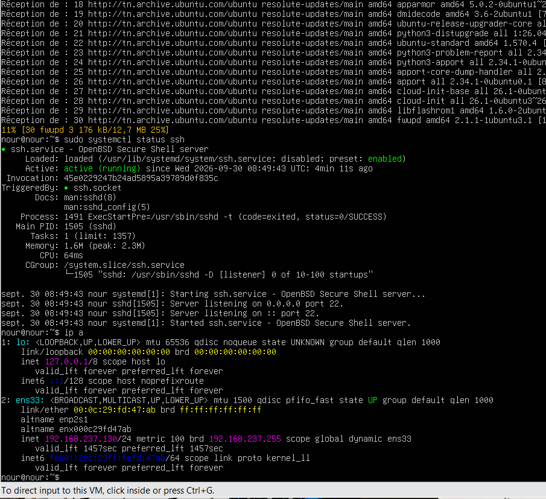

Génération d'une clé Ed25519 sur la machine physique et copie vers la VM :

```powershell
ssh-keygen -t ed25519 -C "nour-vm"
type $env:USERPROFILE\.ssh\id_ed25519.pub | ssh nour@192.168.237.130 "mkdir -p ~/.ssh && chmod 700 ~/.ssh && cat >> ~/.ssh/authorized_keys && chmod 600 ~/.ssh/authorized_keys"
```

Un avertissement `REMOTE HOST IDENTIFICATION HAS CHANGED` est apparu, car l'IP avait été utilisée par une ancienne VM. Correction :

```powershell
ssh-keygen -R 192.168.237.130
```

Durcissement de SSH, dans `/etc/ssh/sshd_config.d/99-hardening.conf` :

```
PermitRootLogin no
PasswordAuthentication no
PubkeyAuthentication yes
MaxAuthTries 3
```

```bash
sudo sshd -t && sudo systemctl restart ssh
sudo ufw allow OpenSSH
sudo ufw allow 8080/tcp
sudo ufw enable
sudo ufw status
```

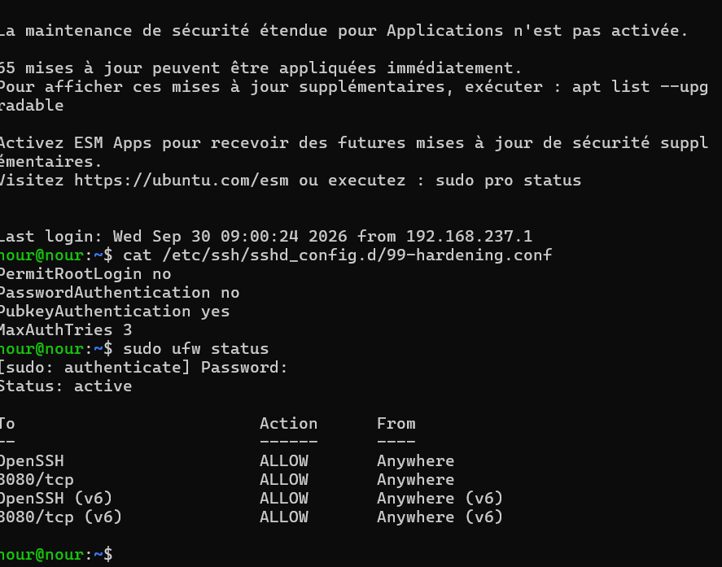

---

## 2. Test de l'accès SSH depuis la machine physique

```powershell
ssh nour@192.168.237.130
hostname && lsb_release -a
```

Connexion réussie par clé, sans mot de passe.

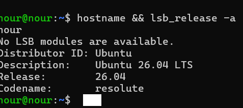

---

## 3. Installation de Docker sur la VM

```bash
sudo apt update && sudo apt upgrade -y
sudo apt install -y docker.io
sudo systemctl enable --now docker
sudo usermod -aG docker $USER && newgrp docker
docker --version
docker run hello-world
sudo systemctl status docker
```

> Docker est installé depuis les dépôts Ubuntu (paquet `docker.io`, version 29.1.3).

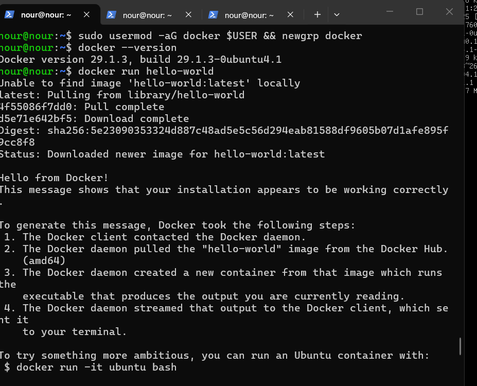
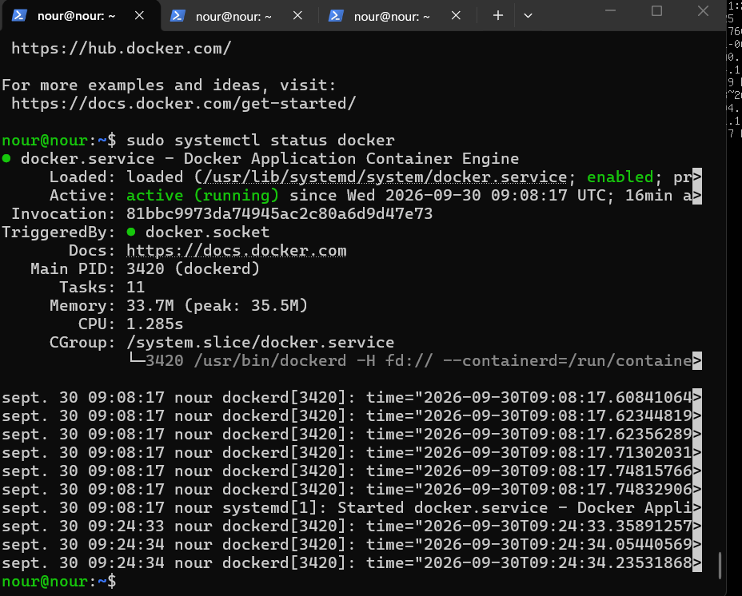

---

## 4. Installation de Jenkins en tant que service

```bash
sudo apt install -y fontconfig openjdk-21-jre
java -version

sudo wget -O /etc/apt/keyrings/jenkins-keyring.asc https://pkg.jenkins.io/debian-stable/jenkins.io-2026.key
echo "deb [signed-by=/etc/apt/keyrings/jenkins-keyring.asc] https://pkg.jenkins.io/debian-stable binary/" | sudo tee /etc/apt/sources.list.d/jenkins.list > /dev/null
sudo apt update
sudo apt install -y jenkins
sudo systemctl enable --now jenkins
sudo systemctl status jenkins
sudo cat /var/lib/jenkins/secrets/initialAdminPassword
```

> Problème rencontré : avec l'ancienne clé `jenkins.io-2023.key`, `apt update` renvoyait `NO_PUBKEY 7198F4B714ABFC68`, car Jenkins a changé sa clé de signature. Utiliser `jenkins.io-2026.key` a résolu le problème.

Vérification depuis la machine physique : `http://192.168.237.130:8080`, avec installation des plugins suggérés et création de l'utilisateur admin.

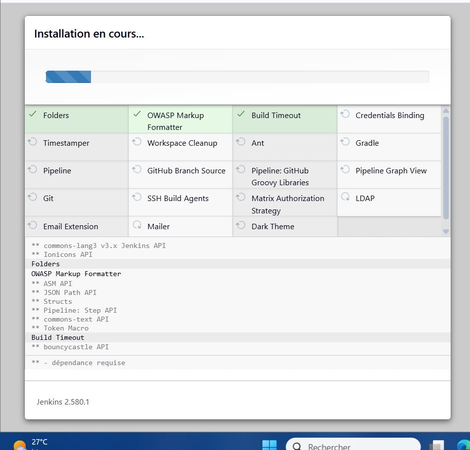
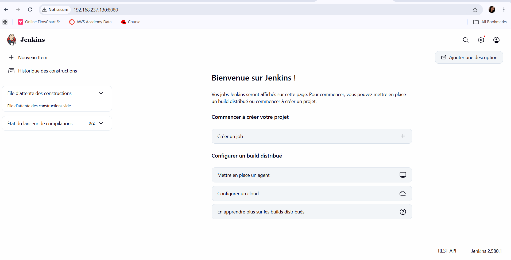


---

## 5. Mini CV One Page (HTML5 / CSS3 / JavaScript)

Le CV est dans le dossier [`cv/`](cv/) (`index.html`, `style.css`, `script.js`). Il propose un mode sombre mémorisé et un bouton d'impression / export PDF.

```powershell
mkdir tp-devops; cd tp-devops
git init -b main
git add .
git commit -m "Ajout du mini CV one page"
```

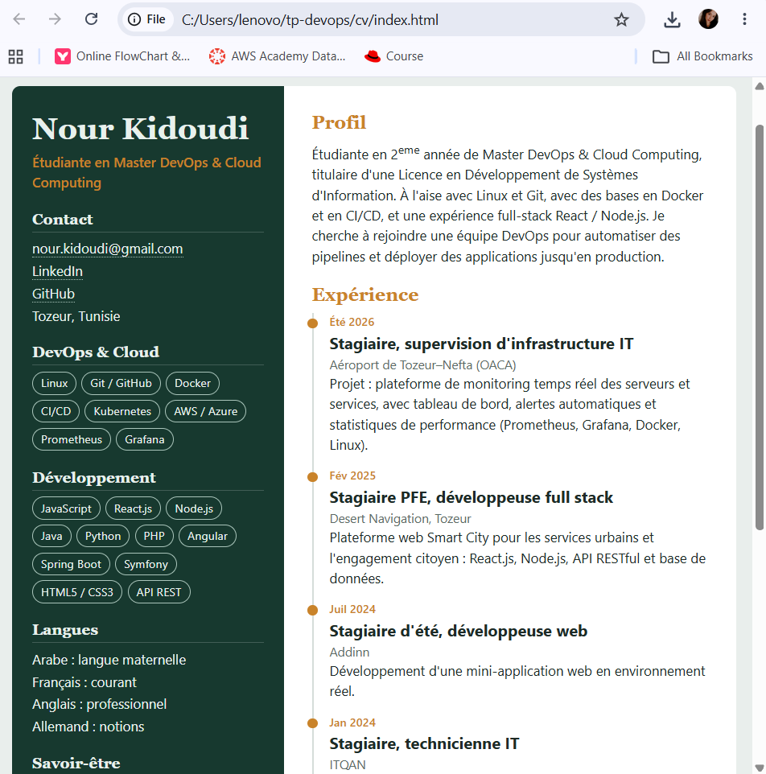

---

## 6. Push GitHub via SSH

Affichage de la clé publique, ajoutée sur GitHub (*Settings → SSH and GPG keys → New SSH key*) :

```powershell
type $env:USERPROFILE\.ssh\id_ed25519.pub
```

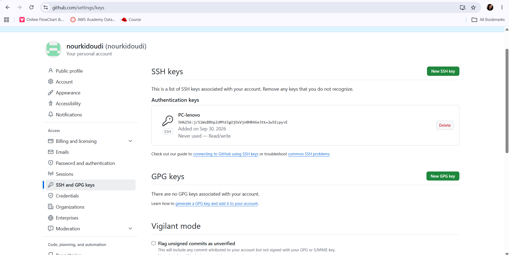

Test de l'authentification :

```powershell
ssh -T git@github.com
```

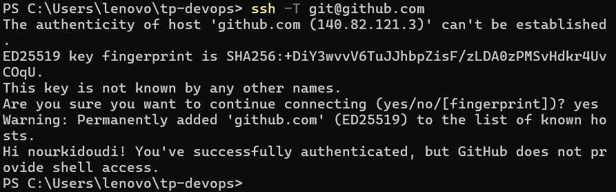

Configuration du dépôt local pour utiliser SSH et push :

```powershell
git remote add origin git@github.com:nourkidoudi/tp-devops.git
git remote -v
git push -u origin main
```

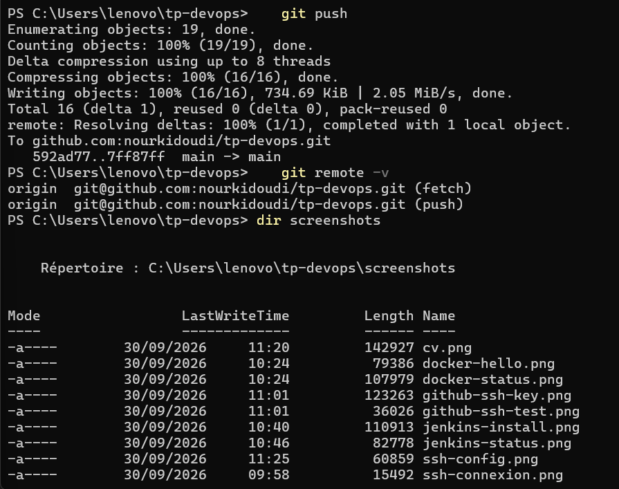

---

## 7. Évolution : application « DevSecOps Portfolio »

Le mini CV devient une petite application web dans le dossier [`portfolio/`](portfolio/) (`index.html`, `style.css`, `script.js`, `Dockerfile`). L'ancienne version reste dans [`cv/`](cv/).

**Sections :** About, Skills, Projects, Experience, Contact.

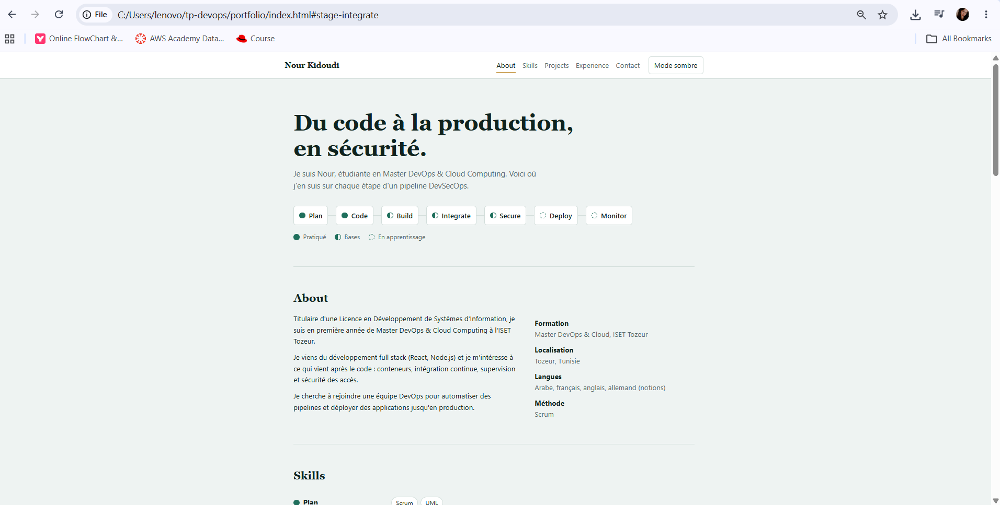

### Principales améliorations

- **Skills présentées comme un pipeline DevSecOps** (Plan, Code, Build, Integrate, Secure, Deploy, Monitor), chaque étape avec son niveau réel : pratiqué, bases ou en apprentissage.
- **Application pilotée par les données** : projets, compétences et expériences sont des tableaux dans `script.js`, la page est générée dynamiquement.
- **Projets filtrables** par catégorie (DevSecOps, Web, Monitoring).
- **Navigation** avec menu fixe et section active mise en évidence.
- **Formulaire de contact** avec validation, qui ouvre le client mail (aucun serveur ni service tiers).
- **Mode sombre** qui suit la préférence du système et mémorise le choix, page responsive et accessible (focus visible, mouvement réduit respecté).
- **Sécurité de la page** : politique CSP stricte (aucun script ni style externe), affichage des données avec `textContent` et non `innerHTML`, liens externes en `rel="noopener noreferrer"`.
- **Conteneurisation** : `Dockerfile` basé sur nginx sans droits root.

### Lancer le portfolio

En local : ouvrir `portfolio/index.html` dans le navigateur.

Dans un conteneur, sur la VM :

```bash
cd portfolio
docker build -t portfolio .
docker run -d --name portfolio -p 8081:8080 portfolio
```
Puis ouvrir `http://192.168.237.130:8081` depuis la machine physique (autoriser le port avec `sudo ufw allow 8081/tcp`).


## 8. Section « DevSecOps Skills »

Une section **DevSecOps Skills** est ajoutée au portfolio ([`portfolio/`](portfolio/)). Elle affiche les 7 technologies demandées :

- **Utilisés dans ce projet :** Git, Docker, Jenkins, avec pour chacun l'usage réel (dépôt GitHub en SSH, conteneurs sur la VM, Jenkins installé comme service).
- **Prochaines étapes :** Kubernetes, Ansible, Terraform, Argo CD, affichés comme « à découvrir » avec leur rôle (orchestration, configuration as code, infrastructure as code, GitOps).

Chaque carte indique le rôle de l'outil et un niveau (pratiqué, bases ou à découvrir), ce qui reste fidèle à ce qui a été réalisé.


## 9. Section « Projects » générée dynamiquement en JavaScript

Les projets ne sont pas écrits en HTML : ils sont décrits dans un **tableau d'objets** (`PROJECTS` dans [`portfolio/script.js`](portfolio/script.js)), et la page est construite à partir de ce tableau. Pour ajouter un projet, il suffit d'ajouter un objet, sans toucher au HTML.

```javascript
const PROJECTS = [
  { cat: 'DevSecOps', title: 'VM DevSecOps sécurisée',
    text: 'Ubuntu Server 26.04, accès SSH par clé, pare-feu, Docker et Jenkins en service.',
    tags: ['Linux', 'SSH', 'Docker', 'Jenkins'],
    link: 'https://github.com/nourkidoudi/tp-devops' },
  { cat: 'Web', title: 'Smart City Web Platform',
    text: 'Plateforme pour les services urbains et l\'engagement citoyen.',
    tags: ['React.js', 'Node.js', 'API REST'] },
  // ...
];

function renderProjects(filter) {
  const ul = document.getElementById('project-list');
  ul.replaceChildren();
  PROJECTS.filter(p => filter === 'Tous' || p.cat === filter).forEach(p => {
    const li = el('li');
    li.dataset.cat = p.cat;
    li.appendChild(el('h3', '', p.title));
    li.appendChild(el('p', 'cat', p.cat));
    li.appendChild(el('p', '', p.text));
    li.appendChild(tagList(p.tags));
    ul.appendChild(li);
  });
}
```

Le code fait trois choses :
- `PROJECTS.filter(...)` sélectionne les projets selon la catégorie choisie ;
- `forEach` crée un bloc de page par objet (titre, catégorie, description, technologies, lien) ;
- les boutons de filtre (Tous, DevSecOps, Web, Monitoring) sont eux aussi générés à partir du tableau et appellent `renderProjects`.

Le texte est inséré avec `textContent` (fonction `el`), jamais avec `innerHTML`, ce qui évite l'injection de code.

**Résultat :**

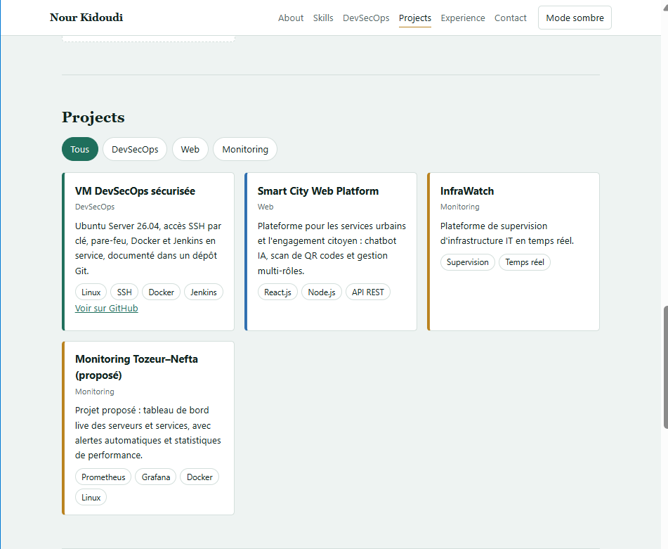

---
---
## 10. Dockerisation initiale

Le portfolio est servi par **Nginx** dans un conteneur grâce au fichier [`portfolio/Dockerfile`](portfolio/Dockerfile) :

```dockerfile
# Image Nginx qui s'exécute sans droits root (écoute sur le port 8080)
FROM nginxinc/nginx-unprivileged:alpine

# Copie des fichiers statiques du portfolio dans le dossier servi par Nginx
COPY index.html style.css script.js /usr/share/nginx/html/

# Port d'écoute du conteneur
EXPOSE 8080
```

**Explication :**
- `FROM nginxinc/nginx-unprivileged:alpine` : image officielle de Nginx, légère (Alpine) et exécutée sans droits root, ce qui limite les risques.
- `COPY ...` : le portfolio est un site statique, il suffit de copier ses trois fichiers dans le dossier que Nginx sert par défaut.
- `EXPOSE 8080` : cette image écoute sur le port 8080 (sans droits root, le port 80 n'est pas utilisable).

---
## 11. Construction de l'image Docker `cv-docker`

Commande utilisée sur la VM, dans le dossier `portfolio/` qui contient le Dockerfile :

```bash
docker build -t cv-docker .
```

- `docker build` construit une image à partir du Dockerfile ;
- `-t cv-docker` donne le nom `cv-docker` à l'image ;
- `.` indique que le Dockerfile se trouve dans le dossier courant.

Vérification avec `docker images cv-docker` :

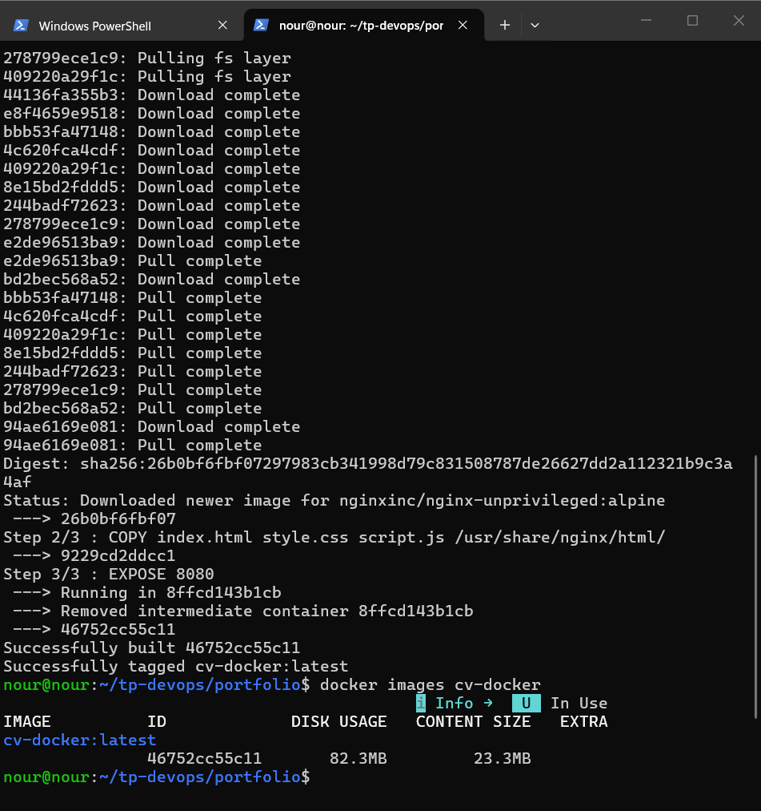

---
## 12. Exécution du conteneur et accès depuis la machine physique

Commande utilisée sur la VM :

```bash
docker run -d --name cv-docker -p 8081:8080 cv-docker
```

- `-d` : exécution en arrière-plan ;
- `--name cv-docker` : nom du conteneur ;
- `-p 8081:8080` : le port 8081 de la VM est redirigé vers le port 8080 du conteneur (Nginx) ;
- `cv-docker` : image construite à l'étape 11.

Le port est ouvert dans le pare-feu avec `sudo ufw allow 8081/tcp`.

Résultat de `docker ps` :

```
COLLER ICI LA SORTIE RÉELLE DE docker ps
```

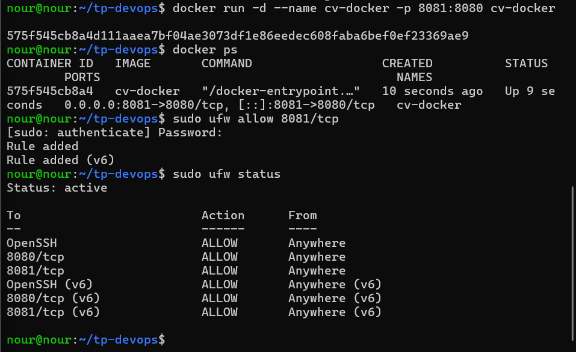

Accès depuis la machine physique sur `http://192.168.237.130:8081` :

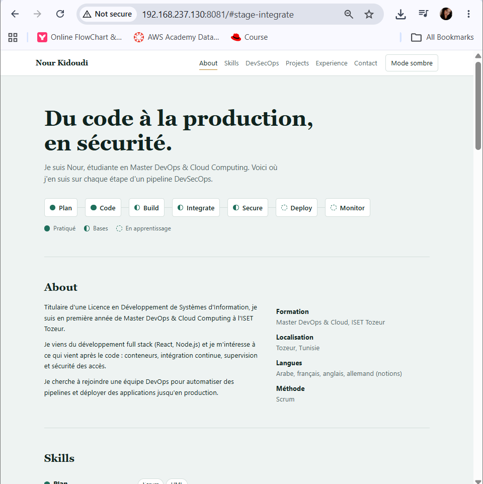

---
## 13. Déploiement avec Docker Compose

Le fichier [`portfolio/docker-compose.yml`](portfolio/docker-compose.yml) décrit le service :

```yaml
services:
  portfolio:
    build: .
    image: cv-docker
    container_name: portfolio
    ports:
      - "8081:8080"
    restart: unless-stopped
    security_opt:
      - no-new-privileges:true
```

- `build: .` construit l'image à partir du Dockerfile du dossier ;
- `image: cv-docker` nomme l'image ;
- `ports: "8081:8080"` expose le portfolio sur le port 8081 de la VM ;
- `restart: unless-stopped` relance le conteneur après un redémarrage de la VM ;
- `no-new-privileges` empêche le processus du conteneur d'obtenir de nouveaux droits.

Commande utilisée sur la VM, dans le dossier `portfolio/` :

```bash
docker compose up -d
```

Résultat de `docker compose ps` :

```
COLLER ICI LA SORTIE RÉELLE DE docker compose ps
```

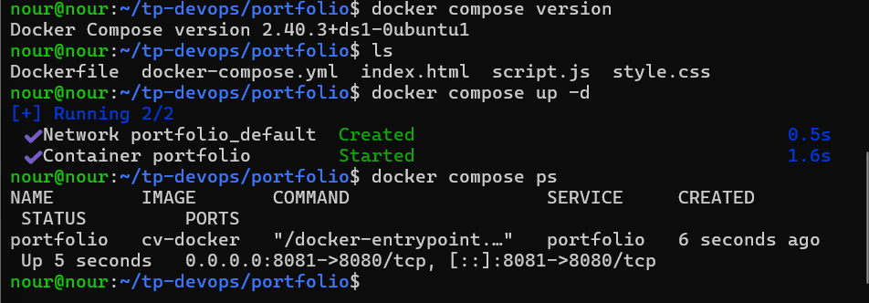

Accès depuis la machine physique sur `http://192.168.237.130:8081` :

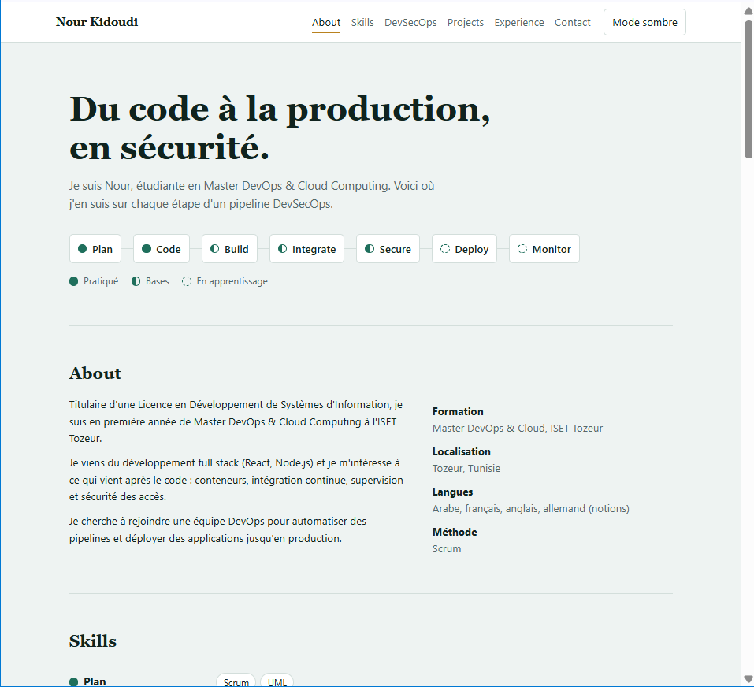

---
## 14. Publication sur GitHub via SSH

Le dépôt est relié à GitHub par SSH (clé `PC-lenovo`, voir l'étape 6). Commandes Git utilisées pour publier les modifications :

```bash
git remote -v                # vérifie que l'origine utilise SSH (git@github.com:...)
ssh -T git@github.com        # teste l'authentification SSH
git status                   # liste les fichiers modifiés
git add -A                   # ajoute les modifications à l'index
git commit -m "Message"      # enregistre les modifications
git push                     # publie sur GitHub via SSH
git log --oneline            # affiche l'historique des commits
```

Dépôt GitHub mis à jour : **https://github.com/nourkidoudi/tp-devops**

---
## 17. Configuration automatique de la VM

Le `Vagrantfile` configure le nom de la VM, l'adresse IP privée, la mémoire et le nombre de CPU :

```ruby
Vagrant.configure("2") do |config|
  config.vm.box = "cloud-image/ubuntu-24.04"
  # La virtualisation imbriquée ralentit le démarrage : on augmente le délai d'attente
  config.vm.boot_timeout = 1200

  # Nom de la VM dans Vagrant (vagrant status) et nom d'hôte
  config.vm.define "ubuntu-devops" do |node|
    node.vm.hostname = "ubuntu-devops"

    # Adresse IP privée (réseau host-only)
    node.vm.network "private_network", ip: "192.168.56.10"

    node.vm.provider "virtualbox" do |vb|
      vb.name   = "ubuntu-devops"   # nom de la VM dans VirtualBox
      vb.memory = 1536              # mémoire en Mo
      vb.cpus   = 2                 # nombre de CPU
      # IO-APIC nécessaire pour que le système invité utilise plusieurs CPU
      vb.customize ["modifyvm", :id, "--ioapic", "on"]
      # Désactive la console série, qui ralentit fortement le démarrage des images cloud Ubuntu
      vb.customize ["modifyvm", :id, "--uartmode1", "disconnected"]
    end

    node.vm.provision "shell", inline: <<-SHELL
      echo "VM créée automatiquement par Vagrant" > /home/vagrant/bienvenue.txt
    SHELL
  end
end
```

| Paramètre | Directive | Valeur |
|---|---|---|
| Nom de la VM | `config.vm.define`, `vb.name` | `ubuntu-devops` |
| Adresse IP privée | `private_network` | `192.168.56.10` |
| Mémoire | `vb.memory` | 1536 Mo |
| Nombre de CPU | `vb.cpus` | 2 |

Remarque : sans l'IO-APIC, l'invité ne voyait qu'un seul CPU malgré `vb.cpus = 2`. L'ajout de `--ioapic on` a corrigé ce point.

Résultat de `vagrant status` :

```
COLLER ICI LA SORTIE RÉELLE DE vagrant status
```

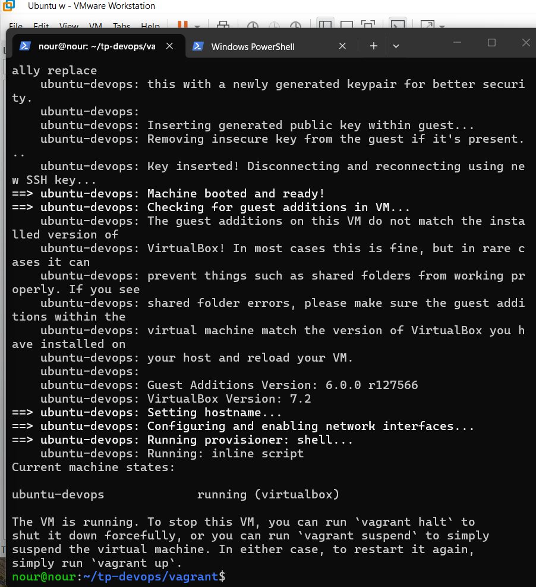

Vérification dans la VM (nom d'hôte, interface `192.168.56.10`, mémoire, 2 CPU) :

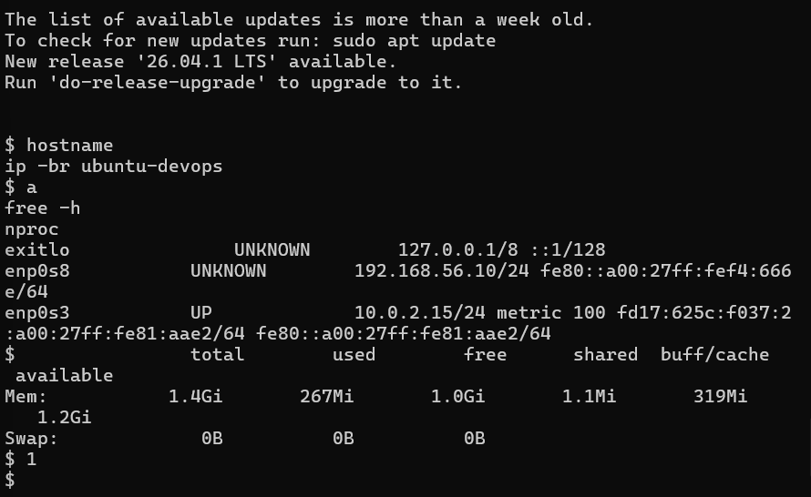

---
## 18. Migration du portfolio vers Next.js

Commande de création du projet :

```bash
npx create-next-app@latest portfolio-next
```

Next.js 16 avec le routeur App Router et TypeScript. Les mêmes sections que la version HTML/CSS/JavaScript sont conservées : About, Skills, DevSecOps Skills, Projects, Experience et Contact. Lancement : `npm run dev`, puis `http://localhost:3000`.

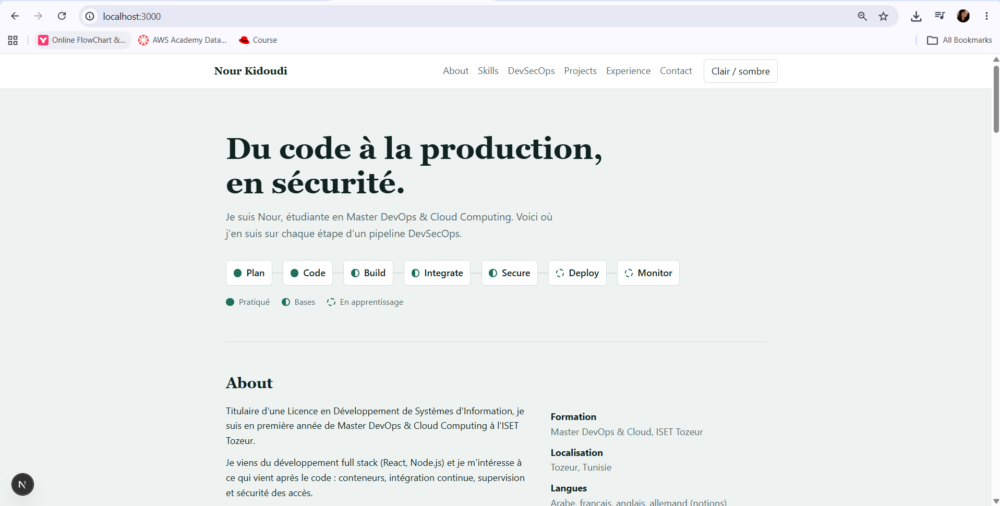

---

## 19. Composants réutilisables

```
portfolio-next/
├── app/
│   ├── layout.tsx          # Header + Footer autour de chaque page
│   ├── page.tsx            # page d'accueil : assemble les sections
│   ├── globals.css
│   └── projects/
│       ├── page.tsx        # /projects
│       └── [slug]/page.tsx # /projects/nom-du-projet
├── components/
│   ├── Header.tsx  ThemeToggle.tsx  Footer.tsx
│   ├── Hero.tsx  About.tsx  Skills.tsx  Tools.tsx
│   ├── Projects.tsx  ProjectList.tsx
│   ├── Experience.tsx
│   └── Contact.tsx  ContactForm.tsx
└── data/
    ├── types.ts  stages.ts  tools.ts
    └── projects.ts  experience.ts
```

La page d'accueil assemble les composants :

```tsx
export default function Home() {
  return (
    <>
      <Hero />
      <About />
      <Skills />
      <Tools />
      <Projects />
      <Experience />
      <Contact />
    </>
  );
}
```

---

## 20. Données séparées des composants

Les projets, compétences et expériences sont dans le dossier `data/`, typés avec TypeScript. Exemple extrait de `data/projects.ts` :

```ts
export const projects: Project[] = [
  {
    slug: "smart-city-web-platform",
    category: "Web",
    title: "Smart City Web Platform",
    status: "Projet de fin d'études",
    summary: "Plateforme pour les services urbains et l'engagement citoyen.",
    tags: ["React.js", "Node.js", "API REST"],
    // ...
  },
];
```

Les composants lisent ces données avec `projects.map(...)` : pour ajouter un projet, il suffit d'ajouter un objet.

---

## 21. Pages dédiées aux projets

- `/projects` affiche la liste de tous les projets, avec filtre par catégorie ;
- `/projects/nom-du-projet` affiche le détail d'un projet (route dynamique `app/projects/[slug]/page.tsx`).

Un projet inconnu renvoie une page 404 grâce à `notFound()`.

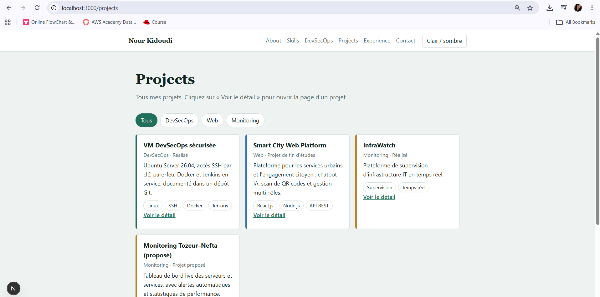
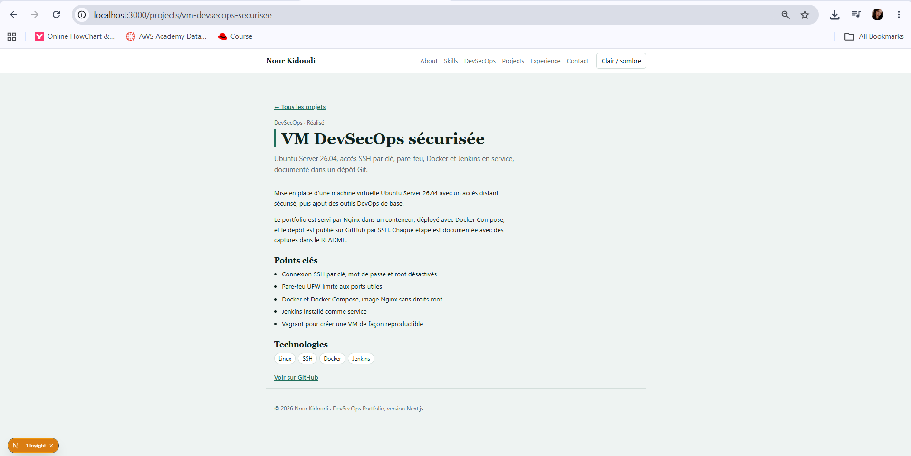

---
## 22. Premier pipeline Jenkins : récupération du dépôt GitHub

Un job Jenkins de type Pipeline (`portfolio-pipeline`) utilise l'option **Pipeline script from SCM** : Jenkins récupère le dépôt `https://github.com/nourkidoudi/tp-devops.git` (branche `main`), puis lit le fichier [`Jenkinsfile`](Jenkinsfile) situé à la racine.

```groovy
// Pipeline Jenkins du DevSecOps Portfolio
pipeline {
    agent any

    options {
        // Le checkout est fait explicitement dans le premier stage
        skipDefaultCheckout(true)
    }

    stages {
        // Étape 22 : récupération automatique du dépôt GitHub
        stage('Checkout') {
            steps {
                checkout scm
                sh 'git log -1 --oneline'
                sh 'ls -la'
            }
        }
    }

    post {
        success {
            echo 'Dépôt récupéré avec succès.'
        }
        failure {
            echo 'Le pipeline a échoué : consulter la console.'
        }
    }
}
```

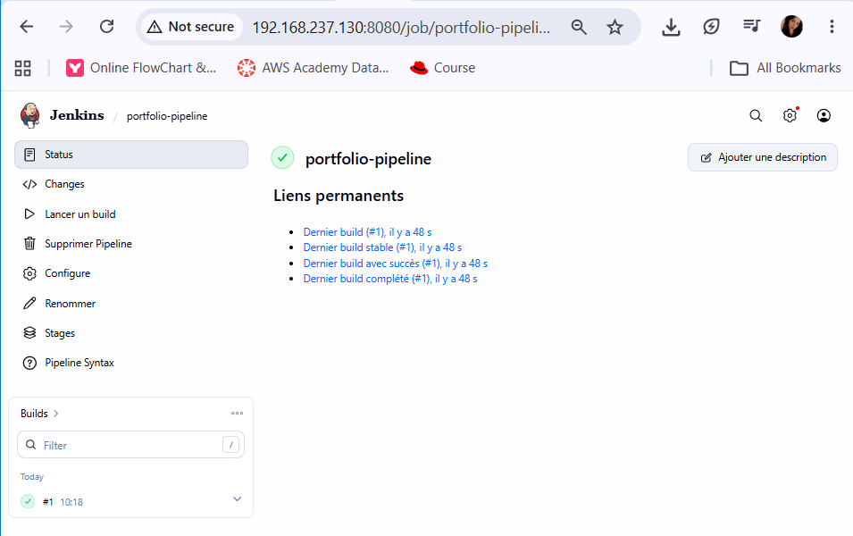

---

## 23. Installation des dépendances du projet Next.js

Node.js 22 est installé sur la VM Jenkins (dépôt NodeSource). Le stage suivant est ajouté au `Jenkinsfile` :

```groovy
        // Étape 23 : installation des dépendances du projet Next.js
        stage('Install dependencies') {
            steps {
                dir('portfolio-next') {
                    sh 'node --version'
                    sh 'npm --version'
                    sh 'npm ci --no-audit --no-fund'
                }
            }
        }
```

`npm ci` installe exactement les versions du fichier `package-lock.json`, ce qui rend le build reproductible.

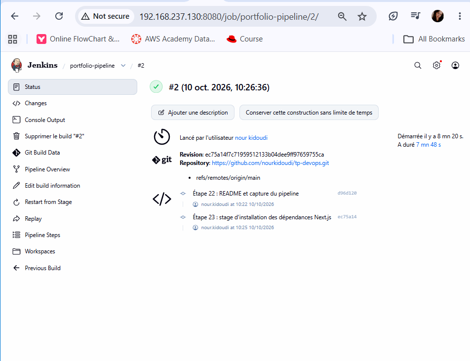
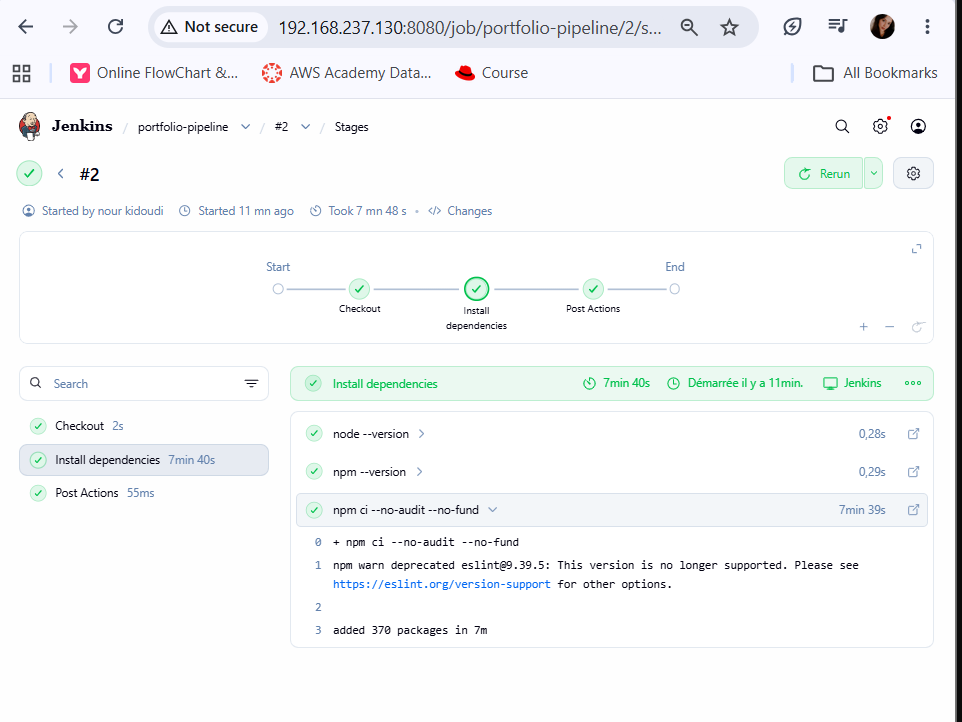

---
## 24. Construction automatique de l'application Next.js

Un stage `Build` est ajouté au `Jenkinsfile` : il exécute `npm run build` dans le dossier `portfolio-next` et produit la version de production du portfolio.

```groovy
        // Étape 24 : construction de l'application Next.js
        stage('Build') {
            steps {
                dir('portfolio-next') {
                    sh 'npm run build'
                }
            }
        }
```

Le pipeline complet enchaîne trois stages : `Checkout`, `Install dependencies` et `Build`.

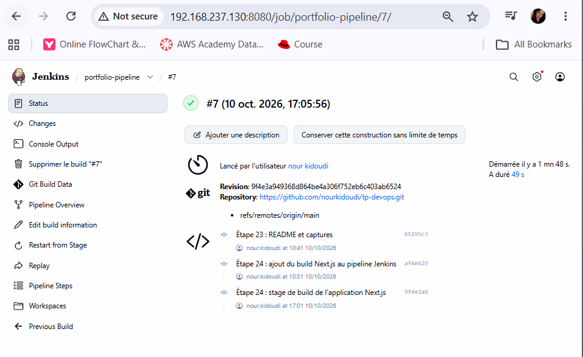

Résultat du build :

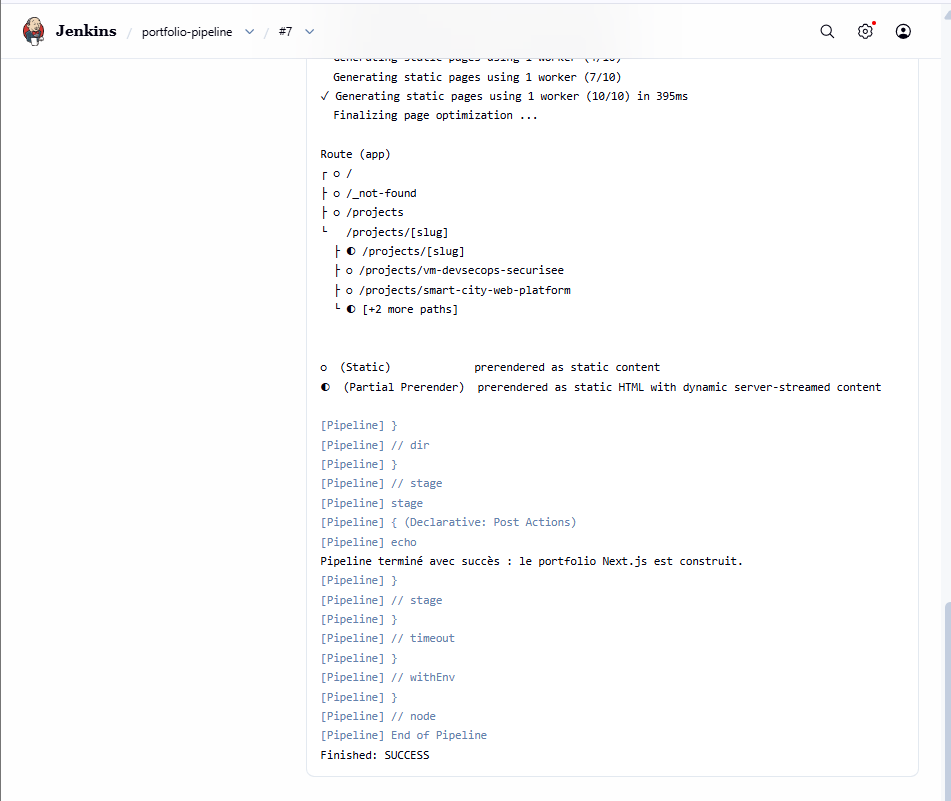

---
## 25. Installation d'Ansible sur une VM d'administration

Ansible est installé sur une VM dédiée à l'administration (`vm-admin`), distincte du serveur géré.

```bash
sudo apt update
sudo apt install -y ansible
ansible --version
```

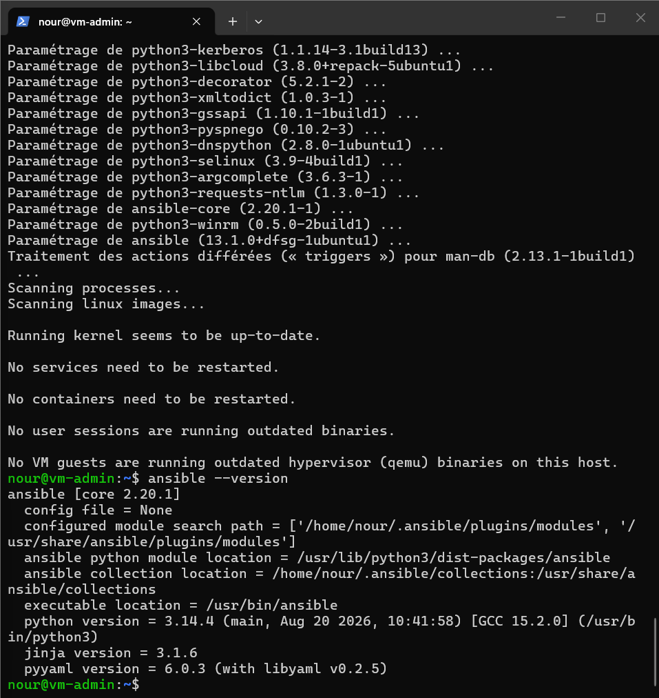

---
## 26. Inventory et test de communication

La VM d'administration se connecte au serveur Ubuntu par clé SSH (mot de passe désactivé). La clé publique de `vm-admin` a été ajoutée dans `~/.ssh/authorized_keys` du serveur.

Fichier `inventory.ini` :

```ini
[serveurs]
192.168.237.135 ansible_user=nour
```

Fichier `ansible.cfg` :

```ini
[defaults]
inventory = ./inventory.ini
host_key_checking = False
```

Test de communication :

```bash
ansible all -m ping
```

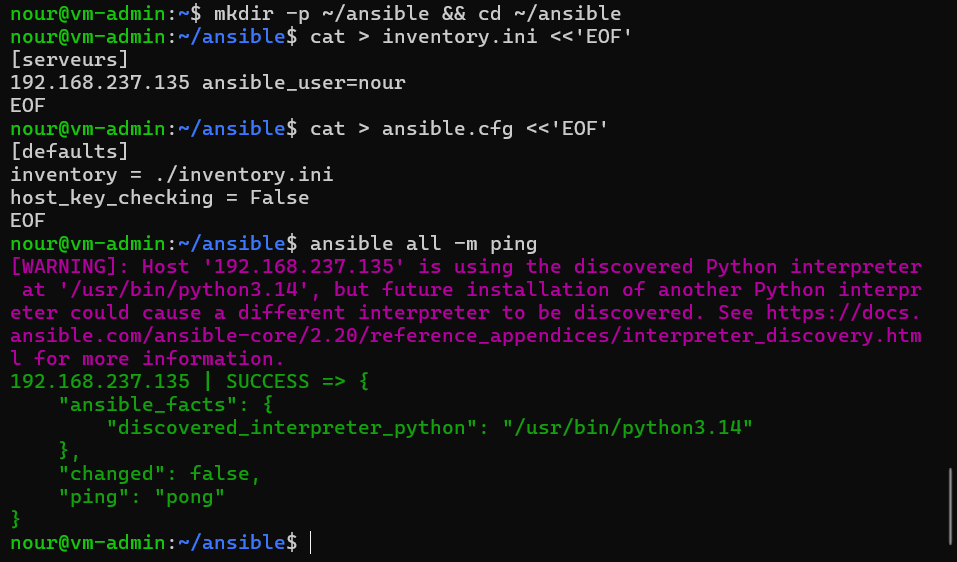
---
## 28. Installation automatique de Docker avec Ansible

Une nouvelle VM (`vm-cible`, sans Docker) est ajoutée à l'inventory dans le groupe `nouvelle_vm` :

```ini
[serveurs]
192.168.237.135 ansible_user=nour

[nouvelle_vm]
192.168.237.136 ansible_user=nour
```

Playbook `install-docker.yml` :

```yaml
---
- name: Installer Docker sur une nouvelle VM
  hosts: nouvelle_vm
  become: true

  tasks:
    - name: Mettre à jour le cache apt
      ansible.builtin.apt:
        update_cache: true
        cache_valid_time: 3600

    - name: Installer Docker
      ansible.builtin.apt:
        name: docker.io
        state: present

    - name: Démarrer et activer le service Docker
      ansible.builtin.service:
        name: docker
        state: started
        enabled: true

    - name: Ajouter l'utilisateur au groupe docker
      ansible.builtin.user:
        name: "{{ ansible_user }}"
        groups: docker
        append: true

    - name: Vérifier la version de Docker
      ansible.builtin.command: docker --version
      register: docker_version
      changed_when: false

    - name: Afficher la version
      ansible.builtin.debug:
        msg: "{{ docker_version.stdout }}"
```

Exécution et vérification :

```bash
ansible-playbook install-docker.yml
ansible nouvelle_vm -a "docker --version"
```

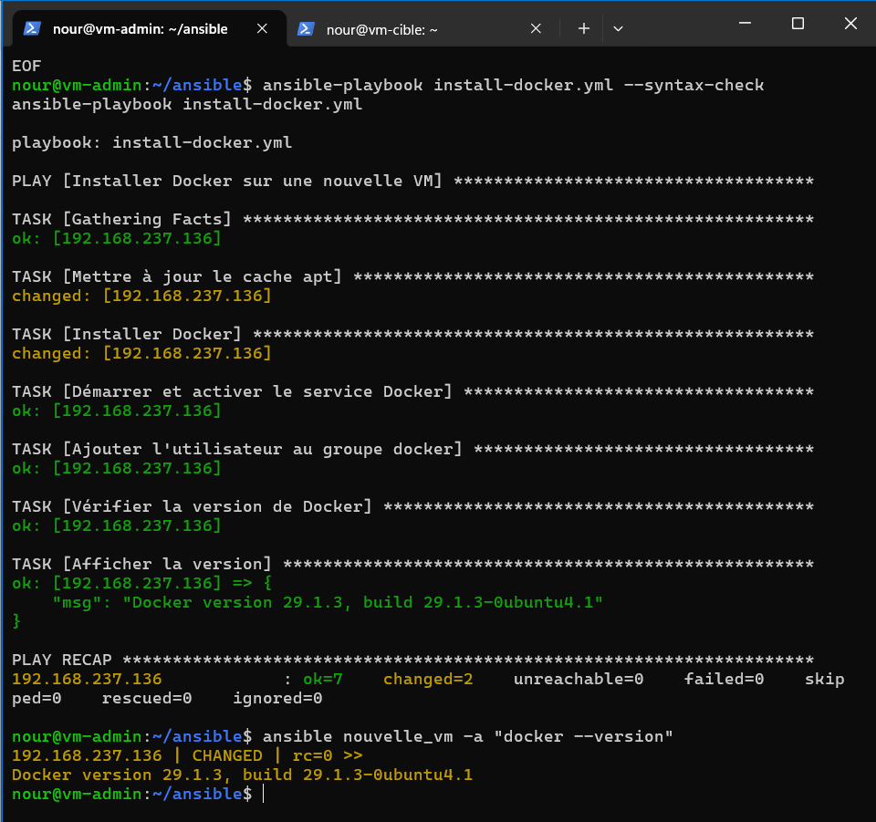
---
## 29. Création de l'API Node.js / Express

Un dossier `api/` contient une application Node.js / Express qui se lance **indépendamment du frontend**.

Structure du projet :

```
tp-devops/
├── api/
│   ├── package.json
│   ├── package-lock.json
│   ├── server.js
│   └── data/
│       ├── profile.js
│       ├── projects.js
│       ├── stages.js
│       ├── tools.js
│       └── experience.js
└── portfolio-next/
```

Installation et démarrage :

```bash
cd api
npm install
npm start
```

L'API écoute sur le port `3001` (modifiable avec la variable `PORT`).

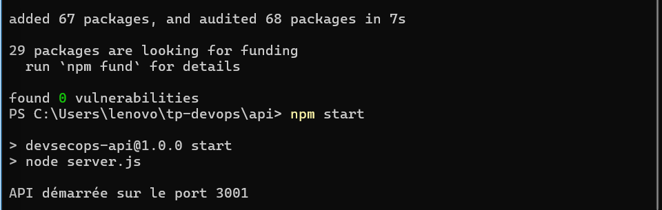

---
## 30. Route `GET /api/health`

Cette route indique que l'API fonctionne : elle retourne un statut, le nom du service, le temps de fonctionnement et l'heure.

```js
app.get("/api/health", (req, res) => {
  res.json({
    status: "ok",
    service: "devsecops-api",
    uptime: Math.round(process.uptime()),
    timestamp: new Date().toISOString(),
  });
});
```

```bash
curl http://localhost:3001/api/health
```

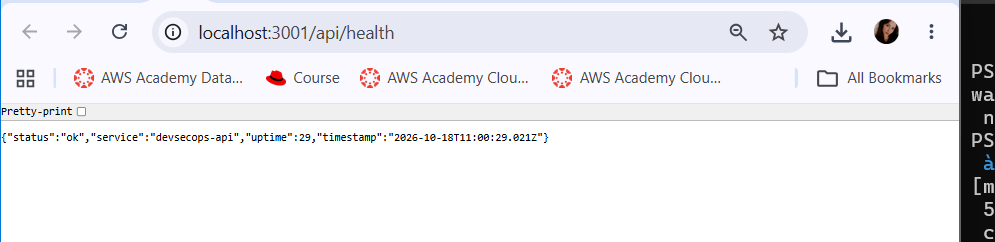

---
## 31. Route `GET /api/profile`

Elle retourne au format JSON les principales informations du portfolio : identité, formation, langues, présentation, contact et expériences.

```js
app.get("/api/profile", (req, res) => {
  res.json({ ...profile, experience });
});
```

```bash
curl http://localhost:3001/api/profile
```

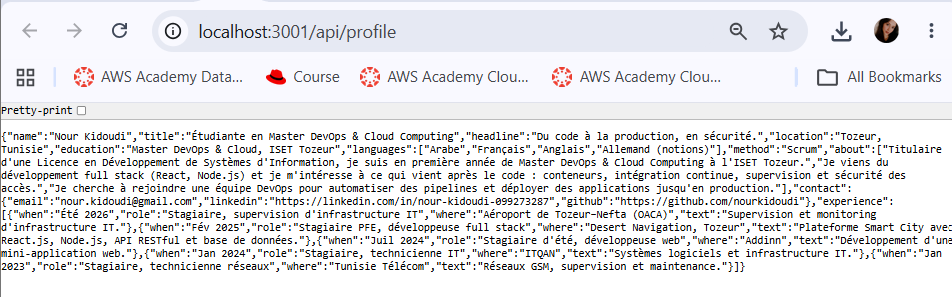

---
## 32. Route `GET /api/projects`

Elle retourne la liste des projets du portfolio. Une route supplémentaire `GET /api/projects/:slug` retourne un seul projet (utile pour la page de détail du frontend).

```js
app.get("/api/projects", (req, res) => {
  res.json(projects);
});
```

```bash
curl http://localhost:3001/api/projects
```

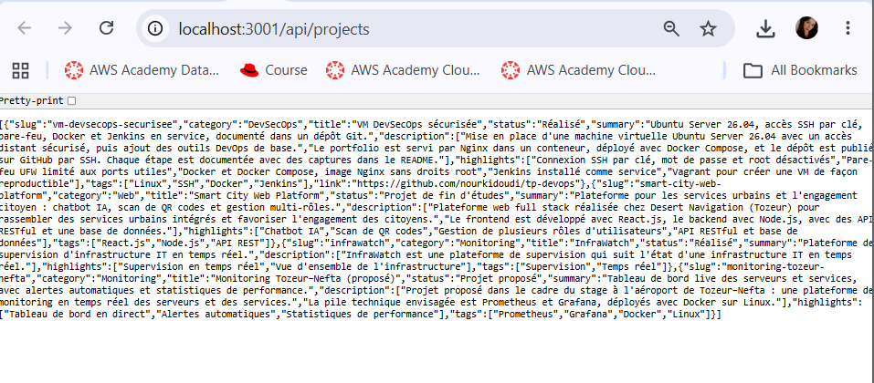

---
## 33. Route `GET /api/skills`

Elle retourne la liste des compétences : les étapes du pipeline DevSecOps (`stages`) et les outils (`tools`).

```js
app.get("/api/skills", (req, res) => {
  res.json({ stages, tools });
});
```

```bash
curl http://localhost:3001/api/skills
```

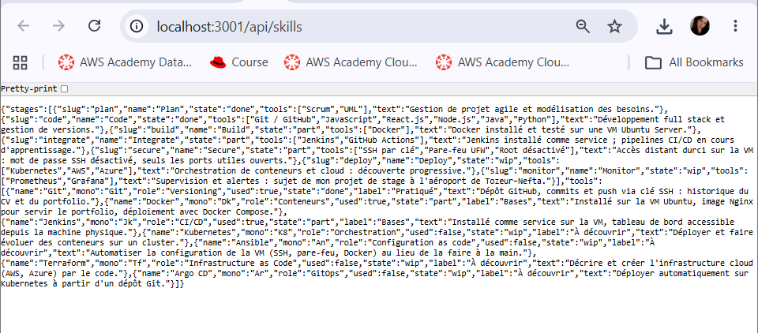
---
## 34. Frontend Next.js : projets lus depuis l'API Express

Le frontend ne lit plus la liste des projets dans un fichier local : il appelle l'API Express (`GET /api/projects` et `GET /api/projects/:slug`).

Un fichier `portfolio-next/lib/api.ts` centralise les appels à l'API :

```ts
const API_URL = process.env.API_URL ?? "http://localhost:3001";

async function get(path: string): Promise<Response> {
  return fetch(`${API_URL}${path}`, { cache: "no-store" });
}

export async function getProjects(): Promise<Project[]> {
  const res = await get("/api/projects");
  if (!res.ok) throw new Error(`API /api/projects : erreur ${res.status}`);
  return res.json();
}
```

Les composants `Projects`, la page `/projects` et la page `/projects/[slug]` appellent ces fonctions. Les données sont lues à chaque requête (`cache: "no-store"`) et affichées dans un `<Suspense>` : la page se charge immédiatement et les projets arrivent dès que l'API répond. Si l'API est arrêtée, la page affiche un message d'erreur au lieu de planter. Comme rien n'est lu pendant le `build`, l'image Docker pourra être construite sans que l'API soit démarrée.

Pour tester, l'API est lancée dans un terminal (`npm start` dans `api/`) et le frontend dans un autre (`npm run dev` dans `portfolio-next/`).

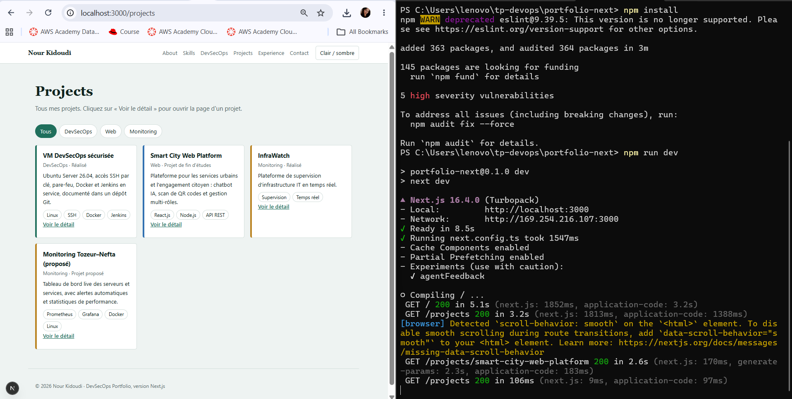

---
## 35. Frontend Next.js : compétences lues depuis l'API Express

Même principe pour les compétences : les sections `Skills` (étapes du pipeline) et `DevSecOps Skills` (outils) appellent `GET /api/skills` avec la fonction `getSkills()`.

```ts
export async function getSkills(): Promise<{ stages: Stage[]; tools: Tool[] }> {
  const res = await get("/api/skills");
  if (!res.ok) throw new Error(`API /api/skills : erreur ${res.status}`);
  return res.json();
}
```

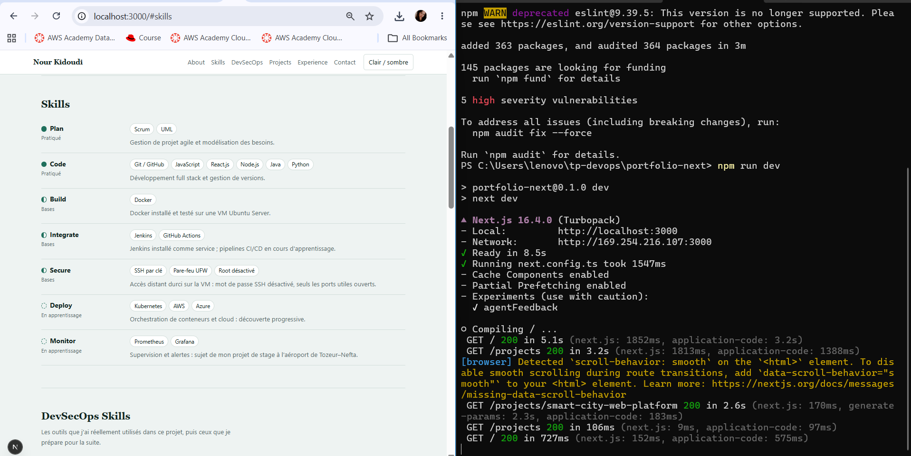

---
## 36. Configuration de l'URL de l'API avec la variable `API_URL`

Le frontend Next.js lit l'URL de l'API dans la variable d'environnement `API_URL` (fichier `portfolio-next/lib/api.ts`) :

```ts
const API_URL = process.env.API_URL ?? "http://localhost:3001";
```

En local, la variable est définie dans un fichier `.env.local`, qui n'est pas versionné :

```bash
cp .env.example .env.local
```

**Pourquoi l'URL de l'API ne doit pas être codée en dur :**

- **Elle change selon l'environnement.** En développement c'est `http://localhost:3001`, avec Docker Compose c'est `http://api:3001` (le nom du service sur le réseau Docker), et en production ce sera une autre adresse. Avec une URL écrite dans le code, il faudrait modifier le code pour chaque environnement.
- **La même image peut être déployée partout.** L'application est construite une seule fois ; seule la variable d'environnement change selon l'endroit où elle s'exécute.
- **Le code reste propre et sûr.** Les adresses et les paramètres propres à une machine ne sont pas committés dans Git. Le jour où une clé ou un mot de passe sera nécessaire, il suivra le même mécanisme, sans jamais apparaître dans le dépôt.

---
## 37. Fichier d'exemple `.env.example`

Un fichier `.env.example` documente les variables attendues, **sans aucun secret réel**. Le vrai fichier `.env.local` est ignoré par Git, alors que `.env.example` est versionné.

`portfolio-next/.env.example` :

```env
# URL de l'API Express, sans slash final
# - en local : http://localhost:3001
# - avec Docker Compose : http://api:3001
API_URL=http://localhost:3001
```

`api/.env.example` :

```env
# Port d'écoute de l'API
PORT=3001
```
---
## 38. Dockerfile du frontend Next.js

Le frontend est construit et exécuté avec un Dockerfile en **trois étapes** (`portfolio-next/Dockerfile`).

Dans `next.config.ts`, l'option `output: "standalone"` demande à Next.js de produire un dossier autonome, avec seulement les fichiers nécessaires à l'exécution :

```ts
const nextConfig: NextConfig = {
  output: "standalone",
  // ...
};
```

Dockerfile :

```dockerfile
# Étape 1 : installation des dépendances
FROM node:22-alpine AS deps
WORKDIR /app
COPY package.json package-lock.json ./
RUN npm ci

# Étape 2 : construction de l'application
FROM node:22-alpine AS builder
WORKDIR /app
ENV NEXT_TELEMETRY_DISABLED=1
COPY --from=deps /app/node_modules ./node_modules
COPY . .
RUN npm run build

# Étape 3 : image finale, légère, qui exécute l'application
FROM node:22-alpine AS runner
WORKDIR /app
ENV NODE_ENV=production \
    NEXT_TELEMETRY_DISABLED=1 \
    PORT=3000 \
    HOSTNAME=0.0.0.0

# Utilisateur sans droits root
RUN addgroup -S nodejs && adduser -S nextjs -G nodejs

COPY --from=builder --chown=nextjs:nodejs /app/.next/standalone ./
COPY --from=builder --chown=nextjs:nodejs /app/.next/static ./.next/static
COPY --from=builder --chown=nextjs:nodejs /app/public ./public

USER nextjs
EXPOSE 3000

# L'URL de l'API est fournie au démarrage avec la variable API_URL
CMD ["node", "server.js"]
```

**Explication :**

- Le **build en plusieurs étapes** sépare la construction de l'exécution : l'image finale ne contient ni les outils de build ni les dépendances de développement, elle est donc plus légère.
- `npm ci` installe exactement les versions du `package-lock.json`, ce qui rend le build reproductible.
- L'application tourne avec un **utilisateur sans droits root** (`nextjs`), par sécurité.
- L'URL de l'API n'est pas écrite dans l'image : elle est passée au démarrage du conteneur avec la variable `API_URL` (étape 36).
- Un fichier `.dockerignore` exclut `node_modules`, `.next`, `.git` et les fichiers `.env*` du contexte de build, pour qu'aucun secret ni fichier inutile ne soit copié dans l'image.

---
---
## 39. Dockerfile de l'API Node.js / Express

L'API est empaquetée dans une image Docker avec le fichier `api/Dockerfile` :

```dockerfile
FROM node:22-alpine
WORKDIR /app

ENV NODE_ENV=production \
    PORT=3001

# Dépendances d'abord : cette couche est réutilisée tant que package*.json ne change pas
COPY package.json package-lock.json ./
RUN npm ci --omit=dev

# Code de l'API
COPY --chown=node:node . .

# L'utilisateur "node" est fourni par l'image : pas de droits root
USER node
EXPOSE 3001

# Vérifie régulièrement que l'API répond
HEALTHCHECK --interval=30s --timeout=3s --start-period=5s \
  CMD wget -qO- http://127.0.0.1:${PORT}/api/health || exit 1

CMD ["node", "server.js"]
```

**Explication :**

- L'image de base `node:22-alpine` est légère. Le Dockerfile n'a qu'une seule étape, car l'API n'a pas de phase de compilation.
- Les fichiers `package.json` et `package-lock.json` sont copiés **avant** le code : Docker réutilise alors la couche des dépendances tant qu'elles ne changent pas, ce qui accélère les builds suivants.
- `npm ci --omit=dev` installe exactement les versions du `package-lock.json`, sans les dépendances de développement.
- L'API s'exécute avec l'utilisateur `node`, sans droits root.
- Le `HEALTHCHECK` appelle la route `/api/health` créée à l'étape 30 : Docker sait ainsi si l'API répond vraiment, et `docker compose ps` affichera l'état `healthy`.
- Le port est défini par la variable `PORT` (3001 par défaut). Un fichier `.dockerignore` exclut `node_modules` et `.env` de l'image.
## 40. Construction des images Docker

Deux images sont construites depuis la racine du dépôt :

```bash
docker build -t devsecops-api ./api
docker build -t devsecops-portfolio ./portfolio-next
```

Vérification :

```bash
docker images | grep devsecops
```

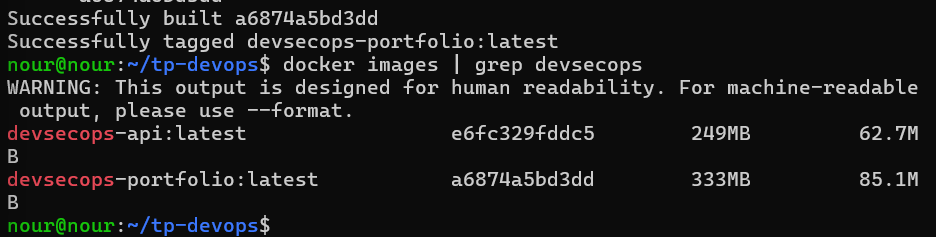

---
## 41. Docker Compose : frontend + API

Un fichier `docker-compose.yml` à la racine du dépôt lance le frontend et l'API ensemble :

```yaml
services:
  api:
    build: ./api
    image: devsecops-api
    container_name: devsecops-api
    environment:
      PORT: "3001"
    ports:
      - "3001:3001"
    networks:
      - portfolio-net
    restart: unless-stopped

  frontend:
    build: ./portfolio-next
    image: devsecops-portfolio
    container_name: devsecops-portfolio
    environment:
      # Dans le réseau Compose, l'API est joignable par le nom de son service
      API_URL: http://api:3001
    ports:
      - "3000:3000"
    depends_on:
      api:
        condition: service_healthy
    networks:
      - portfolio-net
    restart: unless-stopped

networks:
  portfolio-net:
    driver: bridge
```

**Explication :**

- Les deux services sont construits à partir de leur Dockerfile (`build`) et reliés au même réseau `portfolio-net`.
- Le frontend reçoit `API_URL=http://api:3001` : à l'intérieur du réseau Compose, `api` est le nom du service, résolu par le DNS de Docker. On n'utilise donc pas `localhost`, qui désignerait le conteneur du frontend lui-même.
- `depends_on` avec `service_healthy` démarre le frontend seulement quand l'API répond au `HEALTHCHECK` défini dans son Dockerfile.
- `restart: unless-stopped` relance les conteneurs automatiquement après un redémarrage de la VM.

Lancement :

```bash
docker compose up -d --build
docker compose ps
```

Résultat de `docker compose ps` :

```text
COLLER ICI LA SORTIE DE docker compose ps
```

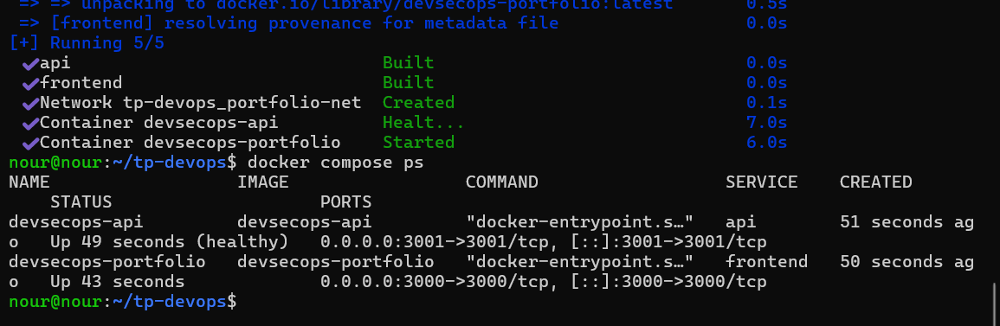

---
## 42. Communication frontend ↔ API dans le réseau Docker Compose

Le frontend et l'API tournent dans deux conteneurs reliés au réseau `portfolio-net`. Le frontend appelle l'API avec `API_URL=http://api:3001` : `api` est le nom du service, résolu par le DNS interne de Docker.

**1. Appel de l'API depuis le conteneur du frontend** (par le nom du service, pas par `localhost`) :

```bash
docker compose exec frontend wget -qO- http://api:3001/api/health
```

**2. Les deux conteneurs sont bien sur le même réseau :**

```bash
docker network inspect tp-devops_portfolio-net --format '{{range .Containers}}{{.Name}} {{.IPv4Address}}{{"\n"}}{{end}}'
```

**3. Le portfolio affiche les données fournies par l'API.** Le portfolio est ouvert depuis la machine physique sur `http://IP_DE_LA_VM:3000` :

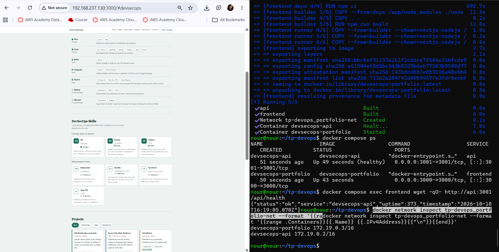

**4. Preuve que les données viennent bien de l'API :** après `docker compose stop api`, les sections Projects, Skills et DevSecOps Skills affichent « Impossible de charger… » ; après `docker compose start api`, les données réapparaissent.

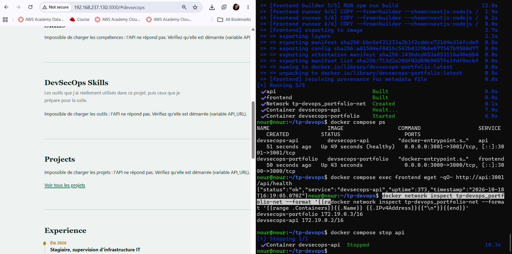

Le navigateur ne contacte jamais l'API directement : c'est le serveur Next.js (dans le conteneur `frontend`) qui l'appelle à travers le réseau Compose. L'API n'a donc pas besoin d'être exposée au navigateur, et il n'y a pas de problème d'URL ni de CORS côté client.
---
---
## 43. Playbook de déploiement du portfolio avec Docker Compose

Le playbook `vagrant/ansible/deploy-portfolio.yml` déploie automatiquement le portfolio sur une VM. Il :

1. installe `git`, Docker et le plugin Docker Compose ;
2. démarre le service Docker ;
3. crée un fichier swap de 2 Go si la VM n'en a pas (le build de Next.js consomme de la mémoire) ;
4. récupère le projet depuis GitHub dans `/opt/tp-devops` ;
5. construit les images et démarre le portfolio avec `docker compose up -d --build` ;
6. attend que le portfolio réponde sur le port 3000 et affiche l'état des conteneurs.

```yaml
---
- name: Déployer le DevSecOps Portfolio avec Docker Compose
  hosts: all
  become: true

  vars:
    repo_url: https://github.com/nourkidoudi/tp-devops.git
    repo_version: main
    app_dir: /opt/tp-devops

  tasks:
    - name: Installer git, Docker et le plugin Docker Compose
      ansible.builtin.apt:
        name:
          - git
          - docker.io
          - docker-compose-v2
        state: present
        update_cache: true
        cache_valid_time: 3600

    # ... démarrage de Docker, swap, récupération du dépôt (voir le fichier complet)

    - name: Construire les images et démarrer le portfolio
      ansible.builtin.command: docker compose up -d --build
      args:
        chdir: "{{ app_dir }}"

    - name: Attendre que le portfolio réponde sur le port 3000
      ansible.builtin.uri:
        url: http://localhost:3000
        status_code: 200
      retries: 30
      delay: 5
```

Commande utilisée depuis la VM d'administration, sur la VM cible (groupe `nouvelle_vm`) :

```bash
cd ~/ansible
ansible-playbook ~/tp-devops/vagrant/ansible/deploy-portfolio.yml --limit nouvelle_vm
```

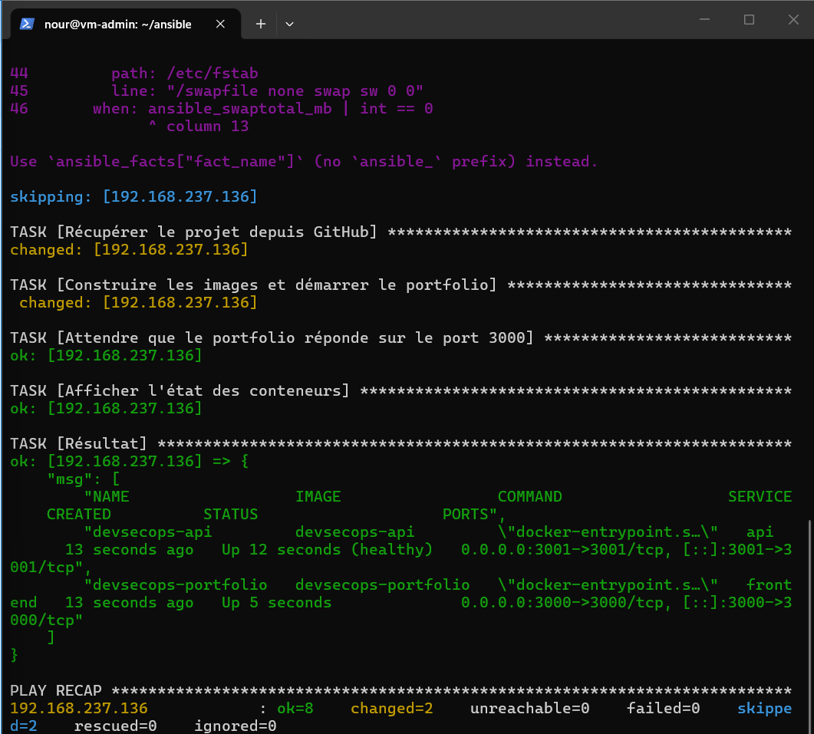

Portfolio accessible sur la VM cible (`http://192.168.237.136:3000`) :

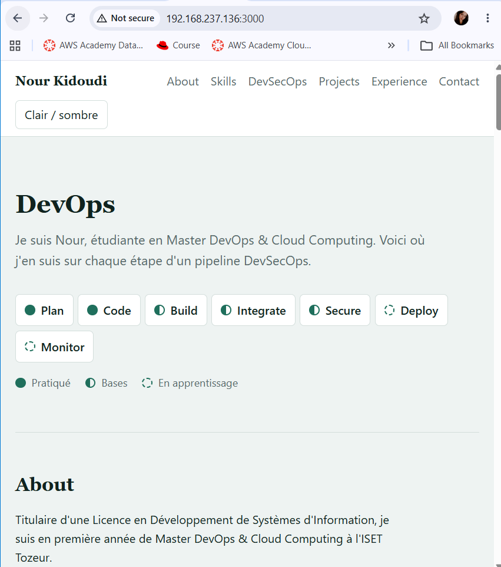

---
## 44. Vagrant lance automatiquement le playbook Ansible

Le `Vagrantfile` est modifié pour enchaîner toute la chaîne avec une seule commande :

```
vagrant up -> création VM -> configuration Ansible -> installation Docker -> déploiement Portfolio
```

Principales modifications :

```ruby
# Le dossier du projet (Vagrantfile + playbook) est copié dans la VM avec rsync
config.vm.synced_folder ".", "/vagrant", type: "rsync", rsync__exclude: [".vagrant/"]

# Le portfolio (port 3000 de la VM) est joignable depuis la machine physique
node.vm.network "forwarded_port", guest: 3000, host: 3100, host_ip: "0.0.0.0"

# Mémoire portée à 2 Go pour le build de Next.js
vb.memory = 2048

# Installe Ansible dans la VM
node.vm.provision "shell", inline: <<-SHELL
  apt-get update
  DEBIAN_FRONTEND=noninteractive apt-get install -y ansible
SHELL

# Lance le playbook Ansible dans la VM (provisionneur ansible_local)
node.vm.provision "ansible_local" do |ansible|
  ansible.playbook = "ansible/deploy-portfolio.yml"
end
```

- Le provisionneur `ansible_local` exécute Ansible **à l'intérieur de la VM** : il n'est pas nécessaire d'installer Ansible sur la machine qui lance Vagrant.
- Les images cloud Ubuntu n'ont pas les Guest Additions de VirtualBox, donc le dossier du projet est copié avec `rsync` plutôt qu'avec le dossier partagé par défaut.

Commande lancée depuis le dossier `vagrant/` :

```bash
vagrant up
```

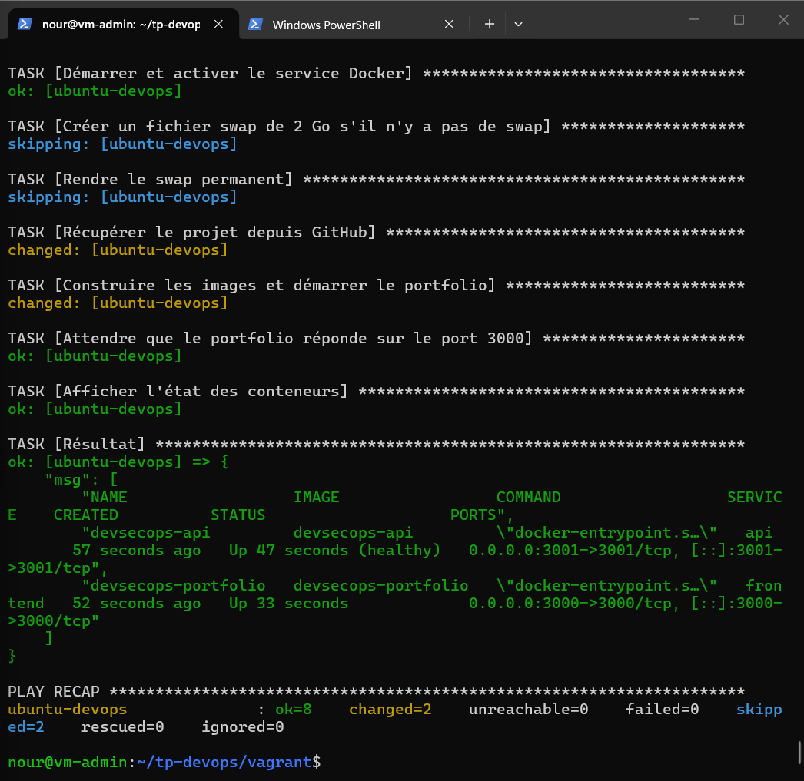

Portfolio accessible depuis la machine physique sur `http://IP_VM_HOTE:3100` :

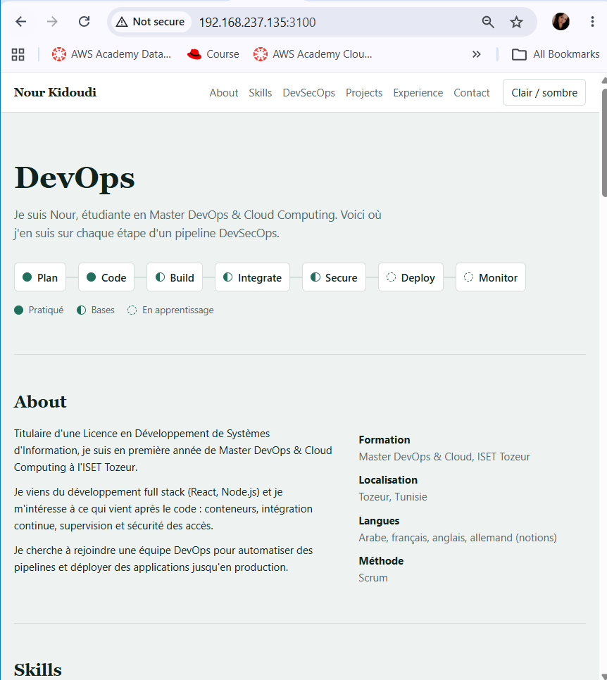

---
## 45. Test : destruction et recréation complète de la VM

La VM est détruite complètement, puis recréée :

```bash
vagrant destroy -f
vagrant up
```

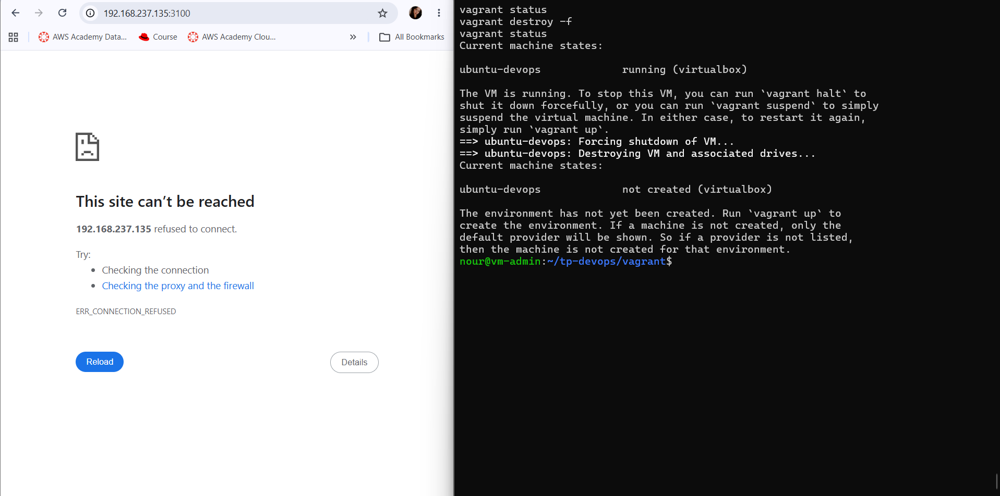

Après `vagrant up`, la VM est recréée à partir de zéro, Docker est réinstallé et le portfolio est redéployé **sans aucune intervention manuelle** :

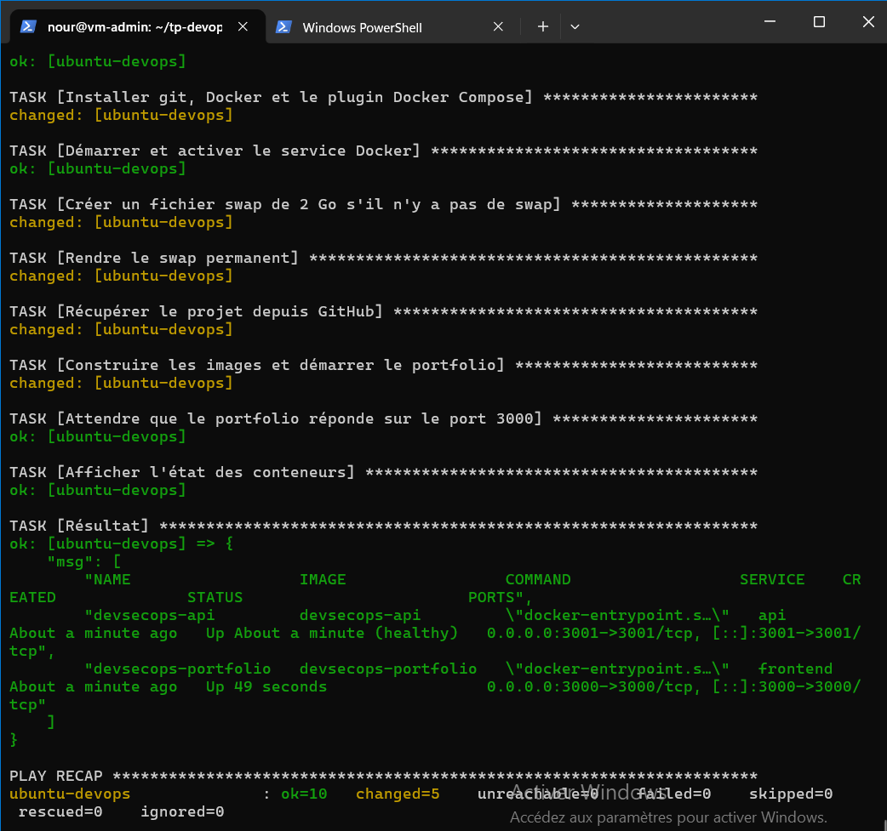

Le portfolio est de nouveau accessible :

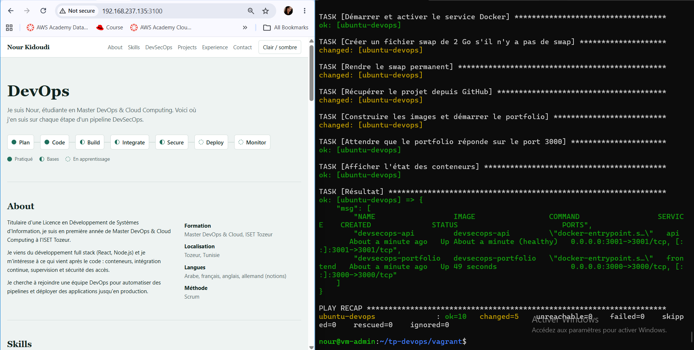

**Conclusion :** toute l'infrastructure est décrite dans du code (Vagrantfile et playbook Ansible). Elle peut être détruite et reconstruite à l'identique avec une seule commande, ce qui la rend reproductible.**Dépôt :** https://github.com/nourkidoudi/tp-devops
