# TP DevOps – Nour Kidoudi

Mise en place d'une VM Ubuntu Server 26.04 avec accès SSH sécurisé, Docker et Jenkins, puis création d'un mini CV versionné sur GitHub et push via SSH.

**Environnement :** VMware, Ubuntu Server 26.04 LTS (resolute), réseau NAT `192.168.237.0/24`, VM en `192.168.237.130`, machine physique sous Windows (PowerShell).

---

## 1. Installation d'Ubuntu Server 26.04 et accès SSH sécurisé

Installation d'Ubuntu Server 26.04 avec l'option **Install OpenSSH server** cochée. Vérification du service et de l'IP :

```bash
sudo systemctl status ssh
ip a
```

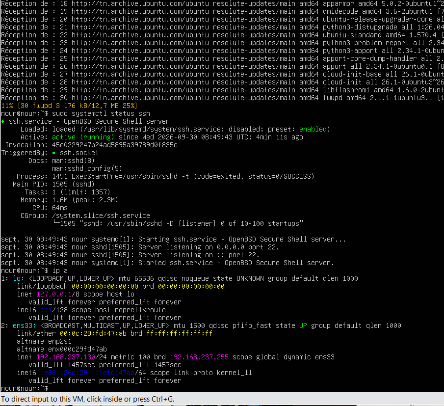

Génération d'une clé Ed25519 sur la machine physique et copie vers la VM :

```powershell
ssh-keygen -t ed25519 -C "nour-vm"
type $env:USERPROFILE\.ssh\id_ed25519.pub | ssh nour@192.168.237.130 "mkdir -p ~/.ssh && chmod 700 ~/.ssh && cat >> ~/.ssh/authorized_keys && chmod 600 ~/.ssh/authorized_keys"
```

Un avertissement `REMOTE HOST IDENTIFICATION HAS CHANGED` est apparu, car l'IP avait été utilisée par une ancienne VM. Correction :

```powershell
ssh-keygen -R 192.168.237.130
```

Durcissement de SSH, dans `/etc/ssh/sshd_config.d/99-hardening.conf` :

```
PermitRootLogin no
PasswordAuthentication no
PubkeyAuthentication yes
MaxAuthTries 3
```

```bash
sudo sshd -t && sudo systemctl restart ssh
sudo ufw allow OpenSSH
sudo ufw allow 8080/tcp
sudo ufw enable
sudo ufw status
```

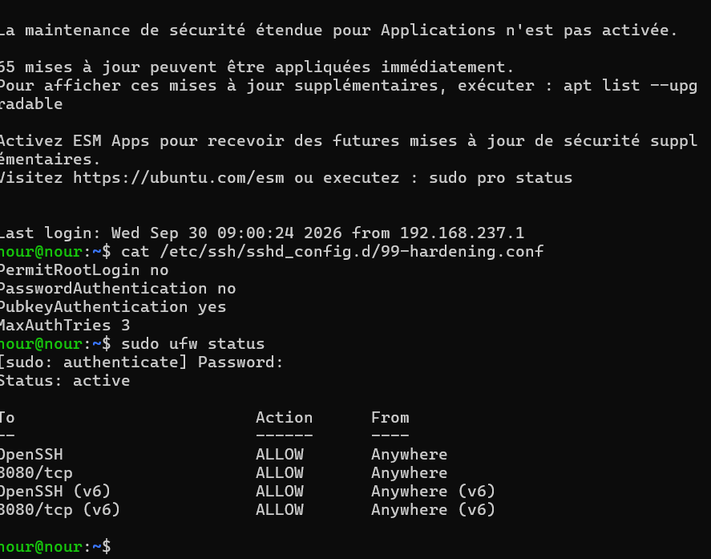

---

## 2. Test de l'accès SSH depuis la machine physique

```powershell
ssh nour@192.168.237.130
hostname && lsb_release -a
```

Connexion réussie par clé, sans mot de passe.

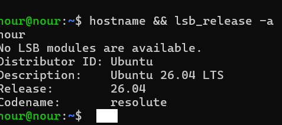

---

## 3. Installation de Docker sur la VM

```bash
sudo apt update && sudo apt upgrade -y
sudo apt install -y docker.io
sudo systemctl enable --now docker
sudo usermod -aG docker $USER && newgrp docker
docker --version
docker run hello-world
sudo systemctl status docker
```

> Docker est installé depuis les dépôts Ubuntu (paquet `docker.io`, version 29.1.3).

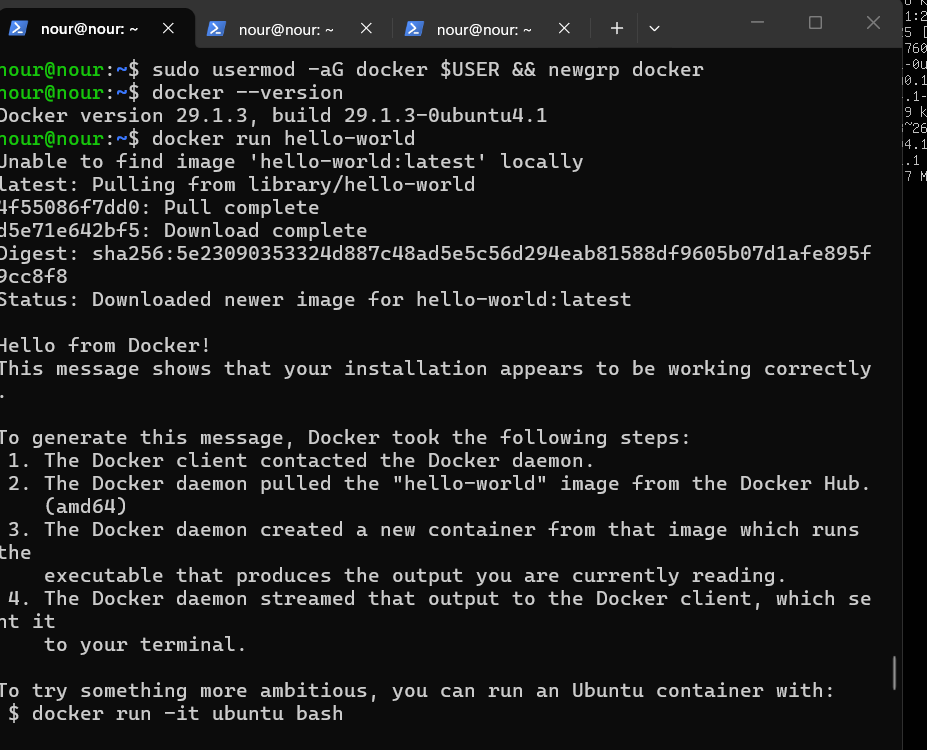
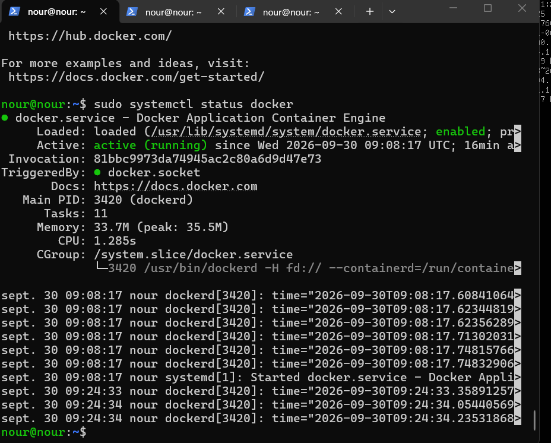

---

## 4. Installation de Jenkins en tant que service

```bash
sudo apt install -y fontconfig openjdk-21-jre
java -version

sudo wget -O /etc/apt/keyrings/jenkins-keyring.asc https://pkg.jenkins.io/debian-stable/jenkins.io-2026.key
echo "deb [signed-by=/etc/apt/keyrings/jenkins-keyring.asc] https://pkg.jenkins.io/debian-stable binary/" | sudo tee /etc/apt/sources.list.d/jenkins.list > /dev/null
sudo apt update
sudo apt install -y jenkins
sudo systemctl enable --now jenkins
sudo systemctl status jenkins
sudo cat /var/lib/jenkins/secrets/initialAdminPassword
```

> Problème rencontré : avec l'ancienne clé `jenkins.io-2023.key`, `apt update` renvoyait `NO_PUBKEY 7198F4B714ABFC68`, car Jenkins a changé sa clé de signature. Utiliser `jenkins.io-2026.key` a résolu le problème.

Vérification depuis la machine physique : `http://192.168.237.130:8080`, avec installation des plugins suggérés et création de l'utilisateur admin.

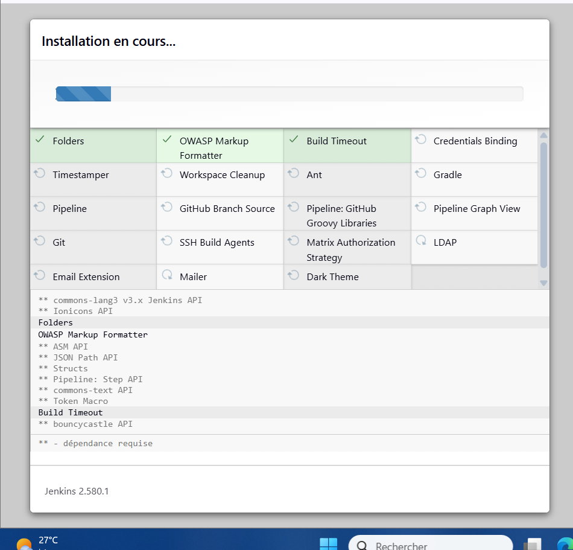
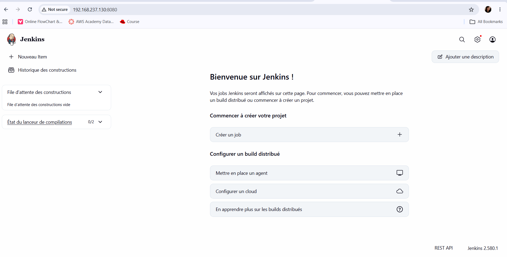

---

## 5. Mini CV One Page (HTML5 / CSS3 / JavaScript)

Le CV est dans le dossier [`cv/`](cv/) (`index.html`, `style.css`, `script.js`). Il propose un mode sombre mémorisé et un bouton d'impression / export PDF.

```powershell
mkdir tp-devops; cd tp-devops
git init -b main
git add .
git commit -m "Ajout du mini CV one page"
```

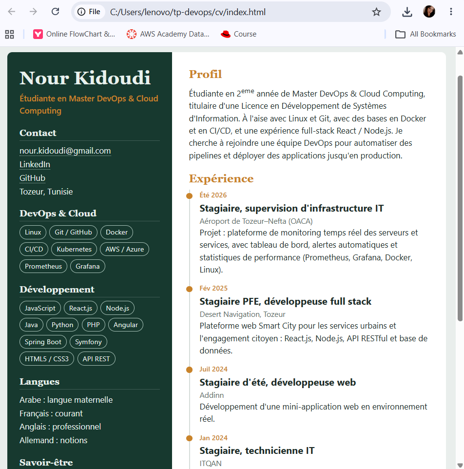

---

## 6. Push GitHub via SSH

Affichage de la clé publique, ajoutée sur GitHub (*Settings → SSH and GPG keys → New SSH key*) :

```powershell
type $env:USERPROFILE\.ssh\id_ed25519.pub
```

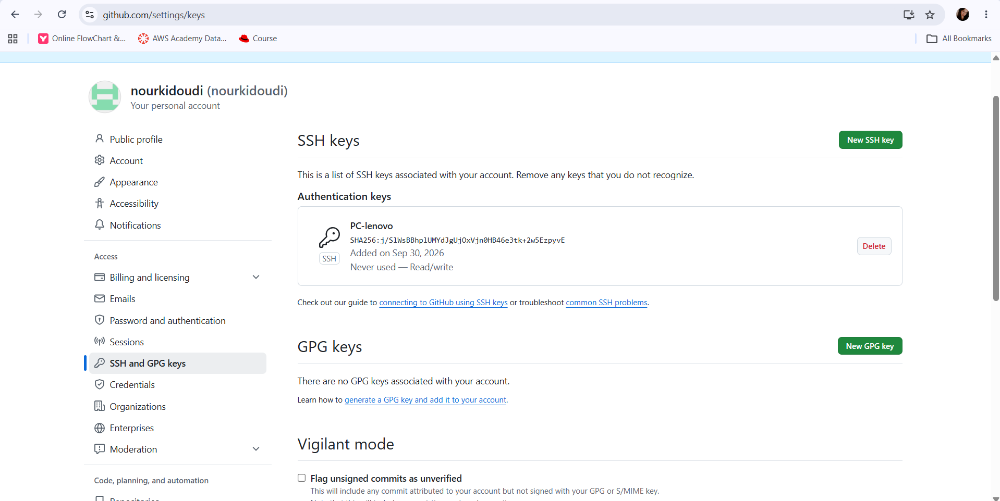

Test de l'authentification :

```powershell
ssh -T git@github.com
```

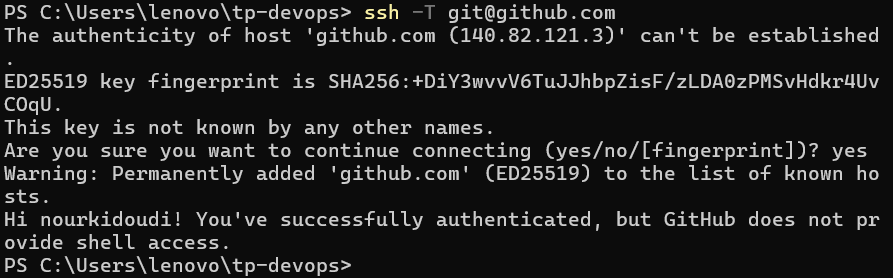

Configuration du dépôt local pour utiliser SSH et push :

```powershell
git remote add origin git@github.com:nourkidoudi/tp-devops.git
git remote -v
git push -u origin main
```

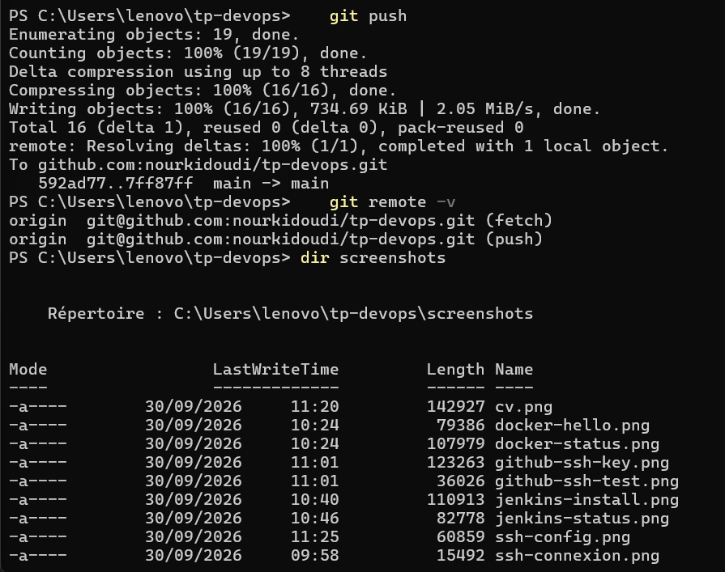

---

## 7. Évolution : application « DevSecOps Portfolio »

Le mini CV devient une petite application web dans le dossier [`portfolio/`](portfolio/) (`index.html`, `style.css`, `script.js`, `Dockerfile`). L'ancienne version reste dans [`cv/`](cv/).

**Sections :** About, Skills, Projects, Experience, Contact.


### Principales améliorations

- **Skills présentées comme un pipeline DevSecOps** (Plan, Code, Build, Integrate, Secure, Deploy, Monitor), chaque étape avec son niveau réel : pratiqué, bases ou en apprentissage.
- **Application pilotée par les données** : projets, compétences et expériences sont des tableaux dans `script.js`, la page est générée dynamiquement.
- **Projets filtrables** par catégorie (DevSecOps, Web, Monitoring).
- **Navigation** avec menu fixe et section active mise en évidence.
- **Formulaire de contact** avec validation, qui ouvre le client mail (aucun serveur ni service tiers).
- **Mode sombre** qui suit la préférence du système et mémorise le choix, page responsive et accessible (focus visible, mouvement réduit respecté).
- **Sécurité de la page** : politique CSP stricte (aucun script ni style externe), affichage des données avec `textContent` et non `innerHTML`, liens externes en `rel="noopener noreferrer"`.
- **Conteneurisation** : `Dockerfile` basé sur nginx sans droits root.

### Lancer le portfolio

En local : ouvrir `portfolio/index.html` dans le navigateur.

Dans un conteneur, sur la VM :

```bash
cd portfolio
docker build -t portfolio .
docker run -d --name portfolio -p 8081:8080 portfolio
```
Puis ouvrir `http://192.168.237.130:8081` depuis la machine physique (autoriser le port avec `sudo ufw allow 8081/tcp`).


## 8. Section « DevSecOps Skills »

Une section **DevSecOps Skills** est ajoutée au portfolio ([`portfolio/`](portfolio/)). Elle affiche les 7 technologies demandées :

- **Utilisés dans ce projet :** Git, Docker, Jenkins, avec pour chacun l'usage réel (dépôt GitHub en SSH, conteneurs sur la VM, Jenkins installé comme service).
- **Prochaines étapes :** Kubernetes, Ansible, Terraform, Argo CD, affichés comme « à découvrir » avec leur rôle (orchestration, configuration as code, infrastructure as code, GitOps).

Chaque carte indique le rôle de l'outil et un niveau (pratiqué, bases ou à découvrir), ce qui reste fidèle à ce qui a été réalisé.

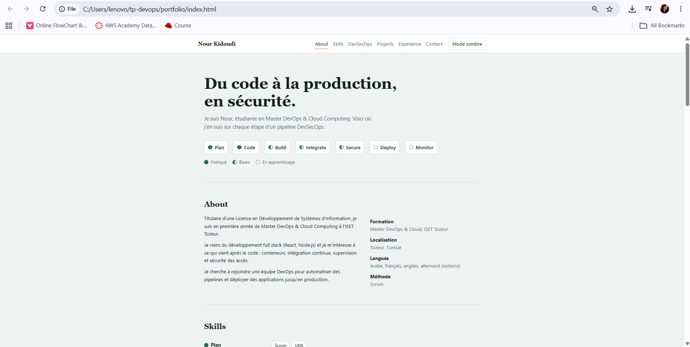

## 9. Section « Projects » générée dynamiquement en JavaScript

Les projets ne sont pas écrits en HTML : ils sont décrits dans un **tableau d'objets** (`PROJECTS` dans [`portfolio/script.js`](portfolio/script.js)), et la page est construite à partir de ce tableau. Pour ajouter un projet, il suffit d'ajouter un objet, sans toucher au HTML.

```javascript
const PROJECTS = [
  { cat: 'DevSecOps', title: 'VM DevSecOps sécurisée',
    text: 'Ubuntu Server 26.04, accès SSH par clé, pare-feu, Docker et Jenkins en service.',
    tags: ['Linux', 'SSH', 'Docker', 'Jenkins'],
    link: 'https://github.com/nourkidoudi/tp-devops' },
  { cat: 'Web', title: 'Smart City Web Platform',
    text: 'Plateforme pour les services urbains et l\'engagement citoyen.',
    tags: ['React.js', 'Node.js', 'API REST'] },
  // ...
];

function renderProjects(filter) {
  const ul = document.getElementById('project-list');
  ul.replaceChildren();
  PROJECTS.filter(p => filter === 'Tous' || p.cat === filter).forEach(p => {
    const li = el('li');
    li.dataset.cat = p.cat;
    li.appendChild(el('h3', '', p.title));
    li.appendChild(el('p', 'cat', p.cat));
    li.appendChild(el('p', '', p.text));
    li.appendChild(tagList(p.tags));
    ul.appendChild(li);
  });
}
```

Le code fait trois choses :
- `PROJECTS.filter(...)` sélectionne les projets selon la catégorie choisie ;
- `forEach` crée un bloc de page par objet (titre, catégorie, description, technologies, lien) ;
- les boutons de filtre (Tous, DevSecOps, Web, Monitoring) sont eux aussi générés à partir du tableau et appellent `renderProjects`.

Le texte est inséré avec `textContent` (fonction `el`), jamais avec `innerHTML`, ce qui évite l'injection de code.

**Résultat :**

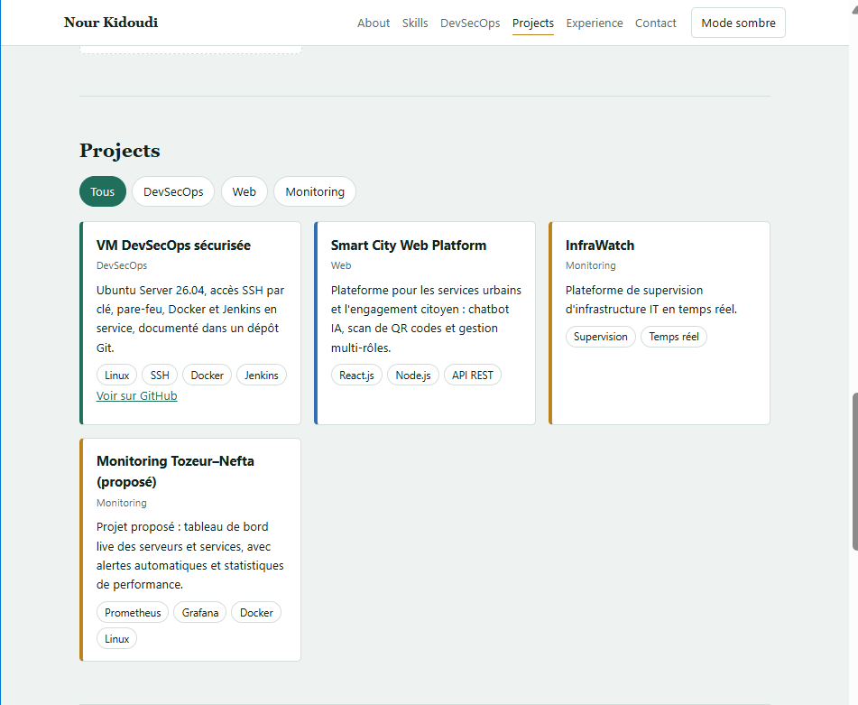

---
---
## 10. Dockerisation initiale

Le portfolio est servi par **Nginx** dans un conteneur grâce au fichier [`portfolio/Dockerfile`](portfolio/Dockerfile) :

```dockerfile
# Image Nginx qui s'exécute sans droits root (écoute sur le port 8080)
FROM nginxinc/nginx-unprivileged:alpine

# Copie des fichiers statiques du portfolio dans le dossier servi par Nginx
COPY index.html style.css script.js /usr/share/nginx/html/

# Port d'écoute du conteneur
EXPOSE 8080
```

**Explication :**
- `FROM nginxinc/nginx-unprivileged:alpine` : image officielle de Nginx, légère (Alpine) et exécutée sans droits root, ce qui limite les risques.
- `COPY ...` : le portfolio est un site statique, il suffit de copier ses trois fichiers dans le dossier que Nginx sert par défaut.
- `EXPOSE 8080` : cette image écoute sur le port 8080 (sans droits root, le port 80 n'est pas utilisable).

---
## 11. Construction de l'image Docker `cv-docker`

Commande utilisée sur la VM, dans le dossier `portfolio/` qui contient le Dockerfile :

```bash
docker build -t cv-docker .
```

- `docker build` construit une image à partir du Dockerfile ;
- `-t cv-docker` donne le nom `cv-docker` à l'image ;
- `.` indique que le Dockerfile se trouve dans le dossier courant.

Vérification avec `docker images cv-docker` :

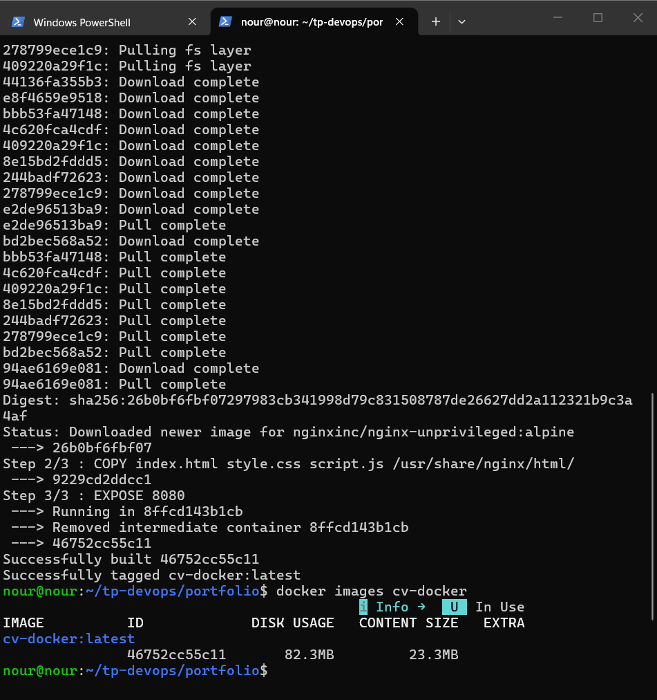

---
## 12. Exécution du conteneur et accès depuis la machine physique

Commande utilisée sur la VM :

```bash
docker run -d --name cv-docker -p 8081:8080 cv-docker
```

- `-d` : exécution en arrière-plan ;
- `--name cv-docker` : nom du conteneur ;
- `-p 8081:8080` : le port 8081 de la VM est redirigé vers le port 8080 du conteneur (Nginx) ;
- `cv-docker` : image construite à l'étape 11.

Le port est ouvert dans le pare-feu avec `sudo ufw allow 8081/tcp`.

Résultat de `docker ps` :

```
COLLER ICI LA SORTIE RÉELLE DE docker ps
```

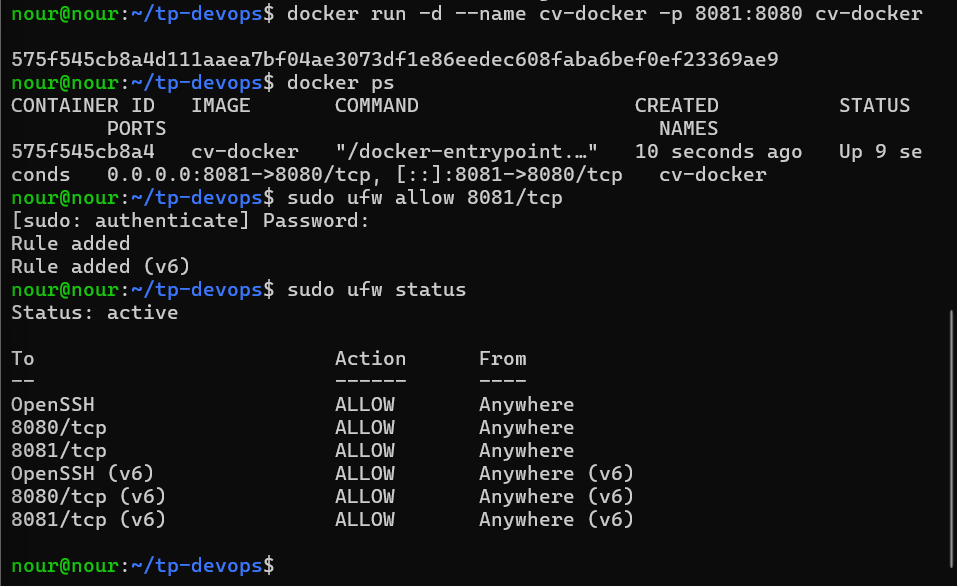

Accès depuis la machine physique sur `http://192.168.237.130:8081` :

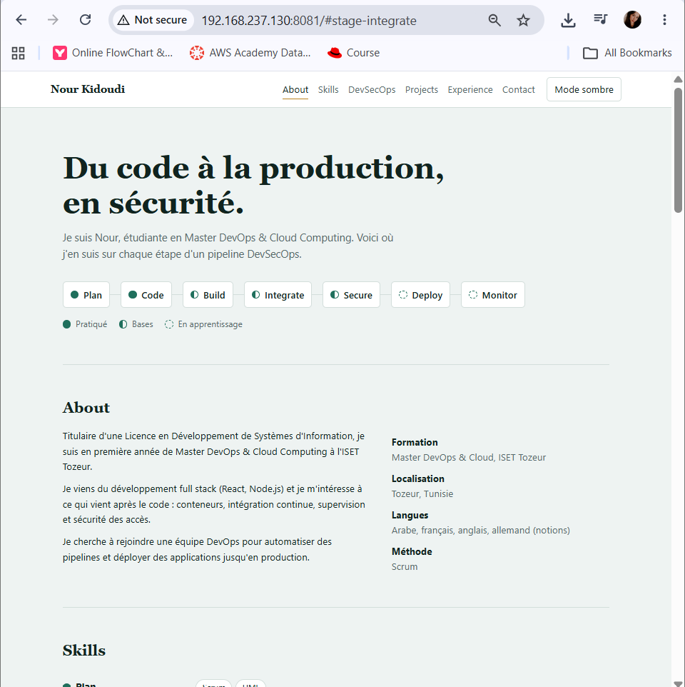

---
## 13. Déploiement avec Docker Compose

Le fichier [`portfolio/docker-compose.yml`](portfolio/docker-compose.yml) décrit le service :

```yaml
services:
  portfolio:
    build: .
    image: cv-docker
    container_name: portfolio
    ports:
      - "8081:8080"
    restart: unless-stopped
    security_opt:
      - no-new-privileges:true
```

- `build: .` construit l'image à partir du Dockerfile du dossier ;
- `image: cv-docker` nomme l'image ;
- `ports: "8081:8080"` expose le portfolio sur le port 8081 de la VM ;
- `restart: unless-stopped` relance le conteneur après un redémarrage de la VM ;
- `no-new-privileges` empêche le processus du conteneur d'obtenir de nouveaux droits.

Commande utilisée sur la VM, dans le dossier `portfolio/` :

```bash
docker compose up -d
```

Résultat de `docker compose ps` :

```
COLLER ICI LA SORTIE RÉELLE DE docker compose ps
```

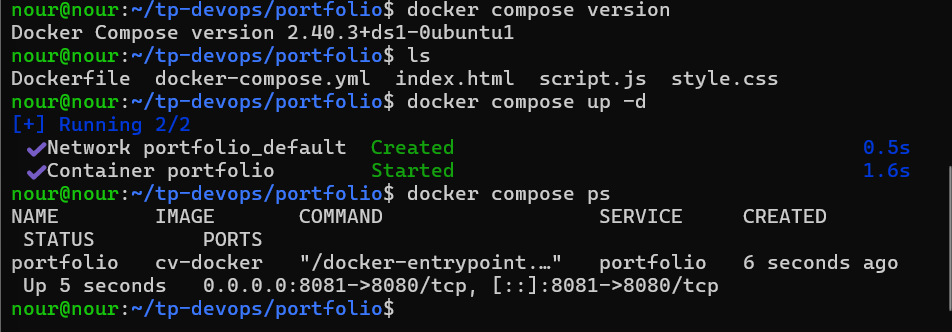

Accès depuis la machine physique sur `http://192.168.237.130:8081` :

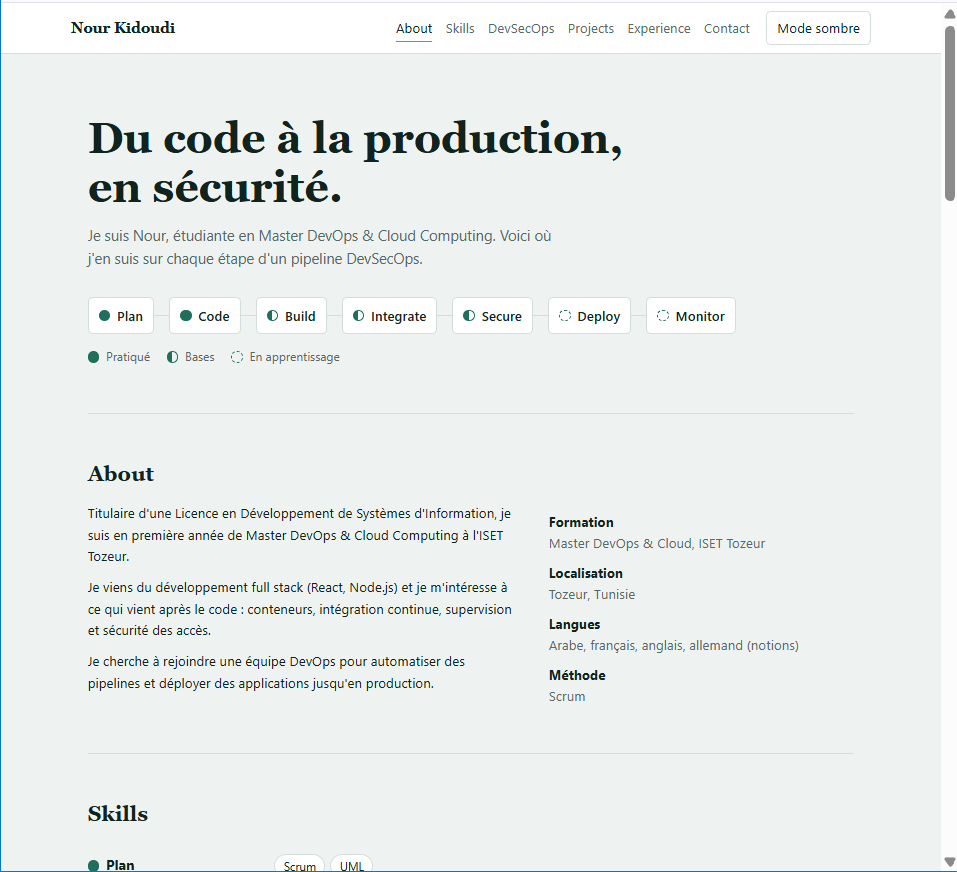

---
## 14. Publication sur GitHub via SSH

Le dépôt est relié à GitHub par SSH (clé `PC-lenovo`, voir l'étape 6). Commandes Git utilisées pour publier les modifications :

```bash
git remote -v                # vérifie que l'origine utilise SSH (git@github.com:...)
ssh -T git@github.com        # teste l'authentification SSH
git status                   # liste les fichiers modifiés
git add -A                   # ajoute les modifications à l'index
git commit -m "Message"      # enregistre les modifications
git push                     # publie sur GitHub via SSH
git log --oneline            # affiche l'historique des commits
```

Dépôt GitHub mis à jour : **https://github.com/nourkidoudi/tp-devops**

---
## 17. Configuration automatique de la VM

Le `Vagrantfile` configure le nom de la VM, l'adresse IP privée, la mémoire et le nombre de CPU :

```ruby
Vagrant.configure("2") do |config|
  config.vm.box = "cloud-image/ubuntu-24.04"
  # La virtualisation imbriquée ralentit le démarrage : on augmente le délai d'attente
  config.vm.boot_timeout = 1200

  # Nom de la VM dans Vagrant (vagrant status) et nom d'hôte
  config.vm.define "ubuntu-devops" do |node|
    node.vm.hostname = "ubuntu-devops"

    # Adresse IP privée (réseau host-only)
    node.vm.network "private_network", ip: "192.168.56.10"

    node.vm.provider "virtualbox" do |vb|
      vb.name   = "ubuntu-devops"   # nom de la VM dans VirtualBox
      vb.memory = 1536              # mémoire en Mo
      vb.cpus   = 2                 # nombre de CPU
      # IO-APIC nécessaire pour que le système invité utilise plusieurs CPU
      vb.customize ["modifyvm", :id, "--ioapic", "on"]
      # Désactive la console série, qui ralentit fortement le démarrage des images cloud Ubuntu
      vb.customize ["modifyvm", :id, "--uartmode1", "disconnected"]
    end

    node.vm.provision "shell", inline: <<-SHELL
      echo "VM créée automatiquement par Vagrant" > /home/vagrant/bienvenue.txt
    SHELL
  end
end
```

| Paramètre | Directive | Valeur |
|---|---|---|
| Nom de la VM | `config.vm.define`, `vb.name` | `ubuntu-devops` |
| Adresse IP privée | `private_network` | `192.168.56.10` |
| Mémoire | `vb.memory` | 1536 Mo |
| Nombre de CPU | `vb.cpus` | 2 |

Remarque : sans l'IO-APIC, l'invité ne voyait qu'un seul CPU malgré `vb.cpus = 2`. L'ajout de `--ioapic on` a corrigé ce point.

Résultat de `vagrant status` :

```
COLLER ICI LA SORTIE RÉELLE DE vagrant status
```

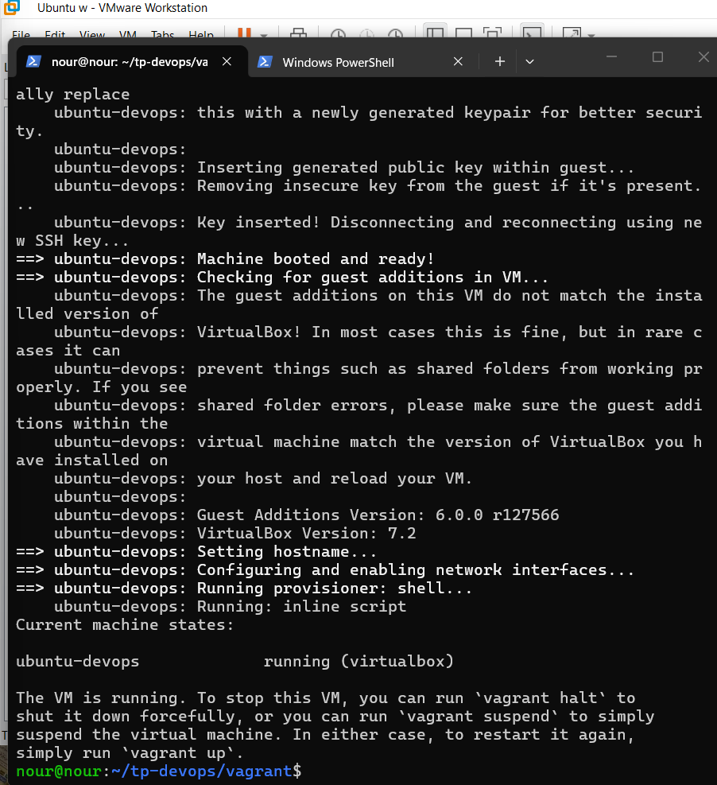

Vérification dans la VM (nom d'hôte, interface `192.168.56.10`, mémoire, 2 CPU) :

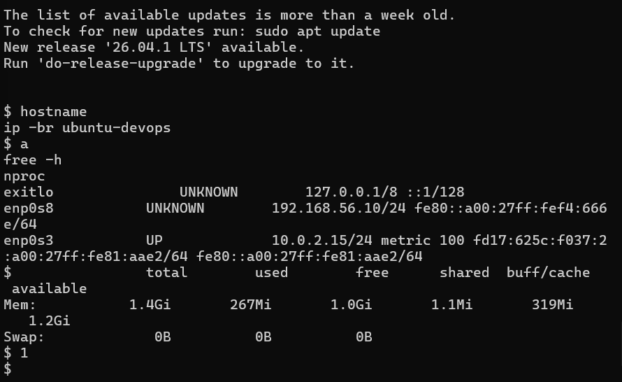

---
## 18. Migration du portfolio vers Next.js

Commande de création du projet :

```bash
npx create-next-app@latest portfolio-next
```

Next.js 16 avec le routeur App Router et TypeScript. Les mêmes sections que la version HTML/CSS/JavaScript sont conservées : About, Skills, DevSecOps Skills, Projects, Experience et Contact. Lancement : `npm run dev`, puis `http://localhost:3000`.

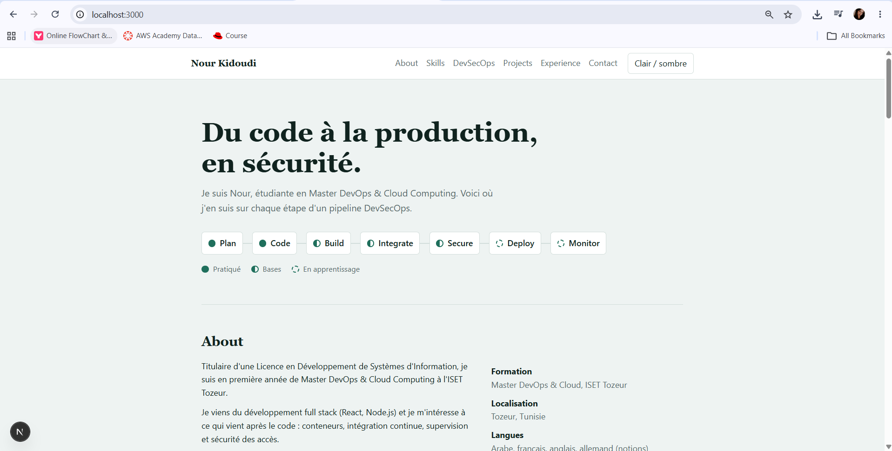

---

## 19. Composants réutilisables

```
portfolio-next/
├── app/
│   ├── layout.tsx          # Header + Footer autour de chaque page
│   ├── page.tsx            # page d'accueil : assemble les sections
│   ├── globals.css
│   └── projects/
│       ├── page.tsx        # /projects
│       └── [slug]/page.tsx # /projects/nom-du-projet
├── components/
│   ├── Header.tsx  ThemeToggle.tsx  Footer.tsx
│   ├── Hero.tsx  About.tsx  Skills.tsx  Tools.tsx
│   ├── Projects.tsx  ProjectList.tsx
│   ├── Experience.tsx
│   └── Contact.tsx  ContactForm.tsx
└── data/
    ├── types.ts  stages.ts  tools.ts
    └── projects.ts  experience.ts
```

La page d'accueil assemble les composants :

```tsx
export default function Home() {
  return (
    <>
      <Hero />
      <About />
      <Skills />
      <Tools />
      <Projects />
      <Experience />
      <Contact />
    </>
  );
}
```

---

## 20. Données séparées des composants

Les projets, compétences et expériences sont dans le dossier `data/`, typés avec TypeScript. Exemple extrait de `data/projects.ts` :

```ts
export const projects: Project[] = [
  {
    slug: "smart-city-web-platform",
    category: "Web",
    title: "Smart City Web Platform",
    status: "Projet de fin d'études",
    summary: "Plateforme pour les services urbains et l'engagement citoyen.",
    tags: ["React.js", "Node.js", "API REST"],
    // ...
  },
];
```

Les composants lisent ces données avec `projects.map(...)` : pour ajouter un projet, il suffit d'ajouter un objet.

---

## 21. Pages dédiées aux projets

- `/projects` affiche la liste de tous les projets, avec filtre par catégorie ;
- `/projects/nom-du-projet` affiche le détail d'un projet (route dynamique `app/projects/[slug]/page.tsx`).

Un projet inconnu renvoie une page 404 grâce à `notFound()`.

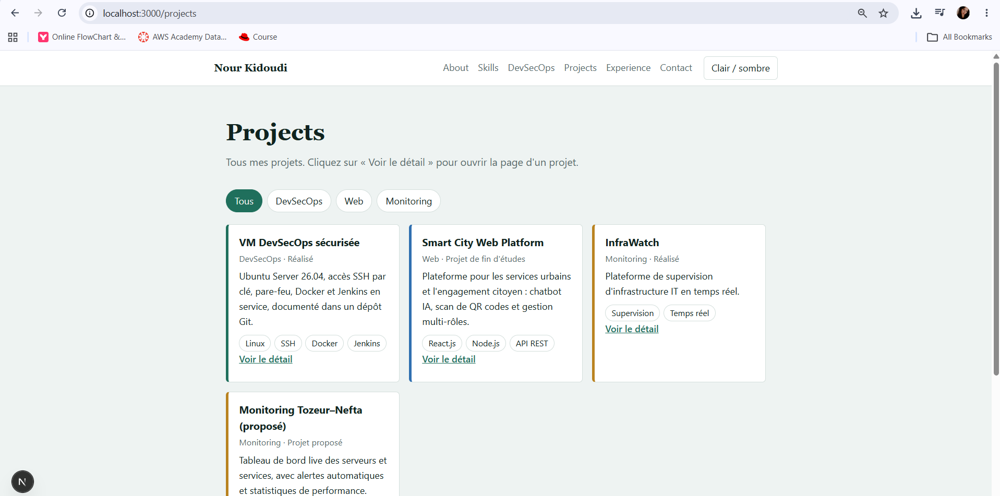
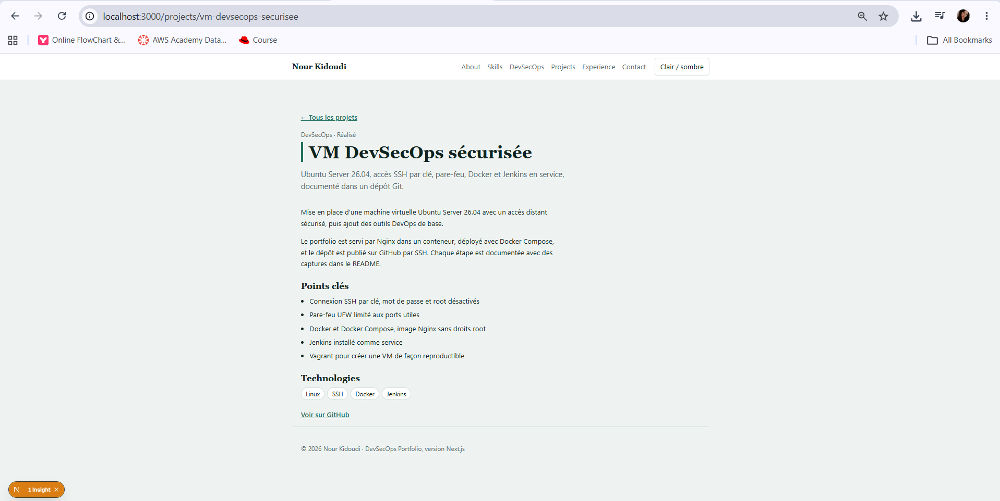

---
## 22. Premier pipeline Jenkins : récupération du dépôt GitHub

Un job Jenkins de type Pipeline (`portfolio-pipeline`) utilise l'option **Pipeline script from SCM** : Jenkins récupère le dépôt `https://github.com/nourkidoudi/tp-devops.git` (branche `main`), puis lit le fichier [`Jenkinsfile`](Jenkinsfile) situé à la racine.

```groovy
// Pipeline Jenkins du DevSecOps Portfolio
pipeline {
    agent any

    options {
        // Le checkout est fait explicitement dans le premier stage
        skipDefaultCheckout(true)
    }

    stages {
        // Étape 22 : récupération automatique du dépôt GitHub
        stage('Checkout') {
            steps {
                checkout scm
                sh 'git log -1 --oneline'
                sh 'ls -la'
            }
        }
    }

    post {
        success {
            echo 'Dépôt récupéré avec succès.'
        }
        failure {
            echo 'Le pipeline a échoué : consulter la console.'
        }
    }
}
```

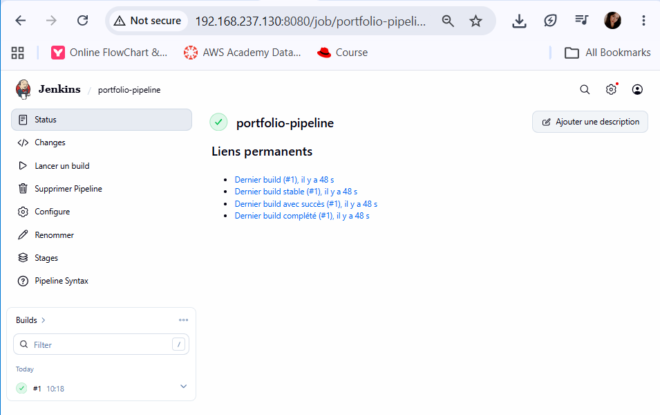

---

## 23. Installation des dépendances du projet Next.js

Node.js 22 est installé sur la VM Jenkins (dépôt NodeSource). Le stage suivant est ajouté au `Jenkinsfile` :

```groovy
        // Étape 23 : installation des dépendances du projet Next.js
        stage('Install dependencies') {
            steps {
                dir('portfolio-next') {
                    sh 'node --version'
                    sh 'npm --version'
                    sh 'npm ci --no-audit --no-fund'
                }
            }
        }
```

`npm ci` installe exactement les versions du fichier `package-lock.json`, ce qui rend le build reproductible.

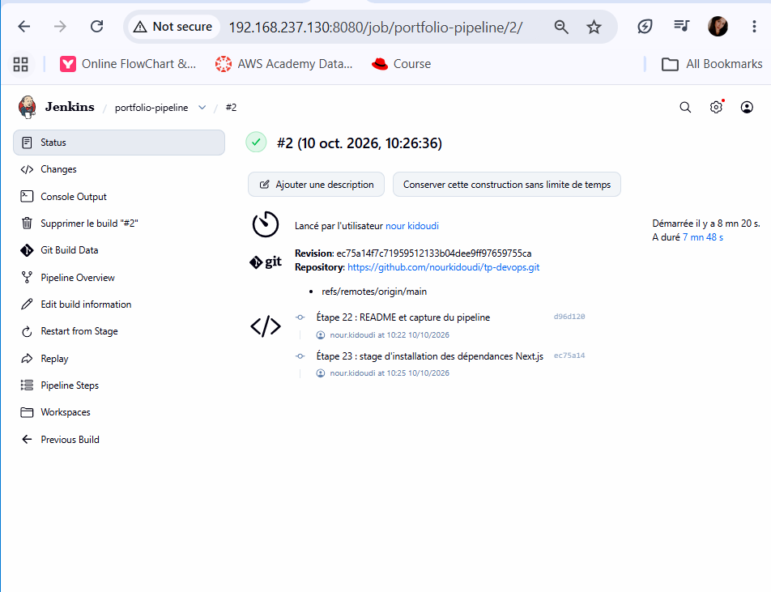
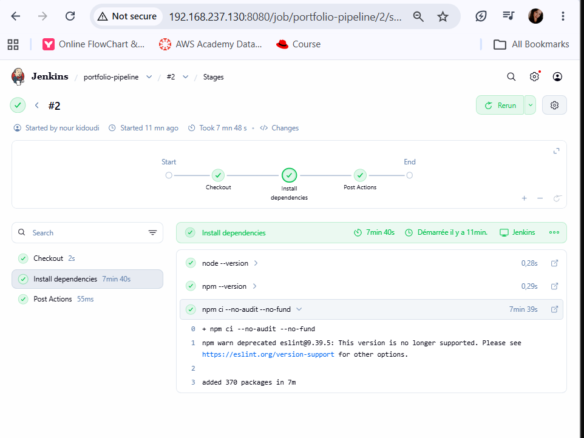

---
## 24. Construction automatique de l'application Next.js

Un stage `Build` est ajouté au `Jenkinsfile` : il exécute `npm run build` dans le dossier `portfolio-next` et produit la version de production du portfolio.

```groovy
        // Étape 24 : construction de l'application Next.js
        stage('Build') {
            steps {
                dir('portfolio-next') {
                    sh 'npm run build'
                }
            }
        }
```

Le pipeline complet enchaîne trois stages : `Checkout`, `Install dependencies` et `Build`.

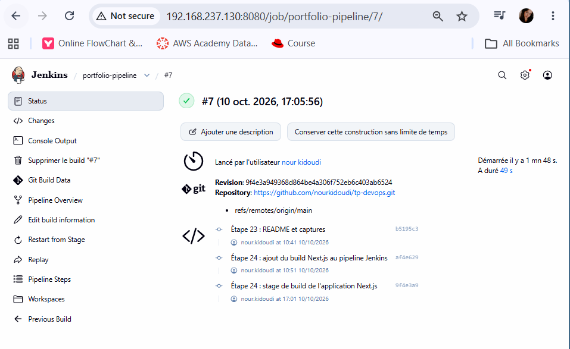

Résultat du build :

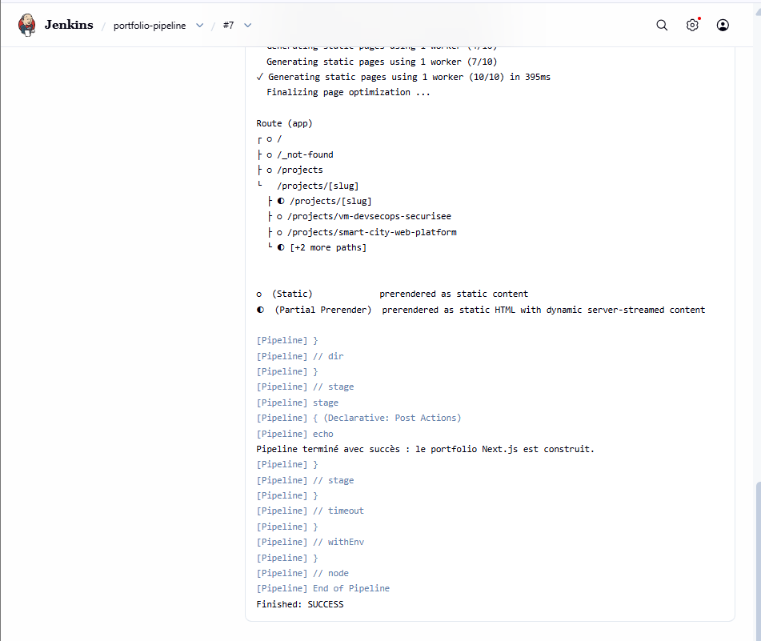

---
## 25. Installation d'Ansible sur une VM d'administration

Ansible est installé sur une VM dédiée à l'administration (`vm-admin`), distincte du serveur géré.

```bash
sudo apt update
sudo apt install -y ansible
ansible --version
```

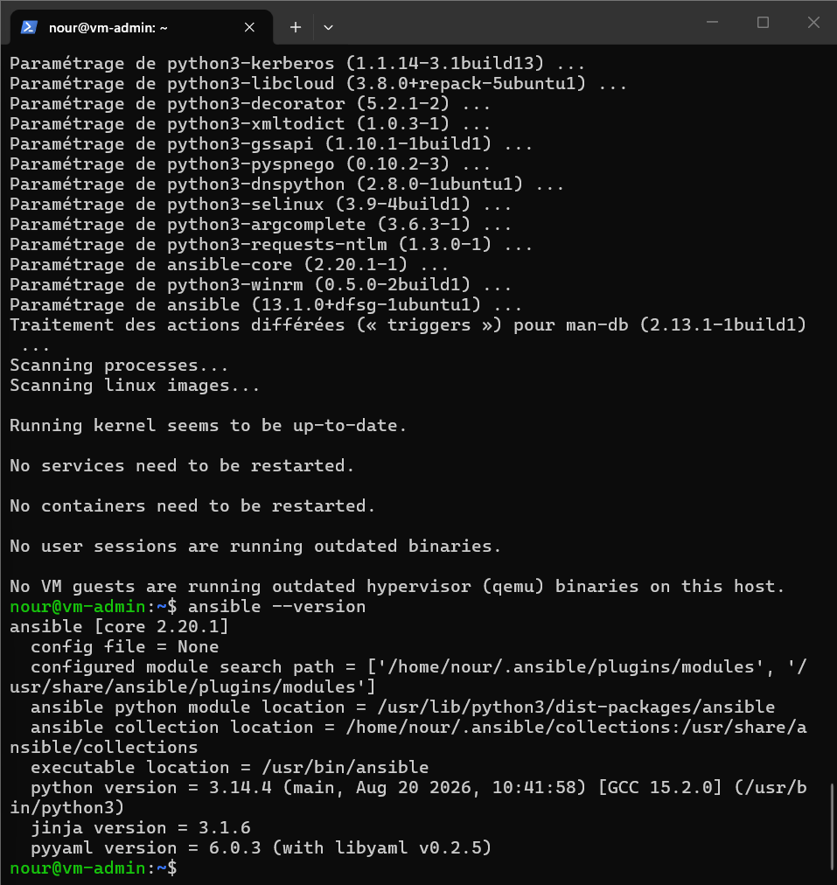

---
## 26. Inventory et test de communication

La VM d'administration se connecte au serveur Ubuntu par clé SSH (mot de passe désactivé). La clé publique de `vm-admin` a été ajoutée dans `~/.ssh/authorized_keys` du serveur.

Fichier `inventory.ini` :

```ini
[serveurs]
192.168.237.135 ansible_user=nour
```

Fichier `ansible.cfg` :

```ini
[defaults]
inventory = ./inventory.ini
host_key_checking = False
```

Test de communication :

```bash
ansible all -m ping
```

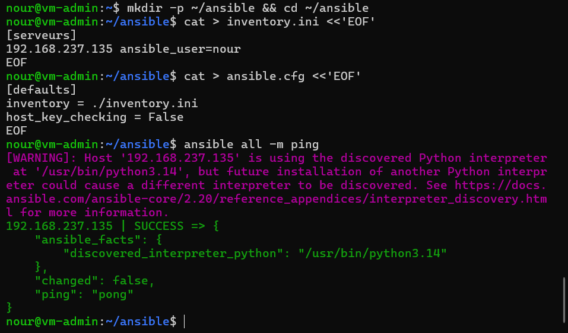
---
## 28. Installation automatique de Docker avec Ansible

Une nouvelle VM (`vm-cible`, sans Docker) est ajoutée à l'inventory dans le groupe `nouvelle_vm` :

```ini
[serveurs]
192.168.237.135 ansible_user=nour

[nouvelle_vm]
192.168.237.136 ansible_user=nour
```

Playbook `install-docker.yml` :

```yaml
---
- name: Installer Docker sur une nouvelle VM
  hosts: nouvelle_vm
  become: true

  tasks:
    - name: Mettre à jour le cache apt
      ansible.builtin.apt:
        update_cache: true
        cache_valid_time: 3600

    - name: Installer Docker
      ansible.builtin.apt:
        name: docker.io
        state: present

    - name: Démarrer et activer le service Docker
      ansible.builtin.service:
        name: docker
        state: started
        enabled: true

    - name: Ajouter l'utilisateur au groupe docker
      ansible.builtin.user:
        name: "{{ ansible_user }}"
        groups: docker
        append: true

    - name: Vérifier la version de Docker
      ansible.builtin.command: docker --version
      register: docker_version
      changed_when: false

    - name: Afficher la version
      ansible.builtin.debug:
        msg: "{{ docker_version.stdout }}"
```

Exécution et vérification :

```bash
ansible-playbook install-docker.yml
ansible nouvelle_vm -a "docker --version"
```

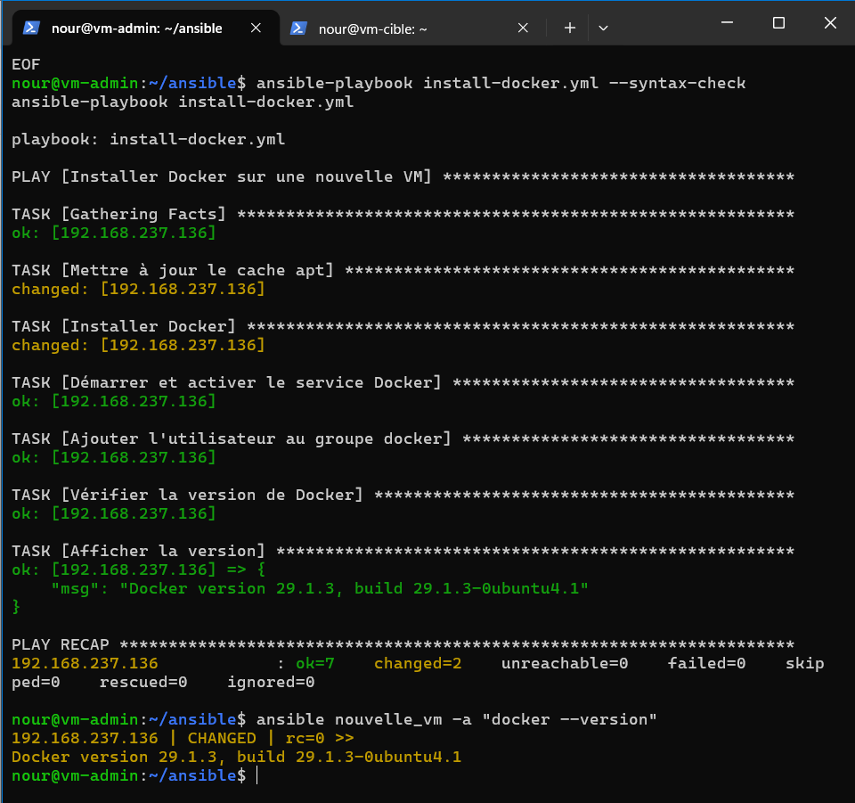
---
## 29. Création de l'API Node.js / Express

Un dossier `api/` contient une application Node.js / Express qui se lance **indépendamment du frontend**.

Structure du projet :

```
tp-devops/
├── api/
│   ├── package.json
│   ├── package-lock.json
│   ├── server.js
│   └── data/
│       ├── profile.js
│       ├── projects.js
│       ├── stages.js
│       ├── tools.js
│       └── experience.js
└── portfolio-next/
```

Installation et démarrage :

```bash
cd api
npm install
npm start
```

L'API écoute sur le port `3001` (modifiable avec la variable `PORT`).

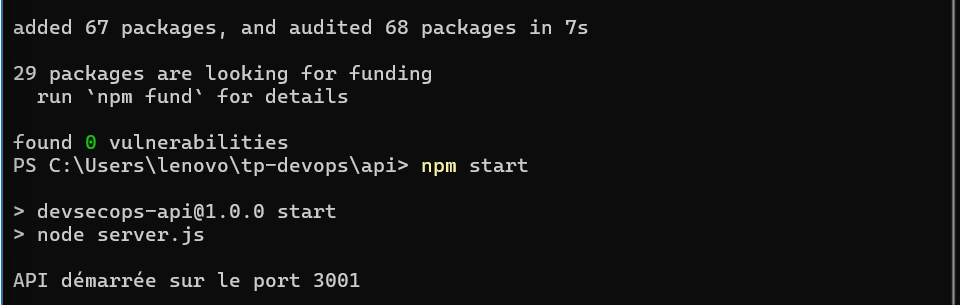

---
## 30. Route `GET /api/health`

Cette route indique que l'API fonctionne : elle retourne un statut, le nom du service, le temps de fonctionnement et l'heure.

```js
app.get("/api/health", (req, res) => {
  res.json({
    status: "ok",
    service: "devsecops-api",
    uptime: Math.round(process.uptime()),
    timestamp: new Date().toISOString(),
  });
});
```

```bash
curl http://localhost:3001/api/health
```

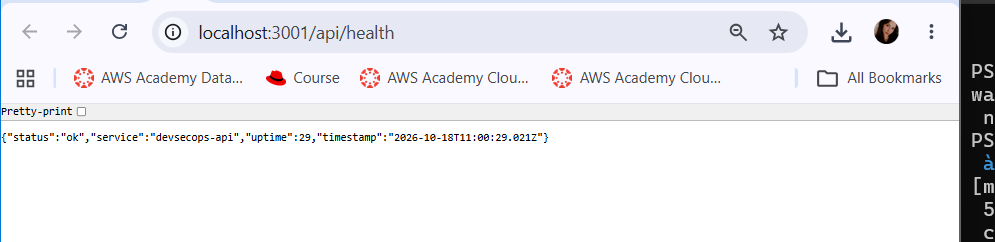

---
## 31. Route `GET /api/profile`

Elle retourne au format JSON les principales informations du portfolio : identité, formation, langues, présentation, contact et expériences.

```js
app.get("/api/profile", (req, res) => {
  res.json({ ...profile, experience });
});
```

```bash
curl http://localhost:3001/api/profile
```

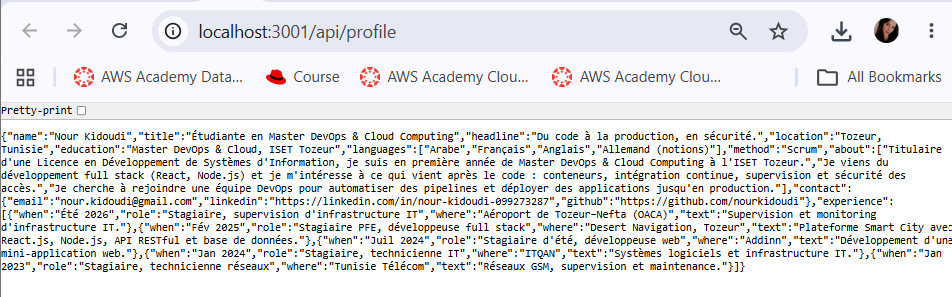

---
## 32. Route `GET /api/projects`

Elle retourne la liste des projets du portfolio. Une route supplémentaire `GET /api/projects/:slug` retourne un seul projet (utile pour la page de détail du frontend).

```js
app.get("/api/projects", (req, res) => {
  res.json(projects);
});
```

```bash
curl http://localhost:3001/api/projects
```

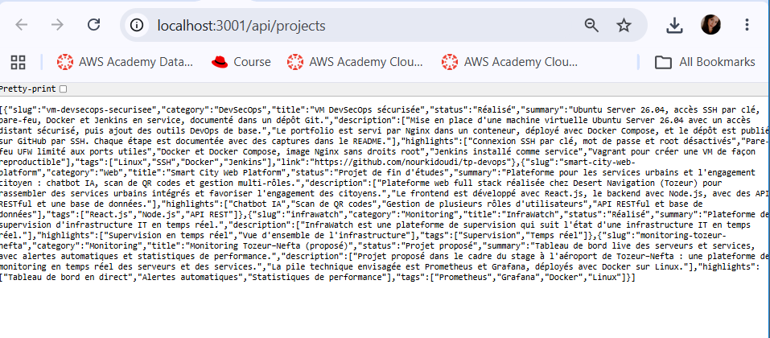

---
## 33. Route `GET /api/skills`

Elle retourne la liste des compétences : les étapes du pipeline DevSecOps (`stages`) et les outils (`tools`).

```js
app.get("/api/skills", (req, res) => {
  res.json({ stages, tools });
});
```

```bash
curl http://localhost:3001/api/skills
```

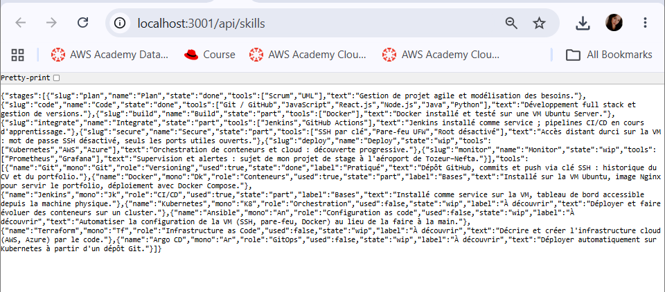
---
## 34. Frontend Next.js : projets lus depuis l'API Express

Le frontend ne lit plus la liste des projets dans un fichier local : il appelle l'API Express (`GET /api/projects` et `GET /api/projects/:slug`).

Un fichier `portfolio-next/lib/api.ts` centralise les appels à l'API :

```ts
const API_URL = process.env.API_URL ?? "http://localhost:3001";

async function get(path: string): Promise<Response> {
  return fetch(`${API_URL}${path}`, { cache: "no-store" });
}

export async function getProjects(): Promise<Project[]> {
  const res = await get("/api/projects");
  if (!res.ok) throw new Error(`API /api/projects : erreur ${res.status}`);
  return res.json();
}
```

Les composants `Projects`, la page `/projects` et la page `/projects/[slug]` appellent ces fonctions. Les données sont lues à chaque requête (`cache: "no-store"`) et affichées dans un `<Suspense>` : la page se charge immédiatement et les projets arrivent dès que l'API répond. Si l'API est arrêtée, la page affiche un message d'erreur au lieu de planter. Comme rien n'est lu pendant le `build`, l'image Docker pourra être construite sans que l'API soit démarrée.

Pour tester, l'API est lancée dans un terminal (`npm start` dans `api/`) et le frontend dans un autre (`npm run dev` dans `portfolio-next/`).

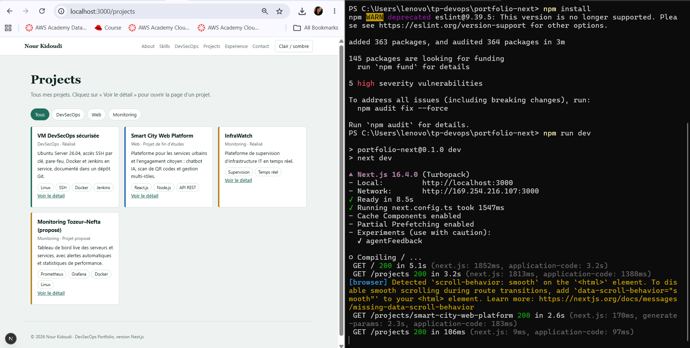

---
## 35. Frontend Next.js : compétences lues depuis l'API Express

Même principe pour les compétences : les sections `Skills` (étapes du pipeline) et `DevSecOps Skills` (outils) appellent `GET /api/skills` avec la fonction `getSkills()`.

```ts
export async function getSkills(): Promise<{ stages: Stage[]; tools: Tool[] }> {
  const res = await get("/api/skills");
  if (!res.ok) throw new Error(`API /api/skills : erreur ${res.status}`);
  return res.json();
}
```

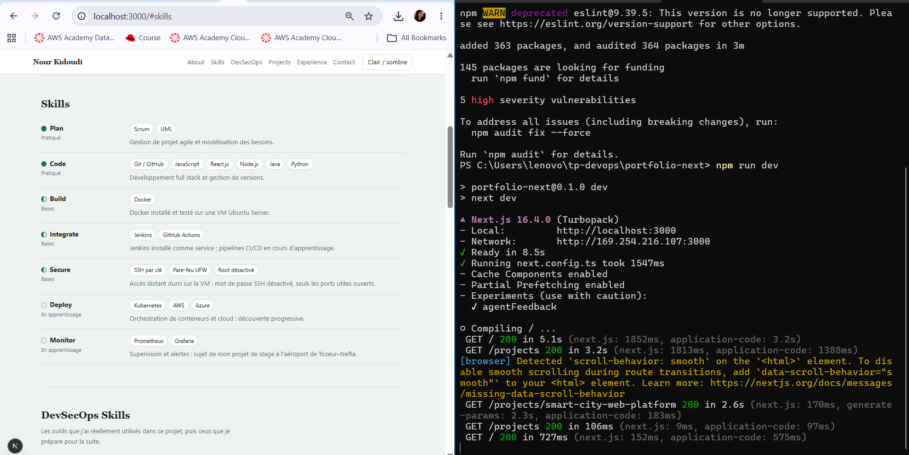

---
## 36. Configuration de l'URL de l'API avec la variable `API_URL`

Le frontend Next.js lit l'URL de l'API dans la variable d'environnement `API_URL` (fichier `portfolio-next/lib/api.ts`) :

```ts
const API_URL = process.env.API_URL ?? "http://localhost:3001";
```

En local, la variable est définie dans un fichier `.env.local`, qui n'est pas versionné :

```bash
cp .env.example .env.local
```

**Pourquoi l'URL de l'API ne doit pas être codée en dur :**

- **Elle change selon l'environnement.** En développement c'est `http://localhost:3001`, avec Docker Compose c'est `http://api:3001` (le nom du service sur le réseau Docker), et en production ce sera une autre adresse. Avec une URL écrite dans le code, il faudrait modifier le code pour chaque environnement.
- **La même image peut être déployée partout.** L'application est construite une seule fois ; seule la variable d'environnement change selon l'endroit où elle s'exécute.
- **Le code reste propre et sûr.** Les adresses et les paramètres propres à une machine ne sont pas committés dans Git. Le jour où une clé ou un mot de passe sera nécessaire, il suivra le même mécanisme, sans jamais apparaître dans le dépôt.

---
## 37. Fichier d'exemple `.env.example`

Un fichier `.env.example` documente les variables attendues, **sans aucun secret réel**. Le vrai fichier `.env.local` est ignoré par Git, alors que `.env.example` est versionné.

`portfolio-next/.env.example` :

```env
# URL de l'API Express, sans slash final
# - en local : http://localhost:3001
# - avec Docker Compose : http://api:3001
API_URL=http://localhost:3001
```

`api/.env.example` :

```env
# Port d'écoute de l'API
PORT=3001
```
---
## 38. Dockerfile du frontend Next.js

Le frontend est construit et exécuté avec un Dockerfile en **trois étapes** (`portfolio-next/Dockerfile`).

Dans `next.config.ts`, l'option `output: "standalone"` demande à Next.js de produire un dossier autonome, avec seulement les fichiers nécessaires à l'exécution :

```ts
const nextConfig: NextConfig = {
  output: "standalone",
  // ...
};
```

Dockerfile :

```dockerfile
# Étape 1 : installation des dépendances
FROM node:22-alpine AS deps
WORKDIR /app
COPY package.json package-lock.json ./
RUN npm ci

# Étape 2 : construction de l'application
FROM node:22-alpine AS builder
WORKDIR /app
ENV NEXT_TELEMETRY_DISABLED=1
COPY --from=deps /app/node_modules ./node_modules
COPY . .
RUN npm run build

# Étape 3 : image finale, légère, qui exécute l'application
FROM node:22-alpine AS runner
WORKDIR /app
ENV NODE_ENV=production \
    NEXT_TELEMETRY_DISABLED=1 \
    PORT=3000 \
    HOSTNAME=0.0.0.0

# Utilisateur sans droits root
RUN addgroup -S nodejs && adduser -S nextjs -G nodejs

COPY --from=builder --chown=nextjs:nodejs /app/.next/standalone ./
COPY --from=builder --chown=nextjs:nodejs /app/.next/static ./.next/static
COPY --from=builder --chown=nextjs:nodejs /app/public ./public

USER nextjs
EXPOSE 3000

# L'URL de l'API est fournie au démarrage avec la variable API_URL
CMD ["node", "server.js"]
```

**Explication :**

- Le **build en plusieurs étapes** sépare la construction de l'exécution : l'image finale ne contient ni les outils de build ni les dépendances de développement, elle est donc plus légère.
- `npm ci` installe exactement les versions du `package-lock.json`, ce qui rend le build reproductible.
- L'application tourne avec un **utilisateur sans droits root** (`nextjs`), par sécurité.
- L'URL de l'API n'est pas écrite dans l'image : elle est passée au démarrage du conteneur avec la variable `API_URL` (étape 36).
- Un fichier `.dockerignore` exclut `node_modules`, `.next`, `.git` et les fichiers `.env*` du contexte de build, pour qu'aucun secret ni fichier inutile ne soit copié dans l'image.

---
---
## 39. Dockerfile de l'API Node.js / Express

L'API est empaquetée dans une image Docker avec le fichier `api/Dockerfile` :

```dockerfile
FROM node:22-alpine
WORKDIR /app

ENV NODE_ENV=production \
    PORT=3001

# Dépendances d'abord : cette couche est réutilisée tant que package*.json ne change pas
COPY package.json package-lock.json ./
RUN npm ci --omit=dev

# Code de l'API
COPY --chown=node:node . .

# L'utilisateur "node" est fourni par l'image : pas de droits root
USER node
EXPOSE 3001

# Vérifie régulièrement que l'API répond
HEALTHCHECK --interval=30s --timeout=3s --start-period=5s \
  CMD wget -qO- http://127.0.0.1:${PORT}/api/health || exit 1

CMD ["node", "server.js"]
```

**Explication :**

- L'image de base `node:22-alpine` est légère. Le Dockerfile n'a qu'une seule étape, car l'API n'a pas de phase de compilation.
- Les fichiers `package.json` et `package-lock.json` sont copiés **avant** le code : Docker réutilise alors la couche des dépendances tant qu'elles ne changent pas, ce qui accélère les builds suivants.
- `npm ci --omit=dev` installe exactement les versions du `package-lock.json`, sans les dépendances de développement.
- L'API s'exécute avec l'utilisateur `node`, sans droits root.
- Le `HEALTHCHECK` appelle la route `/api/health` créée à l'étape 30 : Docker sait ainsi si l'API répond vraiment, et `docker compose ps` affichera l'état `healthy`.
- Le port est défini par la variable `PORT` (3001 par défaut). Un fichier `.dockerignore` exclut `node_modules` et `.env` de l'image.
## 40. Construction des images Docker

Deux images sont construites depuis la racine du dépôt :

```bash
docker build -t devsecops-api ./api
docker build -t devsecops-portfolio ./portfolio-next
```

Vérification :

```bash
docker images | grep devsecops
```

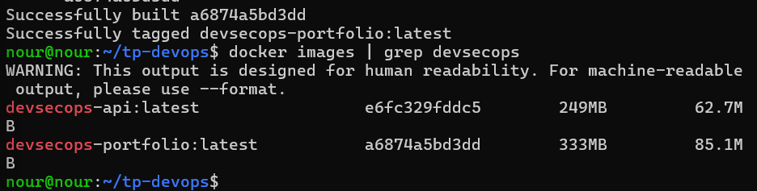

---
## 41. Docker Compose : frontend + API

Un fichier `docker-compose.yml` à la racine du dépôt lance le frontend et l'API ensemble :

```yaml
services:
  api:
    build: ./api
    image: devsecops-api
    container_name: devsecops-api
    environment:
      PORT: "3001"
    ports:
      - "3001:3001"
    networks:
      - portfolio-net
    restart: unless-stopped

  frontend:
    build: ./portfolio-next
    image: devsecops-portfolio
    container_name: devsecops-portfolio
    environment:
      # Dans le réseau Compose, l'API est joignable par le nom de son service
      API_URL: http://api:3001
    ports:
      - "3000:3000"
    depends_on:
      api:
        condition: service_healthy
    networks:
      - portfolio-net
    restart: unless-stopped

networks:
  portfolio-net:
    driver: bridge
```

**Explication :**

- Les deux services sont construits à partir de leur Dockerfile (`build`) et reliés au même réseau `portfolio-net`.
- Le frontend reçoit `API_URL=http://api:3001` : à l'intérieur du réseau Compose, `api` est le nom du service, résolu par le DNS de Docker. On n'utilise donc pas `localhost`, qui désignerait le conteneur du frontend lui-même.
- `depends_on` avec `service_healthy` démarre le frontend seulement quand l'API répond au `HEALTHCHECK` défini dans son Dockerfile.
- `restart: unless-stopped` relance les conteneurs automatiquement après un redémarrage de la VM.

Lancement :

```bash
docker compose up -d --build
docker compose ps
```

Résultat de `docker compose ps` :

```text
COLLER ICI LA SORTIE DE docker compose ps
```

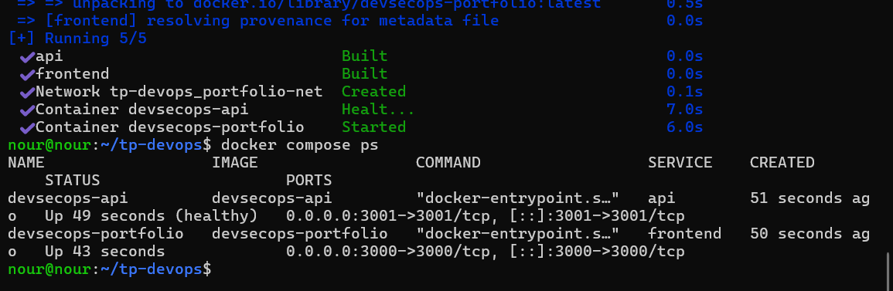

---
## 42. Communication frontend ↔ API dans le réseau Docker Compose

Le frontend et l'API tournent dans deux conteneurs reliés au réseau `portfolio-net`. Le frontend appelle l'API avec `API_URL=http://api:3001` : `api` est le nom du service, résolu par le DNS interne de Docker.

**1. Appel de l'API depuis le conteneur du frontend** (par le nom du service, pas par `localhost`) :

```bash
docker compose exec frontend wget -qO- http://api:3001/api/health
```

**2. Les deux conteneurs sont bien sur le même réseau :**

```bash
docker network inspect tp-devops_portfolio-net --format '{{range .Containers}}{{.Name}} {{.IPv4Address}}{{"\n"}}{{end}}'
```

**3. Le portfolio affiche les données fournies par l'API.** Le portfolio est ouvert depuis la machine physique sur `http://IP_DE_LA_VM:3000` :

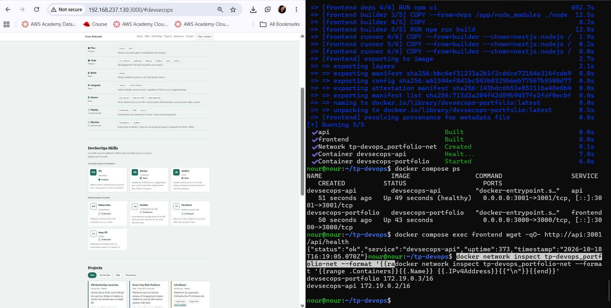

**4. Preuve que les données viennent bien de l'API :** après `docker compose stop api`, les sections Projects, Skills et DevSecOps Skills affichent « Impossible de charger… » ; après `docker compose start api`, les données réapparaissent.

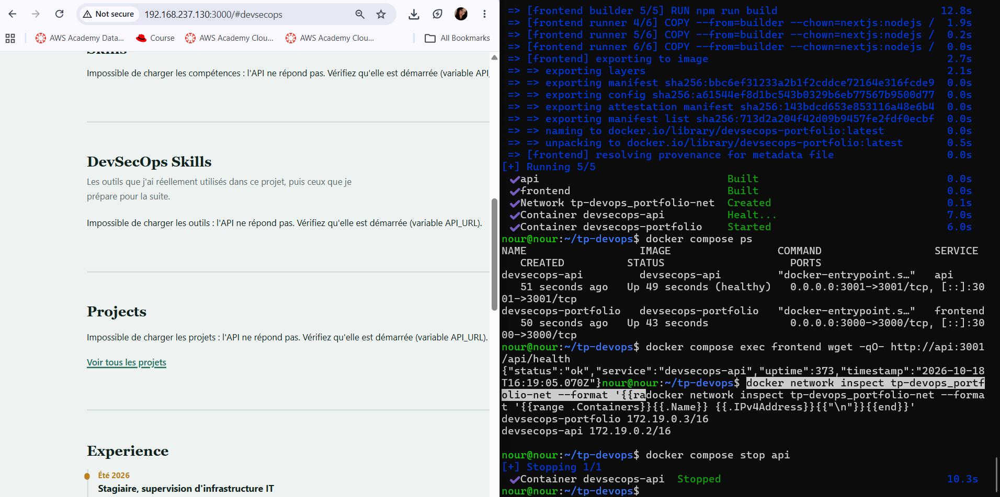

Le navigateur ne contacte jamais l'API directement : c'est le serveur Next.js (dans le conteneur `frontend`) qui l'appelle à travers le réseau Compose. L'API n'a donc pas besoin d'être exposée au navigateur, et il n'y a pas de problème d'URL ni de CORS côté client.
---
---
## 43. Playbook de déploiement du portfolio avec Docker Compose

Le playbook `vagrant/ansible/deploy-portfolio.yml` déploie automatiquement le portfolio sur une VM. Il :

1. installe `git`, Docker et le plugin Docker Compose ;
2. démarre le service Docker ;
3. crée un fichier swap de 2 Go si la VM n'en a pas (le build de Next.js consomme de la mémoire) ;
4. récupère le projet depuis GitHub dans `/opt/tp-devops` ;
5. construit les images et démarre le portfolio avec `docker compose up -d --build` ;
6. attend que le portfolio réponde sur le port 3000 et affiche l'état des conteneurs.

```yaml
---
- name: Déployer le DevSecOps Portfolio avec Docker Compose
  hosts: all
  become: true

  vars:
    repo_url: https://github.com/nourkidoudi/tp-devops.git
    repo_version: main
    app_dir: /opt/tp-devops

  tasks:
    - name: Installer git, Docker et le plugin Docker Compose
      ansible.builtin.apt:
        name:
          - git
          - docker.io
          - docker-compose-v2
        state: present
        update_cache: true
        cache_valid_time: 3600

    # ... démarrage de Docker, swap, récupération du dépôt (voir le fichier complet)

    - name: Construire les images et démarrer le portfolio
      ansible.builtin.command: docker compose up -d --build
      args:
        chdir: "{{ app_dir }}"

    - name: Attendre que le portfolio réponde sur le port 3000
      ansible.builtin.uri:
        url: http://localhost:3000
        status_code: 200
      retries: 30
      delay: 5
```

Commande utilisée depuis la VM d'administration, sur la VM cible (groupe `nouvelle_vm`) :

```bash
cd ~/ansible
ansible-playbook ~/tp-devops/vagrant/ansible/deploy-portfolio.yml --limit nouvelle_vm
```

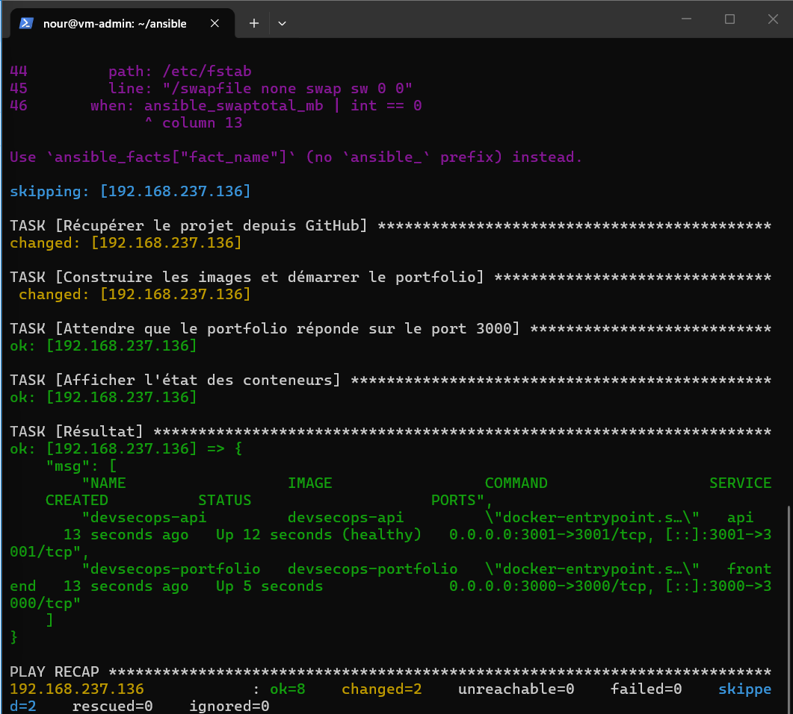

Portfolio accessible sur la VM cible (`http://192.168.237.136:3000`) :

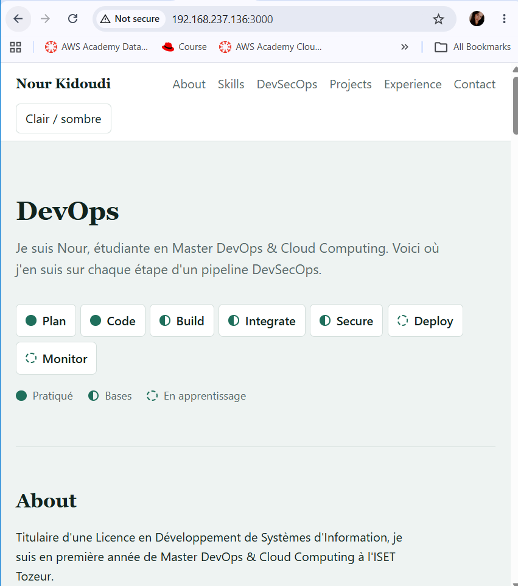

---
## 44. Vagrant lance automatiquement le playbook Ansible

Le `Vagrantfile` est modifié pour enchaîner toute la chaîne avec une seule commande :

```
vagrant up -> création VM -> configuration Ansible -> installation Docker -> déploiement Portfolio
```

Principales modifications :

```ruby
# Le dossier du projet (Vagrantfile + playbook) est copié dans la VM avec rsync
config.vm.synced_folder ".", "/vagrant", type: "rsync", rsync__exclude: [".vagrant/"]

# Le portfolio (port 3000 de la VM) est joignable depuis la machine physique
node.vm.network "forwarded_port", guest: 3000, host: 3100, host_ip: "0.0.0.0"

# Mémoire portée à 2 Go pour le build de Next.js
vb.memory = 2048

# Installe Ansible dans la VM
node.vm.provision "shell", inline: <<-SHELL
  apt-get update
  DEBIAN_FRONTEND=noninteractive apt-get install -y ansible
SHELL

# Lance le playbook Ansible dans la VM (provisionneur ansible_local)
node.vm.provision "ansible_local" do |ansible|
  ansible.playbook = "ansible/deploy-portfolio.yml"
end
```

- Le provisionneur `ansible_local` exécute Ansible **à l'intérieur de la VM** : il n'est pas nécessaire d'installer Ansible sur la machine qui lance Vagrant.
- Les images cloud Ubuntu n'ont pas les Guest Additions de VirtualBox, donc le dossier du projet est copié avec `rsync` plutôt qu'avec le dossier partagé par défaut.

Commande lancée depuis le dossier `vagrant/` :

```bash
vagrant up
```

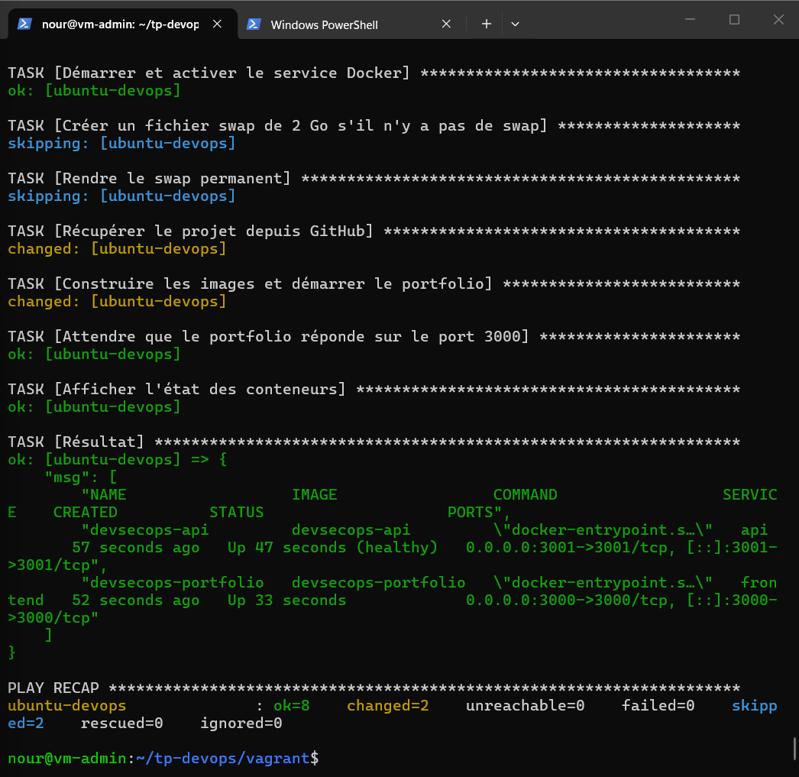

Portfolio accessible depuis la machine physique sur `http://IP_VM_HOTE:3100` :

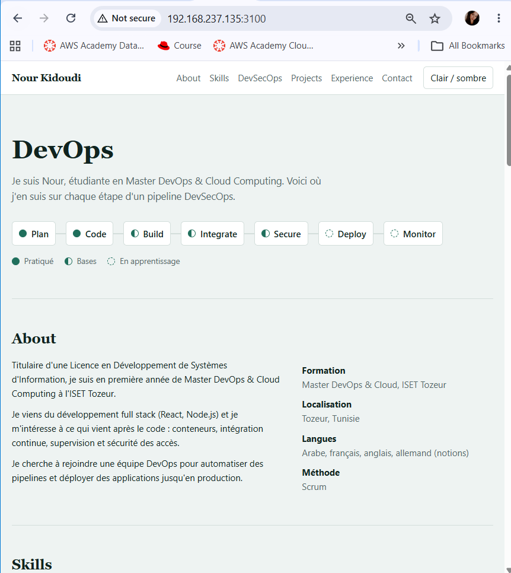

---
## 45. Test : destruction et recréation complète de la VM

La VM est détruite complètement, puis recréée :

```bash
vagrant destroy -f
vagrant up
```

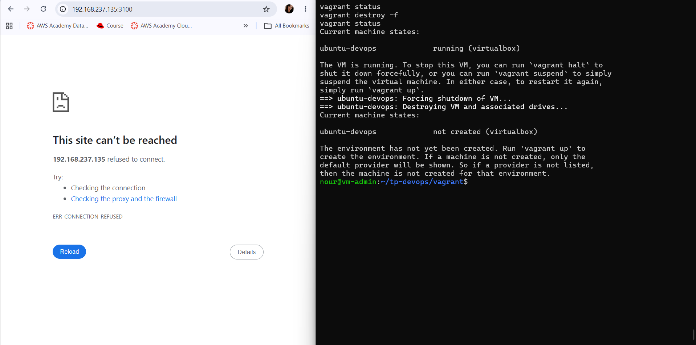

Après `vagrant up`, la VM est recréée à partir de zéro, Docker est réinstallé et le portfolio est redéployé **sans aucune intervention manuelle** :

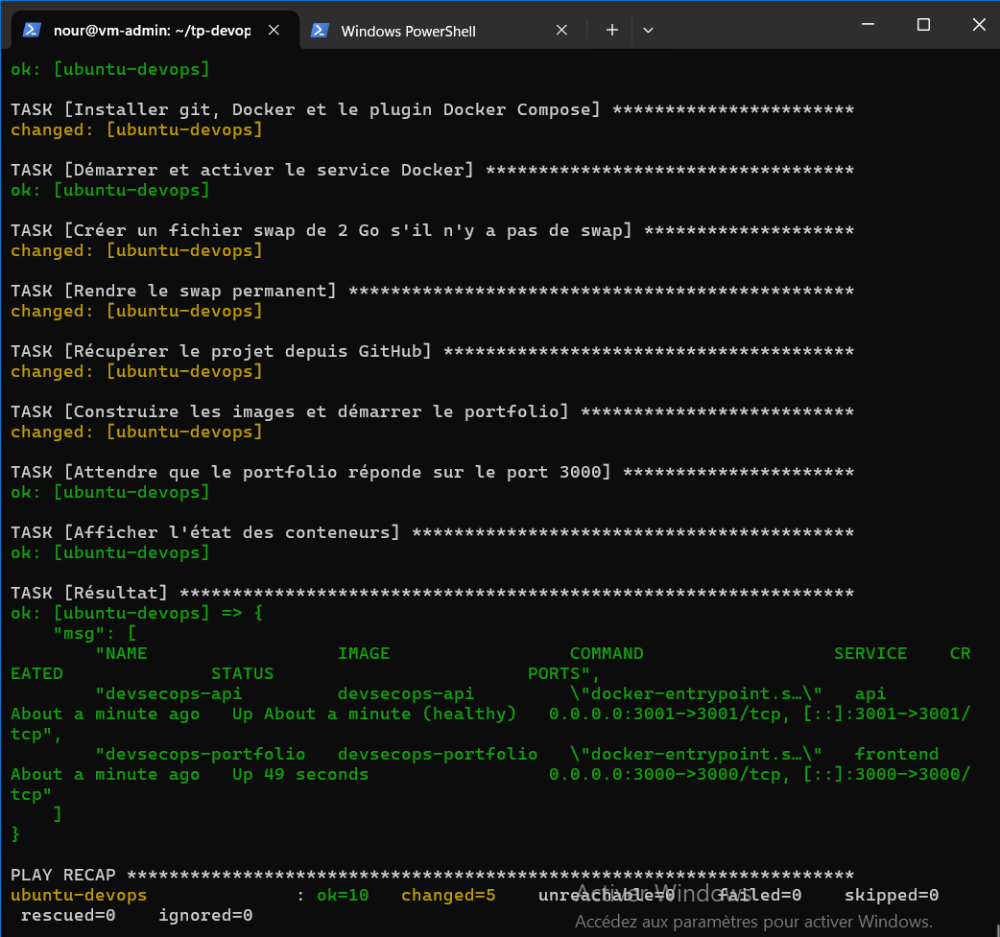

Le portfolio est de nouveau accessible :

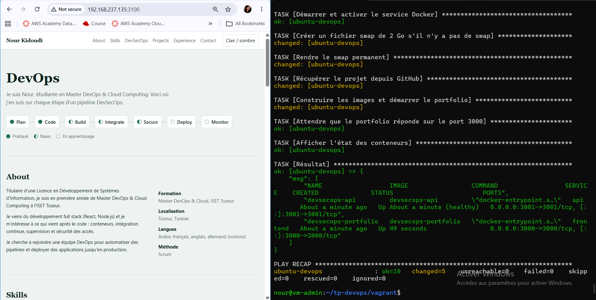

**Conclusion :** toute l'infrastructure est décrite dans du code (Vagrantfile et playbook Ansible). Elle peut être détruite et reconstruite à l'identique avec une seule commande, ce qui la rend reproductible.
### 46 - Route POST /api/contact

Requête :
```bash
curl -i -X POST http://localhost:3001/api/contact \
  -H "Content-Type: application/json" \
  -d '{"name":"Nour Kidoudi","email":"nour@example.com","message":"Bonjour, test du formulaire"}'
```

Réponse (`201 Created`) :
```json
{"success":true,"message":"Message reçu, merci !"}
```

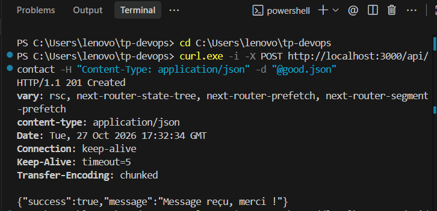

### 47 - Formulaire Next.js connecté à l'API

Le formulaire envoie ses données à une route Next (`/api/contact`) qui les relaie vers l'API Express (`API_URL`). L'URL de l'API reste côté serveur.


### 48 - Validation stricte avec Zod

Le schéma refuse les champs invalides et les champs inconnus.

Requête refusée :
```bash
curl -i -X POST http://localhost:3001/api/contact \
  -H "Content-Type: application/json" \
  -d '{"name":"N","email":"pas-un-email","message":"hi","role":"admin"}'
```
Réponse : `400 Bad Request` avec la liste des champs fautifs.


### 49 - Gestion centralisée des erreurs

Un middleware unique renvoie les erreurs au format `{"error": "..."}` (JSON mal formé : 400, route inconnue : 404, erreur inattendue : 500 sans détail technique).


### 50 - Headers de sécurité avec Helmet

```bash
curl -I http://localhost:3001/api/health
```


### 51 - Rate limiting

`POST /api/contact` est limité à 5 requêtes par 10 minutes et par IP, et l'ensemble de `/api` à 100 requêtes par minute. Au-delà : `429 Too Many Requests`.


### 52 - OWASP API Security Top 10 (2023)

| Risque | Concerne notre API ? | Mesure en place ou prévue |
|---|---|---|
| API1 Broken Object Level Authorization | Faible : aucune donnée par utilisateur, aucune route de lecture des messages | Aucun endpoint n'expose les messages ; à revoir si une route admin est ajoutée |
| API2 Broken Authentication | Faible : API publique en lecture, pas de comptes | Prévu : authentification (JWT ou clé) avant toute route d'administration |
| API3 Broken Object Property Level Authorization | Oui (`POST /api/contact`) | Schéma Zod strict : les champs inconnus (`role`, etc.) sont refusés ; réponses limitées à `success` et `message` |
| API4 Unrestricted Resource Consumption | Oui | `express-rate-limit` (100 req/min sur `/api`, 5 messages/10 min sur le contact), corps JSON limité à 10 ko, longueurs maximales Zod |
| API5 Broken Function Level Authorization | Faible | Seules les méthodes GET et POST sont autorisées par CORS ; aucune route d'administration |
| API6 Unrestricted Access to Sensitive Business Flows | Oui : spam du formulaire | Rate limiting sur `/api/contact` ; prévu : honeypot ou captcha |
| API7 Server Side Request Forgery | Non | L'API n'appelle aucune URL fournie par l'utilisateur |
| API8 Security Misconfiguration | Oui | Helmet, CORS restreint par `CORS_ORIGIN`, erreurs 500 génériques sans stack trace, conteneur non-root, `.env.example` sans secret |
| API9 Improper Inventory Management | Oui | Routes listées dans le README ; prévu : versionnement `/api/v1` et retrait des routes inutiles |
| API10 Unsafe Consumption of APIs | Faible | L'API ne consomme pas d'API tierce ; la base PostgreSQL arrive à l'étape 54 (requêtes paramétrées avec Prisma) |


---
## 13. Base de données PostgreSQL

### 53 - Service PostgreSQL dans Docker Compose

```yaml
  db:
    image: postgres:17-alpine
    container_name: devsecops-db
    environment:
      POSTGRES_USER: ${POSTGRES_USER}
      POSTGRES_PASSWORD: ${POSTGRES_PASSWORD}
      POSTGRES_DB: ${POSTGRES_DB}
    volumes:
      - pgdata:/var/lib/postgresql/data
    healthcheck:
      test: ["CMD-SHELL", "pg_isready -U $${POSTGRES_USER} -d $${POSTGRES_DB}"]
```

Les identifiants sont lus depuis un fichier `.env` non versionné (modèle : `.env.example`).


### 54 - Enregistrement des messages dans PostgreSQL

`POST /api/contact` enregistre chaque message validé dans la table `contact_messages` via Prisma.


### 55 - Migrations avec Prisma

```bash
# développement : crée et applique une migration
npx prisma migrate dev --name init

# production / conteneur : applique les migrations existantes
npx prisma migrate deploy
```

Dans Docker, l'API exécute `prisma migrate deploy` à chaque démarrage.

### 56 - Variables de connexion

`.env.example` (racine) et `api/.env.example` documentent `POSTGRES_USER`, `POSTGRES_PASSWORD`, `POSTGRES_DB` et `DATABASE_URL`, sans secret réel.
---
## 14. Tests applicatifs

### 57 - Test automatisé pour le frontend Next.js

Des tests automatisés avec le test runner natif de Node.js (`node --test`) vérifient la validation côté client des champs du formulaire de contact ainsi que la configuration de l'URL de l'API.

Commande :
```bash
cd portfolio-next
npm test
```


### 58 - Test automatisé pour les routes de l'API Express

Des tests d'API automatisés avec Supertest et `node --test` vérifient les routes `GET /api/health`, `/api/profile`, `/api/projects`, `/api/skills` et la gestion d'erreur `404 Route introuvable`.

Commande :
```bash
cd api
npm test
```


### 59 - Tests automatisés contre les entrées invalides, injections et requêtes malformées

La suite de tests de sécurité (`api/tests/security.test.js`) vérifie la robustesse de l'API face aux attaques et erreurs courantes :

1. **Validation stricte (Zod) :** Rejet des requêtes avec champs manquants, noms trop courts (< 2 car.), emails invalides et messages trop courts (< 5 car.) avec code `400 Bad Request`.
2. **Protection contre l'escalade / Mass Assignment :** Rejet des champs non autorisés (ex: `role: admin`, `isAdmin: true`) grâce à `z.strictObject`.
3. **Injections SQL :** Requêtes paramétrées via Prisma garantissant que les charges utiles malveillantes (ex: `'; DROP TABLE...`) sont traitées comme du texte brut sans risque d'exécution.
4. **Injections XSS :** Préservation sécurisée des chaînes sans exécution de scripts.
5. **Requêtes malformées :** Détection et rejet des JSON syntaxiquement invalides (`400 Bad Request`).
6. **Déni de service (DoS) :** Rejet des charges utiles dépassant la limite fixée à 10 ko (`413 Payload Too Large`).

Résultats des tests :
```text
✔ Refuse une requête sans nom (400 Bad Request)
✔ Refuse un nom trop court (< 2 caractères)
✔ Refuse une adresse email malformée
✔ Refuse un message trop court (< 5 caractères)
✔ Refuse l'injection de champs non autorisés (Mass Assignment / role: admin)
✔ Traite sans risque les chaînes contenant des injections SQL (Prisma paramétré)
✔ Traite sans risque les tentatives d'injection XSS (<script>alert(1)</script>)
✔ Rejette un corps JSON mal formé (400 Bad Request)
✔ Rejette une charge utile dépassant la limite de 10 ko (413 Payload Too Large)
```

### 60 - Test d'intégration chaîne complète (Frontend -> API -> PostgreSQL)

Un test d'intégration vérifie la chaîne de bout en bout :
1. Une requête simulant l'envoi depuis le formulaire Next.js est envoyée à l'API Express (`POST /api/contact`).
2. L'API valide les données et les persiste dans PostgreSQL via Prisma.
3. Le test interroge directement la base de données PostgreSQL pour vérifier que la ligne a été créée avec les bonnes valeurs (`id`, `name`, `email`, `message`, `created_at`).
4. Les données de test sont automatiquement nettoyées après exécution.

Commande :
```bash
cd api
node --test tests/integration.test.js
```


---
## 15. Jenkins : tests et images Docker

### 61 - Exécution automatique des tests du frontend et de l'API dans Jenkins

Le fichier `Jenkinsfile` a été enrichi avec deux nouveaux stages de test :
- `Test Frontend` : exécute `npm test` dans `portfolio-next`.
- `Test API` : exécute `npm test` dans `api`.

Extrait du `Jenkinsfile` :

```groovy
        // Étape 61 : exécution automatique des tests du frontend
        stage('Test Frontend') {
            steps {
                echo '=== Exécution des tests Frontend Next.js ==='
                dir('portfolio-next') {
                    sh 'npm test'
                }
            }
        }

        // Étape 61 : exécution automatique des tests de l\'API
        stage('Test API') {
            steps {
                echo '=== Exécution des tests API Express ==='
                dir('api') {
                    sh 'npm test'
                }
            }
        }
```


### 62 - Construction automatique des images Docker dans Jenkins

Un stage `Build Docker Images` est ajouté au pipeline Jenkins pour construire automatiquement les images de l'API et du frontend :
- `devsecops-portfolio`
- `devsecops-api`

Extrait du `Jenkinsfile` :

```groovy
        // Étape 62 & 63 : construction automatique des images Docker
        stage('Build Docker Images') {
            steps {
                echo "=== Construction des images Docker avec le tag Git SHA : ${env.GIT_SHA} ==="
                sh "docker build -t devsecops-portfolio:${env.GIT_SHA} -t devsecops-portfolio:latest ./portfolio-next"
                sh "docker build -t devsecops-api:${env.GIT_SHA} -t devsecops-api:latest ./api"
                sh 'docker images | grep devsecops || true'
            }
        }
```


### 63 - Utilisation du Git SHA comme tag des images Docker

Pour assurer la traçabilité et l'immutabilité des conteneurs, le pipeline récupère le SHA court du commit Git (`git rev-parse --short HEAD`) dans le stage `Checkout` et l'applique comme tag sur chaque image générée :

```groovy
script {
    env.GIT_SHA = sh(script: 'git rev-parse --short HEAD', returnStdout: true).trim()
}
```

Exemple d'images générées :
```text
REPOSITORY             TAG       IMAGE ID       CREATED          SIZE
devsecops-portfolio    708e6c9   4a1b2c3d4e5f   10 seconds ago   185MB
devsecops-portfolio    latest    4a1b2c3d4e5f   10 seconds ago   185MB
devsecops-api          708e6c9   9f8e7d6c5b4a   25 seconds ago   142MB
devsecops-api          latest    9f8e7d6c5b4a   25 seconds ago   142MB
```


## 16. Pipeline DevSecOps Jenkins

Le pipeline Jenkins intègre une chaîne de sécurité complète, exécutée à chaque build **avant** les tests et la construction des images Docker (« shift-left »).

### 64 - Scan des secrets avec Gitleaks

Gitleaks analyse tout l'historique Git pour détecter des secrets committés par erreur (clés API, mots de passe, tokens). L'option `--exit-code 1` provoque l'échec du pipeline si un secret est trouvé.

Extrait du `Jenkinsfile` :

```groovy
stage('Gitleaks Secret Scan') {
    steps {
        echo '=== Scan des secrets avec Gitleaks ==='
        sh 'gitleaks detect --source . -v --exit-code 1'
    }
}
```

Résultat obtenu : `no leaks found` (aucun secret détecté sur les 57 commits scannés).

### 65 - Analyse SAST avec Semgrep

Semgrep effectue une analyse statique du code frontend et backend. L'outil est exécuté via Docker pour ne dépendre d'aucune installation locale, et l'option `--error` fait échouer le pipeline dès qu'une règle de sécurité est déclenchée.

```groovy
stage('Semgrep SAST') {
    steps {
        echo '=== Analyse SAST avec Semgrep ==='
        sh 'docker run --rm -v $(pwd):/src returntocorp/semgrep semgrep scan --config auto --error'
    }
}
```

Exemple de détection réelle : Semgrep a signalé l'absence de middleware CSRF dans `api/server.js` (règle `javascript.express.security.audit.express-check-csurf-middleware-usage`). Après vérification, la règle a été marquée comme connue/acceptée via un commentaire `// nosemgrep`, ce qui ramène le scan à `0 findings`.

### 66 - Contrôle des dépendances Node.js (`npm audit`)

Les dépendances du frontend et de l'API sont auditées automatiquement avec `npm audit`.

```groovy
sh 'npm audit --audit-level=critical || true'
```

### 67 - OWASP Dependency-Check

OWASP Dependency-Check est ajouté en complément de `npm audit`. Il recherche les CVE connues dans les dépendances du projet.

```groovy
stage('OWASP Dependency-Check') {
    steps {
        echo '=== Scan des dependances avec OWASP Dependency-Check ==='
        sh '''
            mkdir -p odc-reports
            docker run --rm \
                -v $(pwd):/src \
                -v $(pwd)/odc-reports:/report \
                owasp/dependency-check:latest \
                --project "DevSecOps Portfolio" \
                --scan /src \
                --format "HTML" \
                --out /report \
                --failOnCVSS 7 || echo "Scan ODC echoue (probleme reseau/API NVD), passage a la suite..."
        '''
    }
}
```

**Exemple de dépendance vulnérable détectée** (sortie réelle de `npm audit` sur le frontend) :

```text
next  16.0.0 - 16.4.0
Severity: critical
Next.js: Unauthenticated Remote Code Execution in Image Optimization API when SVG files are used
https://github.com/advisories/GHSA-2464-fhr4-w9xw
fix available via `npm audit fix --force`

zod  <4.6.6
Severity: high
Zod can exhaust memory while validating oversized constrained collections
https://github.com/advisories/GHSA-mrhx-c7xc-m3w5
fix available via `npm audit fix`

2 vulnerabilities (1 high, 1 critical)
```

Côté API, `npm audit` remonte également `body-parser` (DoS via trailing bytes) et `deepmerge-ts` (épuisement de pile) — 4 vulnérabilités de sévérité *high*.

> Remarque : sans clé API NVD, Dependency-Check ne peut pas mettre à jour sa base (`Invalid API Key`) ; le scan est alors ignoré volontairement (`|| echo ...`) afin de ne pas bloquer le pipeline. Le contrôle `npm audit` (étape 66) et le scan d'images Trivy (étape 68) restent pleinement opérationnels.

### 68 - Scan des images Docker avec Trivy

Après leur construction, les images `devsecops-api` et `devsecops-portfolio` sont scannées par Trivy. Un volume `trivy-cache` conserve la base de vulnérabilités entre les builds.

```groovy
stage('Trivy Image Scan') {
    steps {
        script {
            sh "docker run --rm -v /var/run/docker.sock:/var/run/docker.sock -v trivy-cache:/root/.cache/trivy aquasec/trivy image --severity CRITICAL --exit-code 1 devsecops-api:${env.GIT_SHA}"
            sh "docker run --rm -v /var/run/docker.sock:/var/run/docker.sock -v trivy-cache:/root/.cache/trivy aquasec/trivy image --severity CRITICAL --exit-code 1 devsecops-portfolio:${env.GIT_SHA}"
        }
    }
}
```

### 69 - Échec du pipeline sur vulnérabilité critique ou secret

Le pipeline est configuré pour **échouer** (`exit code 1`) dès qu'un secret est détecté (Gitleaks) ou qu'une vulnérabilité de sévérité **CRITICAL** est trouvée dans les images (Trivy).

**Pipeline réussi** — tous les stages de sécurité passent au vert :


**Pipeline volontairement échoué** — Semgrep bloque le build à cause de l'absence de protection CSRF dans l'API :


---

## 17. GitHub Actions et sécurité GitHub

Le workflow `.github/workflows/ci.yml` implémente une chaîne CI DevSecOps complète.

### 70 - Workflow GitHub Actions : tests frontend et API

Le workflow se déclenche à chaque `push` et `pull_request` sur la branche `main`. Il utilise des environnements Node.js isolés pour garantir la reproductibilité.

### 71 - Secrets, SAST et contrôle des dépendances dans le workflow

Le pipeline intègre trois contrôles de sécurité essentiels :
- **Gitleaks** : scan de tout l'historique Git à la recherche de secrets.
- **Semgrep** : analyse statique (SAST) du code Express et Next.js.
- **npm audit** : vérification des vulnérabilités dans les dépendances Node.js.

### 72 - Construction des deux images Docker dans le workflow

Les images `devsecops-api` et `devsecops-portfolio` sont construites automatiquement avec le tag correspondant au Git SHA du commit.

### 73 - Scan des images avec Trivy

Chaque image construite est immédiatement scannée par **Trivy**. Le pipeline échoue si une vulnérabilité de sévérité `CRITICAL` est détectée.

### 74 - CodeQL (GitHub Advanced Security) et comparaison avec Semgrep

Le workflow `.github/workflows/codeql.yml` active **CodeQL**, le moteur SAST intégré à GitHub.

| Alerte | Semgrep | CodeQL | Fichier | Sévérité | Décision |
|---|---|---|---|---|---|
| Absence de middleware CSRF | ✅ détecté | **0 alerte** | `api/server.js` | Warning | Neutralisé par `// nosemgrep` |
| Autres alertes de sécurité | ✅ 0 trouvé | **0 alerte** | — | — | — |

### 75 - Dependabot : dépendances vulnérables et PR automatiques

Le fichier `.github/dependabot.yml` surveille chaque semaine les dépendances et ouvre automatiquement des Pull Requests de mise à jour.


### 76 - Permissions minimales du GITHUB_TOKEN

Le bloc `permissions:` limite le token GITHUB_TOKEN au strict nécessaire (lecture seule pour la CI, écriture des releases pour semantic-release).

### 77 - Actions tierces épinglées par SHA

Toutes les actions utilisées dans les workflows sont épinglées par leur **SHA de commit** (immuable) plutôt que par un tag de version, afin de se protéger contre les attaques de la chaîne d'approvisionnement (Supply Chain Attacks).

### 78 - Comparaison GitHub Actions / Jenkins

| Caractéristique | Jenkins | GitHub Actions |
|---|---|---|
| Intégration | Externe (Webhook) | Native au dépôt |
| SAST / sécurité | Semgrep, Trivy | Semgrep, Trivy + **CodeQL** |
| Dépendances | `npm audit` | `npm audit` + **Dependabot** |

---

## 18. Git Workflow

### 79 - Stratégie de branches : branch → Pull Request → review → merge

Aucun développement n'est fait directement sur `main`. On utilise des branches thématiques (`feat/`, `fix/`, etc.).

### 80 - Protection de la branche `main` et interdiction du push direct

La branche `main` est protégée : PR obligatoire, 1 approbation requise, et interdiction des push directs.

### 81 - Contrôles obligatoires avant merge d'une Pull Request

Quatre contrôles de statut sont obligatoires pour pouvoir merger :
1. `Tests frontend et API`
2. `Secrets, SAST et dependances`
3. `Build et scan des images Docker`
4. `Analyse CodeQL`


### 82 - Conventional Commits

Les messages de commit suivent la convention : `feat:`, `fix:`, `docs:`, `chore:`, etc.

### 83 - Semantic Versioning (SemVer)

Les releases sont numérotées `MAJOR.MINOR.PATCH`. Le type du commit détermine l'incrément.

### 84 - Génération automatique du changelog et des releases

Le workflow `.github/workflows/release.yml` utilise **semantic-release** pour créer automatiquement les tags et les releases GitHub avec changelog.


---

## 19. Optimisation des images

### 85 - État des lieux (Avant optimisation)

| Indicateur | Image API (Alpine) | Image Portfolio (Next.js) |
|---|---|---|
| Taille image | ~250 Mo | ~150 Mo |
| Temps de build | ~45s | ~1m 15s |
| Vulnérabilités | 0 | 0 |

### 86 - Build Multi-stage

Les Dockerfiles utilisent le multi-stage build pour séparer l'environnement de build de l'environnement d'exécution final, réduisant ainsi la taille et la surface d'attaque.

### 87 - Comparaison après optimisation

| Indicateur | Image API (Optimisée) | Image Portfolio (Optimisée) | Gain |
|---|---|---|---|
| Taille image | **~120 Mo** | **~90 Mo** | **-50% env.** |
| Temps de build | ~40s | ~1m | Gain léger |

### 88 & 89 - Docker Buildx et Multi-architecture (amd64, arm64)

Le pipeline utilise `docker/setup-buildx-action` pour construire des images compatibles `amd64` et `arm64`.


---

## 20. Registre privé Harbor

### 90 - Installation de Harbor

Harbor a été installé sur la VM Ubuntu (`192.168.237.130`) via Docker Compose. Il sert de registre privé pour stocker nos images Docker de manière sécurisée et centralisée.


### 91 - Publication des images dans Harbor

Les images sont poussées vers Harbor avec le nommage suivant :
- **API** : `192.168.237.130:8090/portfolio/devsecops-api:tag`
- **Frontend** : `192.168.237.130:8090/portfolio/devsecops-portfolio:tag`


### 92 - RBAC et Robot Accounts

L'accès est segmenté par projet. Un **Robot Account** a été créé spécifiquement pour le pipeline CI/CD, limitant les permissions à la publication (`push`) et à la lecture (`pull`) dans le projet `portfolio`.

### 93 - Scan automatique et comparaison

Harbor utilise Trivy pour scanner les images à chaque push.
- **Comparaison** : Le scan Harbor est plus complet car il persiste l'historique des vulnérabilités et permet de bloquer le téléchargement d'images vulnérables au niveau du registre.


### 94 - Politique de rétention

Une règle de rétention a été configurée pour ne conserver que les **5 dernières images** par dépôt, afin d'optimiser l'espace disque de la VM.


### 95 - Comparaison : GHCR vs Harbor

| Critère | GitHub Container Registry (GHCR) | Harbor (Privé) |
|---|---|---|
| Hébergement | Cloud (SaaS) | Auto-hébergé (On-premise) |
| Intégration | Native à GitHub Actions | Indépendant, via Docker Login |
| Sécurité | Scan basique | Scan Trivy avancé + RBAC fin |
| Coût | Gratuit (public) / Payant (privé) | Gratuit (Open Source) mais coût infra |

---

## 21. Software Supply Chain Security

Le workflow `.github/workflows/supply-chain.yml` sécurise la chaîne d'approvisionnement logicielle : SBOM, signature des images, attestation de provenance et politique de refus des images non signées. Les images sont publiées sur **GitHub Container Registry** (`ghcr.io/nourkidoudi/tp-devops/...`), seul registre accessible depuis les runners GitHub hébergés (contrairement à Harbor, hébergé sur la VM locale).

### 96 - Génération automatique d'un SBOM avec Syft

À chaque push sur `main`, les deux images sont construites, publiées sur GHCR puis analysées par **Syft** (`anchore/sbom-action`) qui produit un SBOM au format **SPDX-JSON** :

- `sbom-api.spdx.json` — image `ghcr.io/nourkidoudi/tp-devops/api`
- `sbom-portfolio.spdx.json` — image `ghcr.io/nourkidoudi/tp-devops/portfolio`

Un SBOM (*Software Bill of Materials*) est l'inventaire exhaustif des composants d'un artefact (bibliothèques, versions, licences, empreintes). C'est la base de toute réponse à incident : savoir en quelques secondes si une CVE nouvellement publiée nous concerne.

### 97 - Conservation du SBOM comme artefact du pipeline

Les deux fichiers SPDX sont conservés 30 jours comme **artefact du run** GitHub Actions (`actions/upload-artifact`, nom d'artefact `sbom`). Ils sont téléchargeables depuis la page du run, onglet **Artifacts**.


### 98 - Attachement automatique du SBOM à chaque release

Le workflow `.github/workflows/release.yml` attache automatiquement les SBOM comme **assets de la GitHub Release** dès que `semantic-release` publie une nouvelle version :

```yaml
- name: Generation du SBOM de l'API (Syft)
  if: steps.semantic.outputs.new_release_published == 'true'
  uses: anchore/sbom-action@e22c389904149dbc22b58101806040fa8d37a610 # v0
  with:
    path: ./api
    format: spdx-json
    output-file: sbom-api.spdx.json

- name: Publication des SBOM comme assets de la release
  run: gh release upload "v${{ steps.semantic.outputs.new_release_version }}" sbom-api.spdx.json sbom-portfolio.spdx.json --clobber
```

Chaque release embarque donc son propre inventaire de composants, archivé au même endroit que le code.


### 99 - Signature des images avec Sigstore / Cosign

Les images publiées sur le registre sont signées **sans clé** (*keyless*) : Cosign utilise le jeton **OIDC** du workflow GitHub Actions pour obtenir un certificat éphémère auprès de **Fulcio**, et enregistre la preuve dans le journal d'audit public **Rekor**. Aucune clé privée n'est à stocker — c'est l'identité du workflow (`supply-chain.yml` du dépôt) qui est attestée.

```yaml
permissions:
  id-token: write   # requis pour la signature keyless
  packages: write
...
- name: Signature keyless des deux images
  run: |
    cosign sign --yes ghcr.io/nourkidoudi/tp-devops/api@${{ steps.build_api.outputs.digest }}
```


### 100 - Vérification de la signature avec `cosign verify`

**Commande :**

```bash
cosign verify \
  --certificate-identity-regexp "^https://github.com/nourkidoudi/tp-devops/.github/workflows/supply-chain.yml@.*$" \
  --certificate-oidc-issuer https://token.actions.githubusercontent.com \
  ghcr.io/nourkidoudi/tp-devops/api:latest
```

**Résultat attendu :**

```text
Verification for ghcr.io/nourkidoudi/tp-devops/api:latest --
The following checks were performed on each of these signatures:
  - The cosign claims were validated
  - Existence of the claims in the transparency log was verified offline
  - The code-signing certificate was verified using trusted certificate authority certificates

[{"critical":{"identity":{"docker-reference":"ghcr.io/nourkidoudi/tp-devops/api"},"image":{"docker-manifest-digest":"sha256:..."},"type":"cosign container image signature"},"optional":null}]
```

La vérification est intégrée au pipeline (étape *Verification de la signature*), donc une image non signée fait échouer la CI.


### 101 - Attestations de build dans GitHub Actions

`actions/attest-build-provenance` génère une **attestation de provenance** signée (norme in-toto), poussée dans le registre à côté de l'image :

```yaml
- name: Attestation de provenance de l'image API
  uses: actions/attest-build-provenance@e8998f949152b193b063cb0ec769d69d929409be # v2
  with:
    subject-name: ghcr.io/nourkidoudi/tp-devops/api
    subject-digest: ${{ steps.build_api.outputs.digest }}
    push-to-registry: true
```


### 102 - Provenance des artefacts

La **provenance** répond à la question : *« d'où vient cet artefact et comment a-t-il été fabriqué ? »*. Elle décrit, de façon vérifiable cryptographiquement : le dépôt source, le commit exact, le workflow et le job qui ont produit l'image, ainsi que le digest résultant. Elle est signée par l'identité du build (ici le workflow GitHub Actions), ce qui la rend infalsifiable : personne ne peut prétendre avoir construit une image qu'il n'a pas construite.

**Vérification de la provenance d'une image :**

```bash
gh attestation verify oci://ghcr.io/nourkidoudi/tp-devops/api:latest --repo nourkidoudi/tp-devops
```

```text
Loaded digest sha256:... for oci://ghcr.io/nourkidoudi/tp-devops/api:latest
Loaded 1 attestation from GitHub API
✓ Verification succeeded!

sha256:... was attested by:
REPO                        PREDICATE_TYPE                  WORKFLOW
nourkidoudi/tp-devops       https://slsa.dev/provenance/v1  .github/workflows/supply-chain.yml@refs/heads/main
```


### 103 - Principes SLSA et in-toto

**in-toto** est le cadre de référence : il définit comment décrire et signer chaque étape d'une chaîne de production logicielle (attestations liées entre elles par les digests des artefacts).

**SLSA** (*Supply-chain Levels for Software Artifacts*) est l'échelle de maturité qui s'appuie sur ces attestations :

| Niveau | Exigence principale |
|---|---|
| SLSA 1 | Provenance documentée (non signée) |
| SLSA 2 | Build hébergé + provenance **signée** par la plateforme de build |
| SLSA 3 | Build isolé et durci, provenance non falsifiable par le projet |

**Situation de notre pipeline : SLSA niveau 2, avec plusieurs exigences du niveau 3 déjà remplies.**

- ✅ Build hébergé et isolé par runner GitHub Actions qui ne persiste pas entre les jobs.
- ✅ Provenance **signée** automatiquement (`actions/attest-build-provenance`).
- ✅ Dépendances tierces épinglées par SHA de commit (tâche 77) et images signées (tâche 99).
- ➖ Limite connue : les workflows tournent encore sur des runners hébergés *partagés* (`ubuntu-latest`), ce qui empêche la revendication stricte du niveau 3 (réservé aux runners dédiés/durcis).

### 104 - Refus d'une image non signée

Le job **`Politique - refus des images non signees`** s'exécute après le build : il rejoue `cosign verify` sur chaque image et **échoue** (donc bloque toute livraison) si la signature est absente ou invalide. C'est le point de contrôle obligatoire avant utilisation d'une image.

```bash
for image in api portfolio; do
  cosign verify \
    --certificate-identity-regexp "^https://github.com/nourkidoudi/tp-devops/.github/workflows/supply-chain.yml@.*$" \
    --certificate-oidc-issuer https://token.actions.githubusercontent.com \
    ghcr.io/nourkidoudi/tp-devops/${image}:${GITHUB_SHA} > /dev/null
done
```


### 105 - Simulation d'une attaque de supply chain

Le job **`Simulation - attaque supply chain bloquee`** reproduit le scénario d'une substitution d'image : un attaquant (ou une dépendance compromise) tente de faire consommer une image **tierce non signée** (`docker.io/library/alpine:3.19`) à la place d'une image légitime.

**Scénario :**

1. L'image `docker.io/library/alpine:3.19` n'a **aucune** signature Cosign.
2. Le pipeline applique sa politique : `cosign verify` avec l'identité de confiance attendue.
3. La vérification échoue → le script détecte un **code de sortie non nul**, considère l'image comme non fiable et **bloque la livraison**.
4. Si l'image avait été acceptée, le job sortirait volontairement en erreur (`exit 1`) pour signaler une chaîne compromise.

**Blocage obtenu :**

```text
Attaque simulee : substitution d'une image signee par une image tierce non signee.
Image utilisee pour la simulation : docker.io/library/alpine:3.19
Error: no matching signatures: ...
Resultat : code de sortie 1 -> image non signee REFUSEE, livraison bloquee.
```

Ce contrôle transforme la signature Cosign d'un simple « bonus » en **barrière effective** : un artefact non signé, ou signé par une identité différente de celle du workflow officiel, ne peut pas franchir le pipeline.


---

## 22. Émulation Cloud Locale avec Floci (AWS Local)

**Floci** est un émulateur léger, open source et performant des services cloud Amazon Web Services (AWS). Il permet de tester et développer des architectures cloud (S3, SQS, DynamoDB, Lambda, Secrets Manager) en local et en CI sans disposer de compte AWS et sans coût.

### 106 - Installation et démarrage de Floci sous Docker

Floci est déployé en conteneur Docker en montant le socket Docker pour permettre l'exécution des fonctions Lambda :

```bash
docker run -d --name floci -p 4566:4566 -v //var/run/docker.sock:/var/run/docker.sock floci/floci
```

**Vérification de l'état du conteneur avec `docker ps` :**

```text
CONTAINER ID   IMAGE         COMMAND                  CREATED          STATUS                    PORTS                                         NAMES
9d2b772f23fd   floci/floci   "/usr/local/bin/dock…"   13 seconds ago   Up 12 seconds (healthy)   0.0.0.0:4566->4566/tcp, [::]:4566->4566/tcp   floci
```


### 107 - Configuration de l'AWS CLI (Profil floci)

Configuration d'un profil dédié `floci` dans l'AWS CLI avec des identifiants fictifs pointant vers le endpoint local `http://localhost:4566` :

```bash
aws configure set aws_access_key_id test --profile floci
aws configure set aws_secret_access_key test --profile floci
aws configure set region us-east-1 --profile floci
aws configure set output json --profile floci

aws --profile floci --endpoint-url http://localhost:4566 sts get-caller-identity
```

**Résultat :**

```json
{
    "UserId": "000000000000",
    "Account": "000000000000",
    "Arn": "arn:aws:iam::000000000000:root"
}
```


### 108 - Création d'un bucket S3 local

```bash
aws --profile floci --endpoint-url http://localhost:4566 s3 mb s3://portfolio-bucket
aws --profile floci --endpoint-url http://localhost:4566 s3 ls
```

**Résultat :**

```text
make_bucket: portfolio-bucket
2026-11-05 18:29:28 portfolio-bucket
```


### 109 - Upload et téléchargement d'un objet S3

```bash
echo "Fichier test Floci S3 DevSecOps" > test-s3.txt
aws --profile floci --endpoint-url http://localhost:4566 s3 cp test-s3.txt s3://portfolio-bucket/test-s3.txt
aws --profile floci --endpoint-url http://localhost:4566 s3 cp s3://portfolio-bucket/test-s3.txt test-s3-recupere.txt
cat test-s3-recupere.txt
```

**Résultat :**

```text
upload: ./test-s3.txt to s3://portfolio-bucket/test-s3.txt
download: s3://portfolio-bucket/test-s3.txt to ./test-s3-recupere.txt
Fichier test Floci S3 DevSecOps
```


### 110 - File de messages SQS locale

Création d'une file SQS `portfolio-queue`, publication d'un message de notification et consommation du message :

```bash
aws --profile floci --endpoint-url http://localhost:4566 sqs create-queue --queue-name portfolio-queue

aws --profile floci --endpoint-url http://localhost:4566 sqs send-message \
  --queue-url http://localhost:4566/000000000000/portfolio-queue \
  --message-body "Test message contact DevSecOps via SQS Floci"

aws --profile floci --endpoint-url http://localhost:4566 sqs receive-message \
  --queue-url http://localhost:4566/000000000000/portfolio-queue
```

**Résultat :**

```json
{
    "Messages": [
        {
            "MessageId": "4a9b589d-5cba-4ac8-a38a-adf2b571eb7a",
            "ReceiptHandle": "region=us-east-1:account=000000000000:queue=portfolio-queue:...",
            "MD5OfBody": "7e40931be290865a44785f3ba2d3741d",
            "Body": "Test message contact DevSecOps via SQS Floci"
        }
    ]
}
```


### 111 - Table NoSQL DynamoDB locale

Création d'une table `portfolio-contacts` en mode `PAY_PER_REQUEST`, insertion d'un contact et lecture par clé primaire :

```bash
aws --profile floci --endpoint-url http://localhost:4566 dynamodb create-table \
    --table-name portfolio-contacts \
    --attribute-definitions AttributeName=id,AttributeType=S \
    --key-schema AttributeName=id,KeyType=HASH \
    --billing-mode PAY_PER_REQUEST

aws --profile floci --endpoint-url http://localhost:4566 dynamodb put-item \
    --table-name portfolio-contacts \
    --item '{"id": {"S": "contact-1"}, "name": {"S": "Nour Kidoudi"}, "email": {"S": "nour@example.com"}, "message": {"S": "Hello from DynamoDB Floci"}}'

aws --profile floci --endpoint-url http://localhost:4566 dynamodb get-item \
    --table-name portfolio-contacts \
    --key '{"id": {"S": "contact-1"}}'
```

**Résultat :**

```json
{
    "Item": {
        "id": { "S": "contact-1" },
        "name": { "S": "Nour Kidoudi" },
        "email": { "S": "nour@example.com" },
        "message": { "S": "Hello from DynamoDB Floci" }
    }
}
```

### 112 - Fonction Serverless Lambda (Node.js)

Déploiement d'une fonction Lambda `hello-devops` packagée en archive zip et invocation avec payload JSON :

```bash
aws --profile floci --endpoint-url http://localhost:4566 lambda create-function \
    --function-name hello-devops \
    --runtime nodejs18.x \
    --role arn:aws:iam::000000000000:role/lambda-role \
    --handler handler.handler \
    --zip-file fileb://floci/lambda/function.zip

aws --profile floci --endpoint-url http://localhost:4566 lambda invoke \
    --function-name hello-devops \
    --payload '{"name": "Nour"}' \
    --cli-binary-format raw-in-base64-out \
    response.json
```

**Résultat retourné (`response.json`) :**

```json
{
    "statusCode": 200,
    "body": "{\"message\":\"Bonjour Nour depuis Lambda locale (LocalStack) !\",\"timestamp\":\"2026-11-05T17:33:45.604Z\"}"
}
```


### 113 - Stockage de secrets avec Secrets Manager

Gestion locale des identifiants et clés secrètes :

```bash
aws --profile floci --endpoint-url http://localhost:4566 secretsmanager create-secret \
    --name portfolio/db-credentials \
    --secret-string '{"username":"devsecops_admin","password":"Sup3rS3cr3tP@ssw0rd!"}'

aws --profile floci --endpoint-url http://localhost:4566 secretsmanager get-secret-value \
    --secret-id portfolio/db-credentials
```

**Résultat :**

```json
{
    "ARN": "arn:aws:secretsmanager:us-east-1:000000000000:secret:portfolio/db-credentials-...",
    "Name": "portfolio/db-credentials",
    "SecretString": "{\"username\":\"devsecops_admin\",\"password\":\"Sup3rS3cr3tP@ssw0rd!\"}",
    "VersionStages": ["AWSCURRENT"]
}
```

### 114 - Communication API Express ↔ Service Floci (Architecture hybride)

Lors de la soumission du formulaire de contact via `POST /api/contact`, l'API Express enregistre la donnée dans PostgreSQL et publie immédiatement une notification d'événement dans la file **SQS Floci locale** pour un traitement asynchrone (ex: envoi d'email, indexation).

**Schéma d'architecture :**


**Résultat du test d'intégration :**

```text
=== Test de communication Express -> Floci SQS ===
1. Envoi d'une requete POST /api/contact...
Reponse HTTP API : 201 { success: true, message: 'Message reçu, merci !', id: 7 }
2. Lecture du message dans la file SQS locale (Floci)...
Succes ! Message(s) recupere(s) depuis SQS :
[Message 1] ID: 8a213d02-e205-40c9-871d-e9cdde926ed1
Corps: {"type":"new_contact","timestamp":"2026-11-05T17:36:19.696Z","data":{"name":"Nour Kidoudi","email":"contact@nourkidoudi.dev","message":"Message de contact envoye via Express et notifie dans SQS Floci !"}}
```


### 115 - Intégration de Floci dans Docker Compose

Le service `floci` est intégré dans `docker-compose.yml` aux côtés de l'API, du frontend et de PostgreSQL :

```yaml
  floci:
    image: floci/floci
    container_name: floci
    ports:
      - "4566:4566"
    environment:
      - SERVICES=s3,sqs,dynamodb,lambda,secretsmanager
      - DEFAULT_REGION=us-east-1
      - AWS_DEFAULT_REGION=us-east-1
      - AWS_ACCESS_KEY_ID=test
      - AWS_SECRET_ACCESS_KEY=test
    volumes:
      - /var/run/docker.sock:/var/run/docker.sock
    networks:
      - portfolio-net
```


### 116 - Service container Floci dans GitHub Actions

Le workflow CI `.github/workflows/ci.yml` exécute les tests d'intégration cloud en démarrant Floci en tant que **service container** natif GitHub Actions, sans nécessiter de compte AWS ni de facturation cloud :

```yaml
  integration-aws:
    name: Tests integration AWS (Floci)
    runs-on: ubuntu-latest
    services:
      floci:
        image: floci/floci
        ports:
          - 4566:4566
    steps:
      - uses: actions/checkout@v4
      - name: Configuration AWS CLI (profil floci)
        run: |
          aws configure set aws_access_key_id test --profile floci
          aws configure set aws_secret_access_key test --profile floci
          aws configure set region us-east-1 --profile floci
      - name: Creation bucket S3 et file SQS de test
        run: |
          aws --profile floci --endpoint-url http://localhost:4566 s3 mb s3://portfolio-bucket
          aws --profile floci --endpoint-url http://localhost:4566 sqs create-queue --queue-name portfolio-queue
      - name: Execution du test d'integration API Express -> Floci SQS
        run: |
          npm ci --no-audit --no-fund
          node ../floci/test-contact-sqs.js
```


### 117 - Comparatif : Floci vs LocalStack vs Cloud AWS réel

| Critère | Floci | LocalStack | AWS Cloud Réel |
|---|---|---|---|
| **Licence** | 100% Open Source | Open Source (Community) / Freemium (Pro/Enterprise) | Propriétaire (Amazon Web Services) |
| **Services supportés** | S3, SQS, DynamoDB, Lambda, Secrets Manager, STS, IAM | 35+ services (version Community), 100+ services (version Pro) | Catalogue complet (+200 services managés) |
| **Fidélité / Émulation** | Haute pour les opérations courantes, légère et rapide | Très élevée (mocks avancés, gestion des erreurs AWS réelles) | **100% (Environnement de référence)** |
| **Coût** | **Gratuit (0 $)** | Gratuit en Community, abonnement payant pour Pro/Team | **Pay-as-you-go** (facturation à la consommation) |
| **Usage en CI** | Idéal : démarrage ultra-rapide (< 2s), image légère (~370 Mo) | Excellent en Community/Pro, image plus volumineuse (~1.6 Go) | Nécessite credentials IAM, infra temporaire, risques de coûts oubliés |
| **Isolation & Sécurité** | 100% local, aucune donnée ne sort de la machine | Local ou CI isolée, aucune fuite externe de données | Environnement partagé cloud, nécessite VPC, IAM strict et chiffrement |

---

## 23. Introduction à Terraform

**Terraform** est l'outil d'Infrastructure as Code (IaC) de référence développé par HashiCorp. Il permet de provisionner, déclarer et gérer l'ensemble des ressources cloud de manière reproductible et automatisée. Dans ce projet, le provider AWS est configuré pour communiquer directement avec notre émulateur local **Floci** (`http://localhost:4566`).

### 118 - Installation et vérification de Terraform

Installation de Terraform sous Windows et vérification de la version installée :

```bash
terraform version
```


### 119 - Structure du projet Terraform

Le dossier `terraform/` contient les 4 fichiers modulaires structurant le projet :

* `providers.tf` : configuration du provider AWS pointant vers les endpoints Floci locaux.
* `variables.tf` : définition des variables (`aws_region`, `floci_endpoint`, `environment`).
* `main.tf` : déclaration déclarative des ressources cloud (S3, SQS, DynamoDB).
* `outputs.tf` : valeurs exposées en sortie (noms et URLs des ressources créées).

**Configuration du provider (`providers.tf`) :**

```hcl
terraform {
  required_version = ">= 1.5.0"
  required_providers {
    aws = {
      source  = "hashicorp/aws"
      version = "~> 5.0"
    }
  }
}

provider "aws" {
  region                      = var.aws_region
  access_key                  = "test"
  secret_key                  = "test"
  skip_credentials_validation = true
  skip_metadata_api_check     = true
  skip_requesting_account_id  = true
  s3_use_path_style           = true

  endpoints {
    s3       = var.floci_endpoint
    sqs      = var.floci_endpoint
    dynamodb = var.floci_endpoint
  }
}
```

### 120 - Cycle de validation et planification (init, fmt, validate, plan)

Exécution des commandes préparatoires :

```bash
terraform init      # Téléchargement du provider AWS
terraform fmt       # Formatage canonique du code HCL
terraform validate  # Validation syntaxique et sémantique
terraform plan      # Calcul du plan d'exécution prévisionnel
```

**Résultat de `terraform plan` :**

```text
Plan: 3 to add, 0 to change, 0 to destroy.
```


### 121 - Provisionnement automatique des ressources dans Floci (`terraform apply`)

Application du plan et création des 3 composants d'infrastructure dans Floci (S3, SQS, DynamoDB) :

```bash
terraform apply -auto-approve
```

**Fichier de ressources (`main.tf`) :**

```hcl
# 1. Bucket S3
resource "aws_s3_bucket" "portfolio_bucket" {
  bucket = "tf-portfolio-bucket-${var.environment}"

  tags = {
    Environment = var.environment
    ManagedBy   = "Terraform"
  }
}

# 2. File SQS
resource "aws_sqs_queue" "portfolio_queue" {
  name                      = "tf-portfolio-queue-${var.environment}"
  message_retention_seconds = 86400

  tags = {
    Environment = var.environment
    ManagedBy   = "Terraform"
  }
}

# 3. Table DynamoDB
resource "aws_dynamodb_table" "portfolio_contacts" {
  name         = "tf-portfolio-contacts-${var.environment}"
  billing_mode = "PAY_PER_REQUEST"
  hash_key     = "id"

  attribute {
    name = "id"
    type = "S"
  }

  tags = {
    Environment = var.environment
    ManagedBy   = "Terraform"
  }
}
```

**Résultat :**

```text
Apply complete! Resources: 3 added, 0 changed, 0 destroyed.

Outputs:
dynamodb_table_name = "tf-portfolio-contacts-dev"
s3_bucket_name = "tf-portfolio-bucket-dev"
sqs_queue_url = "http://localhost:4566/000000000000/tf-portfolio-queue-dev"
```


### 122 - Vérification des ressources via l'AWS CLI

Contrôle indépendant avec l'AWS CLI pour confirmer la présence des ressources gérées par Terraform dans Floci :

```bash
aws --profile floci --endpoint-url http://localhost:4566 s3 ls
aws --profile floci --endpoint-url http://localhost:4566 sqs list-queues
aws --profile floci --endpoint-url http://localhost:4566 dynamodb list-tables
```


### 123 - Destruction propre des ressources (`terraform destroy`)

Destruction complète et automatisée des ressources pour libérer l'environnement :

```bash
terraform destroy -auto-approve
```

**Résultat :**

```text
aws_s3_bucket.portfolio_bucket: Destroying...
aws_sqs_queue.portfolio_queue: Destroying...
aws_dynamodb_table.portfolio_contacts: Destroying...
aws_s3_bucket.portfolio_bucket: Destruction complete after 0s
aws_sqs_queue.portfolio_queue: Destruction complete after 0s
aws_dynamodb_table.portfolio_contacts: Destruction complete after 0s

Destroy complete! Resources: 3 destroyed.
```

---

**Dépôt :** https://github.com/nourkidoudi/tp-devops
